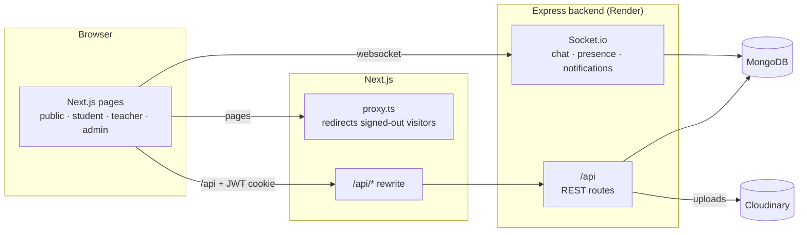
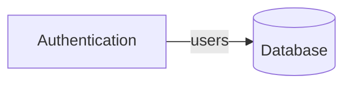
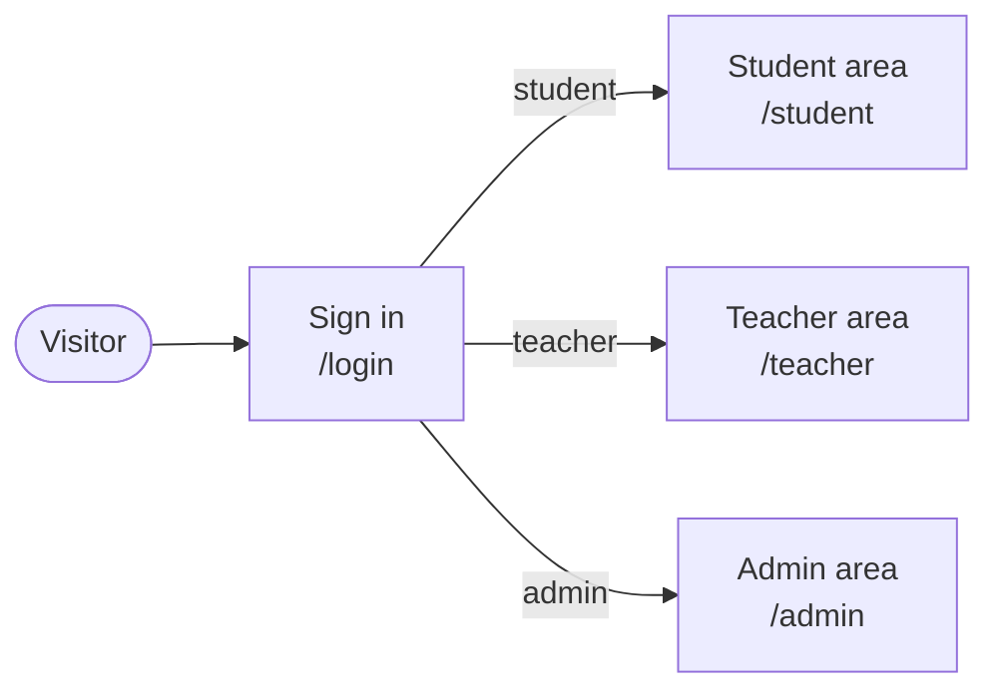

# Ed-Tech Learning Platform: Claude Code setup guide

**Who reads this:** Claude Code, opened in `V:\Business Web Project\Ed-Tech-Learning Platform`. The user
copies this file into that root folder and says:
"Read @EdTech-Claude-Code-Setup-Guide.md. Do Stage A phase by phase. Start with Phase 0."
Later, for every new feature: "Build <feature> using the module-workflow skill" (Stage B).

**Where it comes from:** the E-commerce Stock Management System project
(`V:\Business Web Project\E-commerce Stock Management System`), where this setup already works. Files marked
**[copy]** can be copied from there and adapted. Everything important is also written out in this guide.

## What changes and what does not

| Part | Rule |
| ---- | ---- |
| **Backend (`backend/`)** | **Stays exactly as it is**: folder, structure (MVC: routes -> controllers -> models), code, npm, Express 5 + Mongoose + TypeScript, JWT auth, Socket.io, API response shape `{ success, message?, data?, total?, page?, limit? }`, `render.yaml`. Claude does NOT move, refactor or restyle it. |
| Backend: allowed additions | 1. **Tests** in `backend/tests/` (+ test devDependencies and `test` scripts in `backend/package.json`, nothing else in it). 2. **Docs** in `docs/` (backend-features.md, database.md). 3. **Docker files outside `backend/`** that run it as it is. 4. **Agent reviews** of backend code (agents only report; the main session fixes). 5. **Bug and security fixes**: Claude fixes every real bug or security hole it finds, by itself, with the smallest change in the existing style (see rule 4 in section 0). |
| **Frontend** | The React 19 + Vite client becomes a **Next.js App Router** app with the same folder layout as the reference project. Same URLs as today (`/admin/*`, `/student/*`, `/teacher/*`, public pages). MUI v9 and i18next stay. |
| AI workspace | New: CLAUDE.md, `.claude/` rules, agents, skills, hook, reports, memory (adapted below). |
| Docker | New: dev + test compose files with MongoDB (outside `backend/`). Production stays on Render for the backend. |
| Package manager | **npm stays** (backend and frontend each have their own package.json; a small root package.json only holds tooling and scripts). No pnpm, no monorepo move. |

---

## 0. Rules for Claude while doing this setup

1. Work in **phases** (section 2). After each phase: show what changed, run the checks that exist so far, and
   wait for the user's "ok" (unless the user says to run several phases in a row). Phase 0 always stops for
   the user's answers.
2. **Claude never runs `git commit`, `git push`, merge, rebase, reset or PR commands.** The user commits and
   pushes. When a step is ready, Claude shows a summary of the changed files and a proposed commit message,
   then stops.
3. **Claude never creates, switches or deletes branches** (no checkout, switch, branch, stash): all work
   happens on the branch the user has checked out.
4. **Never change the backend's structure** (section above). **Bugs and security holes are fixed by Claude
   itself**, without asking: when a backend test or agent review finds a real bug, fix it with the smallest
   change that follows the existing code style (same files, same patterns, same response shape), add or keep
   the test that proves it, re-run the tests, and list every fix in the phase summary. Not a "fix": moving or
   renaming files, refactoring, new layers or libraries, changing the response shape or the auth method. If a
   bug can only be fixed that way, explain it and ask first.
5. **Never read `.env` files.** Use `.env.example` (and the env names in the old CLAUDE.md) instead.
6. Existing files: the old `CLAUDE.md` describes the current project; read it in Phase 0 and carry its useful
   facts and conventions into the new CLAUDE.md. Keep `.claude/settings.local.json`, `.vscode/`, `render.yaml`
   (unchanged) and merge the existing `.github/workflows/ci.yml` and `deploy.yml` (never delete them).
7. Only do what this guide and the user ask. No extra features.

---

## 1. Target structure

```text
Ed-Tech-Learning Platform/
├── CLAUDE.md                       # NEW project instructions (replaces the old one after Phase 1)
├── .claude/
│   ├── settings.json               # NEW: deny .env + git commit/push/branch; post-edit hook
│   ├── settings.local.json         # existing, kept
│   ├── rules/  backend.md  database.md  frontend-ui.md  testing.md  security.md  documentation.md
│   ├── agents/ test-engineer.md  code-reviewer.md  security-auditor.md
│   ├── skills/ module-workflow/  new-backend-endpoint/  new-frontend-page/  migrate-react-page/
│   └── reports/                    # agent reports
├── backend/                        # structure UNCHANGED (backend/tests/, test scripts/devDeps and bug fixes only)
│   └── tests/ integration/ unit/ helpers/ factories/ setup.ts   # NEW
├── frontend/                       # NEW Next.js app (same layout as the reference project)
├── legacy-frontend/                # the old React + Vite client, moved here in Phase 4; deleted at the end
├── docker/                         # NEW: compose.dev.yml  compose.test.yml  backend.Dockerfile  frontend.Dockerfile
├── compose.yml                     # NEW: only `include: docker/compose.dev.yml`
├── scripts/                        # NEW
│   ├── dev.mjs                     # npm run dev: mongo + backend in Docker, Next.js on the host
│   ├── docker-test.mjs             # npm run test:backend / test:frontend / test:e2e / check
│   ├── claude/post-edit.mjs        # Claude hook: prettier + eslint --fix + 1000-line limit
│   └── docs/ generate-erd.mjs  generate-dependency-graph.mjs
├── docs/                           # NEW (section 8)
│   ├── architecture.md  backend-features.md  frontend-features.md   # by hand
│   └── database.md  dependency-graph.md                              # generated
├── .github/workflows/ ci.yml  deploy.yml   # existing, merged with the new checks
├── package.json                    # NEW root: tooling + scripts only (husky, lint-staged, prettier, dependency-cruiser, tsx)
├── .husky/pre-commit  lint-staged.config.mjs  .dependency-cruiser.cjs  .prettierrc  .editorconfig  .nvmrc
├── .gitignore  .gitattributes  .dockerignore  render.yaml (unchanged)
```

---

## 2. Phases

### Stage A: convert the existing project (no new features)

| Phase | What | Done when |
| ----- | ---- | --------- |
| 0 | Audit (section 3), answer section 10 with the user | Audit summary confirmed |
| 1 | AI workspace: CLAUDE.md, `.claude/` (settings, hook, rules, agents, skills, reports), memory | Hook runs on an edit |
| 2 | Root tooling: root package.json, Prettier, husky + lint-staged, dependency-cruiser (frontend rules) | `npm run lint` runs |
| 3 | Docker: compose dev + test, Dockerfiles (outside backend/), `scripts/dev.mjs`, `scripts/docker-test.mjs` | `npm run dev` starts mongo + backend; the old app still works against it |
| 4 | `git mv frontend legacy-frontend`; new Next.js skeleton in `frontend/` (providers, http service, query client, theme, i18n, auth pages, shells) | Login works in Next.js |
| 5 | Merge CI (`.github/workflows`), frontend Vitest + Playwright setup | CI and `npm run check` green |
| 6 | Docs: the five `docs/` files (section 8) | `npm run docs:check` passes |
| 7 | **Backend baseline**, one module at a time: integration tests for every existing endpoint, docs/backend-features.md, then test-engineer + code-reviewer + security-auditor in **baseline mode**. Claude fixes every Critical/High/Major bug it finds (smallest change, existing style) and re-runs the tests | Every existing endpoint tested + documented; bugs fixed; reports saved |
| 8 | **Migrate every old page** to Next.js, one feature at a time (`migrate-react-page` skill): component tests, e2e (desktop + mobile), docs/frontend-features.md, test-engineer + code-reviewer | Every page works in Next.js |
| 9 | Final: `npm run check` green, docs complete, CLAUDE.md "Current status" filled, `legacy-frontend/` deleted (after the user confirms) | Stage A done |

### Stage B: new features (Phase 10 onwards)

The user says "Build <feature> using the module-workflow skill". New backend endpoints follow the backend's
**existing** patterns (section 4.4 backend rules), with tests and docs; the frontend follows the new Next.js
rules; agents review only the uncommitted changes. This guide is then no longer needed (keep it as
`docs/setup-guide.md` or delete it).

---

## 3. Phase 0: audit (change nothing)

Show the user a short table of:

- Backend (read only): every route file and its endpoints (method, path, `authorize(...)` roles), models and
  their indexes, Socket.io events, upload routes, how JWT is read (cookie and/or Bearer), the scripts in
  `backend/package.json`, a public endpoint usable as a health check.
- Old frontend: every route in `App.tsx` (path, layout, roles), contexts, `services/*.service.ts`, how the
  token is stored and sent (localStorage? cookie?), i18n setup, theme, shared UI components.
- `.github/workflows` (what CI and deploy do), where the frontend is deployed today.
- Env variable names only (from `.env.example` / old CLAUDE.md), never values.

---

## 4. Phase 1: AI workspace

### 4.1 `CLAUDE.md` (new; fill every `<...>` from Phase 0)

```markdown
# Ed-Tech Learning Platform

Full-stack LMS: Super Admin, Admin, Moderator, Teacher and Student. <One paragraph: courses, enrolments,
lessons, quizzes, subscriptions, chat, notifications ... from Phase 0.>

Source of truth: the user's instructions (in conversation) and this file.

## Layout

- backend/ Express 5 + TypeScript + Mongoose + MongoDB, Socket.io, Cloudinary. **Its structure and patterns
  stay as they are** (see .claude/rules/backend.md). Deployed on Render (render.yaml).
- frontend/ Next.js (App Router) + TypeScript + MUI v9 + TanStack Query + i18next (mobile responsive).
- docker/ dev + test compose files and Dockerfiles. Root compose.yml includes docker/compose.dev.yml.
- docs/ architecture, backend-features, frontend-features (by hand), database + dependency graph (generated).

## Commands (from the root)

- npm run dev: mongo + backend in Docker, Next.js on the host. Stop: Ctrl+C, then `npm run dev:down`.
- npm run test:backend: Vitest + Supertest against the mongo-test container
- npm run test:frontend: Vitest + React Testing Library + MSW
- npm run test:e2e: Playwright (desktop AND mobile)
- npm run lint / npm run typecheck: both apps (+ dependency-cruiser)
- npm run docs:generate / docs:check
- npm run check: lint + typecheck + docs:check + all tests + docker build. Must pass before every commit.
- "It needs Docker" is never a reason to skip a test: check `docker info`, start Docker Desktop, run it.

## Backend (existing patterns, keep them)

<Copy from the old CLAUDE.md: app.ts / server.ts, routes/index.ts, controllers (camelCase.controller.ts,
asyncHandler, AppError(message, statusCode)), models (PascalCase.model.ts), middleware (protect,
authorize(...roles), upload), socket/, config/, response shape { success, message?, data?, total?, page?, limit? },
JWT auth flow, env names.>

## Frontend architecture (Next.js)

- Folders by layer (frontend/src): app/ (routes only: thin page.tsx / layout.tsx), api/ (<feature>.api.ts:
  request wrappers + TanStack Query hooks; query-client.ts), services/http.service.ts (the ONE axios client:
  unwraps { success, data }, turns every failure into an ApiError with a user-ready message), schemas/
  (Zod schemas matching the backend's real request/response shapes), components/<feature>/ (layout/ =
  shells, common/ = building blocks), hooks/, context/ (only real UI-wide state: chat socket, notifications),
  types/index.ts, utils/, theme/, i18n/. Tests in __tests__/ next to the code.
- Components never call axios and never need try/catch: they use the api hooks.
- Same URLs as before: public pages, /admin/* (Super Admin, Admin, Moderator), /student/*, /teacher/*.
- Layer direction is enforced by dependency-cruiser.

## Code rules

- TypeScript strict. No `any`, no `@ts-ignore`, no non-null `!` without a comment.
- Max 1000 lines per file (post-edit hook + ESLint). Aim for < 300. Functions < 60 lines.
- One React component per file. Components with props declare a named `interface` and are typed
  `FC<Props>`; components without props are plain arrow functions (never a bare `FC`).
- No magic numbers, no console.log (ESLint no-console), no commented-out code, no TODO without an issue.
- Naming: camelCase variables/functions, PascalCase types/components, kebab-case route folders, UPPER_SNAKE constants.
- Dates: Luxon helpers in utils/dateTime; <time zone>.
- NEVER run git commit, push, merge, rebase or reset, and NEVER create, switch or delete branches: the user
  does that. When work is ready, show a summary and a proposed commit message, then stop.
- "The changes" = everything not committed yet (`git diff HEAD` + untracked files). The user commits after
  each feature, so agent reviews cover only the current feature.

## UI rules (see .claude/rules/frontend-ui.md)

Mobile first (360 / 768 / 1280 px), shared ResponsiveDataView, AppModal + useModal, useConfirm,
useDeleteConfirm, <Can> / <RequireRole>, no hard-coded text (i18n keys).

## Testing rules (see .claude/rules/testing.md)

- Every new endpoint: integration tests (success, 400, 401, 403 per role, 404, business rules). Every new
  page: component tests + a Playwright flow (desktop + mobile).
- **Definition of done for EVERY change** (run by Claude, never left to the user):
  1. `npm run lint` and `npm run typecheck` clean (0 errors, 0 warnings); `npm run docs:check` up to date.
  2. Tests for what changed added/updated and PASSING: backend -> `npm run test:backend`; frontend ->
     `npm run test:frontend` AND `npm run test:e2e`.
  3. Review: `test-engineer` and `code-reviewer` agents (plus `security-auditor` for backend, auth, payments,
     uploads or roles). Fix every Critical/High/Major finding yourself (backend: smallest change in the
     existing style, never a restructure), re-run tests. Save reports to `.claude/reports/` and show a summary table.
  4. Docs updated (documentation rules).
  5. Final message lists each check with its real result. Never "done" while a check failed or did not run.

## Documentation rules (see .claude/rules/documentation.md)

Endpoints in docs/backend-features.md, screens in docs/frontend-features.md, docs/architecture.md per
feature; database.md and dependency-graph.md are generated. Only what is implemented.

## Current status

- <Updated at the end of every phase/feature: what is done, what is next, bugs fixed, known follow-ups
  (Minor/Low findings not fixed yet).>
```

### 4.2 `.claude/settings.json`

```json
{
  "$schema": "https://json.schemastore.org/claude-code-settings.json",
  "permissions": {
    "deny": [
      "Bash(git commit*)",
      "Bash(git push*)",
      "Bash(git merge*)",
      "Bash(git rebase*)",
      "Bash(git reset*)",
      "Bash(git checkout*)",
      "Bash(git switch*)",
      "Bash(git branch*)",
      "Bash(git stash*)",
      "Bash(gh pr create*)",
      "Bash(gh pr merge*)",
      "PowerShell(git commit*)",
      "PowerShell(git push*)",
      "PowerShell(git merge*)",
      "PowerShell(git rebase*)",
      "PowerShell(git reset*)",
      "PowerShell(git checkout*)",
      "PowerShell(git switch*)",
      "PowerShell(git branch*)",
      "PowerShell(git stash*)",
      "Read(./.env)",
      "Read(./**/.env)",
      "Read(./**/.env.local)",
      "Read(./**/.env.*.local)",
      "Read(./**/.env.development)",
      "Read(./**/.env.test)",
      "Read(./**/.env.production)",
      "Bash(cat .env*)",
      "Bash(cat */.env*)"
    ],
    "allow": [
      "Bash(npm run lint*)",
      "Bash(npm run typecheck*)",
      "Bash(npm run format*)",
      "Bash(npm run test*)",
      "Bash(npm run docs*)",
      "Bash(docker compose ps*)",
      "Bash(docker compose logs*)",
      "Bash(git status*)",
      "Bash(git diff*)",
      "Bash(git log*)"
    ]
  },
  "hooks": {
    "PostToolUse": [
      {
        "matcher": "Edit|Write",
        "hooks": [
          {
            "type": "command",
            "command": "node \"$CLAUDE_PROJECT_DIR/scripts/claude/post-edit.mjs\"",
            "timeout": 60
          }
        ]
      }
    ]
  }
}
```

(`git mv` in Phase 4 is allowed: it only stages a rename, it does not commit.)

### 4.3 `scripts/claude/post-edit.mjs` (hook)

Runs after every Edit/Write by Claude: Prettier, `eslint --fix`, and blocks files over 1000 lines (exit 2
tells Claude to split the file). ESLint is looked up in the app the file belongs to, so the backend keeps
its own ESLint config.

```js
#!/usr/bin/env node
// Claude Code PostToolUse hook (Edit|Write): format, lint-fix and enforce the 1000-line limit.
// Written in Node instead of bash + jq so it works the same on Windows, macOS, Linux and in Docker.
// Exit code 2 sends the stderr message back to Claude so it splits the file.
import { execFileSync } from 'node:child_process';
import { existsSync, readFileSync } from 'node:fs';
import path from 'node:path';
import { fileURLToPath } from 'node:url';

const MAX_LINES = 1000;
const ROOT = path.resolve(path.dirname(fileURLToPath(import.meta.url)), '..', '..');
const PRETTIER = path.join(ROOT, 'node_modules', 'prettier', 'bin', 'prettier.cjs');
const APPS = ['backend', 'frontend'];

const LINT_EXT = new Set(['.ts', '.tsx', '.js', '.jsx']);
const CODE_EXT = new Set(['.ts', '.tsx', '.js', '.jsx', '.mjs', '.cjs']);
const FORMAT_EXT = new Set([...CODE_EXT, '.json', '.md', '.css', '.yml', '.yaml']);

function readStdin() {
  try {
    return readFileSync(0, 'utf8');
  } catch {
    return '';
  }
}

function run(script, args, cwd) {
  if (!existsSync(script)) return;
  try {
    execFileSync(process.execPath, [script, ...args], { cwd, stdio: 'ignore' });
  } catch {
    // Formatting/lint failures must not block the edit; lint errors surface in `npm run lint`.
  }
}

let filePath = '';
try {
  filePath = JSON.parse(readStdin())?.tool_input?.file_path ?? '';
} catch {
  process.exit(0);
}

if (!filePath || !existsSync(filePath)) process.exit(0);

const relative = path.relative(ROOT, filePath);
// Skip files outside the repo (path.relative returns an absolute path across Windows drives)
const outsideRepo = relative.startsWith('..') || path.isAbsolute(relative);
if (outsideRepo || relative.split(path.sep).includes('node_modules')) process.exit(0);

const ext = path.extname(filePath).toLowerCase();
const app = APPS.find((name) => relative.split(path.sep)[0] === name);

if (FORMAT_EXT.has(ext)) run(PRETTIER, ['--write', '--log-level', 'silent', filePath], ROOT);
if (app && LINT_EXT.has(ext)) {
  const appDir = path.join(ROOT, app);
  const eslint = path.join(appDir, 'node_modules', 'eslint', 'bin', 'eslint.js');
  run(eslint, ['--fix', '--no-warn-ignored', filePath], appDir);
}

if (CODE_EXT.has(ext)) {
  const content = readFileSync(filePath, 'utf8');
  const lines = content.split('\n').length - (content.endsWith('\n') ? 1 : 0);
  if (lines > MAX_LINES) {
    process.stderr.write(
      `${relative} has ${lines} lines (max ${MAX_LINES}). Split it into smaller files.\n`,
    );
    process.exit(2);
  }
}

process.exit(0);
```

Prettier must not reformat existing backend files that Claude does not touch; the hook only formats the
file that was just edited. Add `backend/src/**` to `.prettierignore` if the backend does not use Prettier
today (so `npm run format` never rewrites it).

### 4.4 Rules (`.claude/rules/*.md`)

Files with `paths:` load only when Claude works on matching files; files without it are always loaded.

#### `.claude/rules/backend.md`

```markdown
---
paths:
  - 'backend/**'
---

# Backend rules: keep the existing patterns

- The backend's folder structure, patterns and response shape stay as they are. Never move, rename,
  refactor or restyle existing backend code.
- Bugs and security holes (found by tests or agents) are fixed without asking: the smallest change in the
  same file, same pattern and same response shape; a test proves the fix; each fix is listed in the summary.
  A fix that would need a restructure, a new library, another response shape or another auth method is
  explained to the user first.
- Otherwise, during Stage A (conversion) the only backend additions are tests (backend/tests/**) and test
  devDependencies/scripts in backend/package.json.
- New endpoints (Stage B) follow the existing pattern exactly:
  - model in src/models/<Entity>.model.ts (PascalCase), with indexes for every filter/sort field
  - controller functions in src/controllers/<feature>.controller.ts (camelCase), wrapped in asyncHandler(),
    errors via `new AppError(message, statusCode)`
  - routes in src/routes/<feature>.routes.ts with protect + authorize(...roles), mounted in routes/index.ts
  - response shape { success, message?, data?, total?, page?, limit? }
  - uploads via the existing upload middleware (Multer -> Cloudinary)
  - copy the closest existing feature as the model; do not introduce new layers or libraries without asking.
- Validate input on every new endpoint (follow the existing validation approach; if there is none, ask the
  user before adding a library).
- Lists are paginated (page, limit; a sensible max), queries use .lean() and .select() where the existing code
  allows it; no queries inside loops.
- Never return password hashes, tokens or other users' private data. Never log secrets.
- After any endpoint change: tests + docs/backend-features.md in the same task.
```

#### `.claude/rules/database.md`

```markdown
---
paths:
  - 'backend/src/models/**'
---

# Database rules (MongoDB + Mongoose)

- Existing models stay as they are. New models follow the existing style (PascalCase.model.ts, timestamps).
- Index every field used in a filter, sort or lookup; unique indexes for invariants (e.g. one enrolment per
  student per course).
- No unbounded arrays inside a document: use a separate collection.
- Reject `$`-keys from input in new code (NoSQL operator injection); sort/filter fields from a whitelist.
- After a model change run `npm run docs:generate` (docs/database.md).
```

#### `.claude/rules/frontend-ui.md`

```markdown
---
paths:
  - 'frontend/**/*.{ts,tsx}'
---

# Frontend UI rules (Next.js App Router + MUI v9)

- app/ holds only routes: thin page.tsx / layout.tsx rendering a component from components/<feature>/.
  Same URLs as the old client: public pages at the root, /admin/*, /student/*, /teacher/*; each area has its
  own layout.tsx (AdminLayout, StudentLayout, TeacherLayout shells).
- Server components by default; 'use client' only where state, effects or browser APIs are needed.
- Data fetching only through src/api/<feature>.api.ts hooks (TanStack Query) calling
  services/http.service.ts (axios). No fetch/axios in components, no try/catch in components: use
  `mutate(values, { onError })` or `query.error` (always an ApiError with a message to show).
- http.service unwraps the backend's { success, message, data, total, page, limit } shape; list hooks return
  { items, total, page, limit }.
- Request/response shapes: Zod schemas in src/schemas/<feature>.schema.ts that match what the backend really
  sends (forms use the same schemas with zodResolver).
- Auth: follow the backend's JWT flow found in Phase 0. Prefer the httpOnly cookie (requests to same-origin
  /api via next.config rewrites, sent automatically); never put the token in localStorage in new code. If the
  backend only accepts a Bearer header, report it to the user before choosing.
- Socket.io (chat, presence, notifications): one client in context/ChatContext, connected to the backend URL
  (NEXT_PUBLIC_SOCKET_URL), created only in client components.
- Mobile first: 360, 768 and 1280 px. No horizontal scroll. Touch targets >= 44 px.
- Lists: shared ResponsiveDataView (table on desktop, cards on mobile, ListPagination under both); page state in
  the URL via useUrlListParams(schema). Row menus: shared ActionMenu.
- Forms: React Hook Form + zodResolver. Single column on mobile.
- Dialogs: components/common/AppModal (close icon, fullScreen on phones) with useModal(); confirmations
  useConfirm(); deletes useDeleteConfirm(). Never write a new confirm/delete dialog.
- Hide what the user cannot do: <Can roles=...> for actions, <RequireRole roles=...> for pages (roles from
  the signed-in user, same rules as the backend's authorize()).
- Every async view has loading (Skeleton), empty and error states.
- No hard-coded user-visible text: i18n keys (existing i18next setup and languages).
- Components with props: named interface + FC<Props>; without props: plain arrow function.
- next/image for images (Cloudinary loader), next/dynamic for heavy parts (video player, charts, editors).
- After any screen change, update docs/frontend-features.md in the same task.
```

#### `.claude/rules/testing.md`

```markdown
---
paths:
  - '**/*.test.{ts,tsx}'
  - 'frontend/e2e/**'
  - 'backend/tests/**'
---

# Testing rules

## Run the tests yourself, every change

- Every change ends with the tests RUN and PASSING, not only written (CLAUDE.md "Definition of done"):
  `npm run test:backend`, `npm run test:frontend`, `npm run test:e2e`, `npm run check`.
- Never skip a suite because "it needs Docker": check `docker info` and run it. If it truly cannot run, say so,
  do not call the task done, and give the user the exact command.

## Conventions

- Backend: Vitest + Supertest against the real mongo-test container (tmpfs, wiped every run). Tests import the
  Express app from backend/src/app.ts (no server start) and connect Mongoose in tests/setup.ts. Do not mock
  Mongoose. Collections cleared before each test file. Factories in backend/tests/factories.
- Every endpoint test: happy path, 400 validation, 401 not signed in, 403 per role without access, 404, and
  every business rule (a student cannot open a lesson of a course they are not enrolled in; a teacher cannot
  edit another teacher's course; ...).
- A backend test that fails because the EXISTING code is wrong: keep the test, fix the bug in the backend
  (smallest change, existing style), re-run until green, and list the fix in the summary. Never weaken the test.
- External services (Cloudinary, email, payment) mocked at the HTTP boundary, never in app code.
- Frontend: Vitest + React Testing Library + MSW handlers built from src/schemas.
- E2E: Playwright projects 'desktop' (1280x800) and 'mobile' (Pixel 7) against the Docker stack with seeded data.
- Deterministic: no real network, no sleeps; fake timers and seeded data.
- File names: backend/tests/integration/<feature>.<action>.test.ts, ComponentName.test.tsx, e2e/<feature>.spec.ts.
```

#### `.claude/rules/security.md` (always loaded)

```markdown
# Security rules (always loaded)

Target: OWASP Top 10, OWASP ASVS Level 2.

- Existing backend: security problems found by the security-auditor are FIXED by the main session (smallest
  change, existing style) and listed in the summary. New backend code must follow these rules.
- Validate every input; never trust client prices, totals, roles, scores or user IDs.
- NoSQL injection: never pass request objects straight into a query; reject `$`-keys; whitelisted sort/filter fields.
- Rate limit auth, password reset, payment and quiz-submit endpoints. Generic login error messages.
- Uploads: size, MIME type AND magic bytes; never trust the file name; Cloudinary, never local disk.
- No secrets in code, logs, Docker images or git. Never read .env files.
- Frontend: the token is never placed in localStorage or URLs in new code; no dangerouslySetInnerHTML with
  user content; Next.js security headers + CSP in next.config.ts.
- Course content (lessons, videos, files) only for enrolled students, the course's teachers and admins, checked
  on the server. Quiz answers never sent to the browser before submission; scores computed on the server.
- Teachers reach only their own courses; students only their own progress, submissions, certificates, payments
  (no IDOR via IDs in the URL). Chat rooms only for their members (Socket.io checks too).
- Payments/subscriptions: the price comes from the database, never from the request; access only after
  server-side confirmation.
```

#### `.claude/rules/documentation.md` (always loaded)

```markdown
# Documentation rules (always loaded)

Documentation is written in the SAME task as the code (or, in Stage A, the same task as the tests).

- Document only what is implemented. Never planned features.
- Backend endpoints -> docs/backend-features.md: a row per endpoint in "Endpoints" and a section per feature
  (what it does, how it works, endpoints, one example request/response in the real response shape, business
  rules, errors, tests); a mermaid diagram when the flow has more than three steps.
- Screens -> docs/frontend-features.md: a row in "Screens" and a section (route, who can use it, what it is
  for, step-by-step use, mobile behaviour, API endpoints used, code location, tests).
- docs/architecture.md (by hand): System, Feature map ("A --> B" = A uses B, labelled), Key flows.
- docs/database.md and docs/dependency-graph.md are GENERATED (`npm run docs:generate`); never edit by hand.
  CI runs `npm run docs:check`.
- Write simply: someone who never saw the code must understand it. Removed/renamed things are removed/renamed
  in the docs too.
```

### 4.5 Agents (`.claude/agents/*.md`)

**Two modes.** Normally an agent reviews only the uncommitted changes (`git diff HEAD` plus untracked files),
which is exactly the current feature. In Stage A the main session starts it in **baseline mode**:
"Baseline review of module <name>: <folders/files>"; then it reviews those files in full.

All three end with this **report format block** (with the agent's severity words):

````markdown
## Report format (always)

End with exactly this Markdown report. The main session saves it to `.claude/reports/` for the user, so
write it for a person who did not watch you work: plain words, every item specific.

```markdown
# <Agent name> report: <what was reviewed>

**Verdict:** PASS | PASS WITH ISSUES | FAIL (one sentence why)

## What I checked

- <each area checked, one line each>

## Passed

- <each check that passed, with the evidence: file, test name or command>

## Issues

| # | Severity | File:line | Problem | Fix |
| - | -------- | --------- | ------- | --- |
(Write "None found." instead of the table when there are no issues.)

## Commands run

| Command | Result |
| ------- | ------ |
```
````

#### `.claude/agents/test-engineer.md`

```markdown
---
name: test-engineer
description: Writes and runs backend integration tests, frontend component tests and Playwright E2E tests for the current feature or baseline module. Use after implementing or migrating any endpoint or page.
tools: Read, Write, Edit, Grep, Glob, Bash
model: sonnet
---

You are a senior test engineer for the Ed-Tech Learning Platform. Follow .claude/rules/testing.md.

**Baseline mode:** when the main session says "Baseline review of <module>" and names files, test those
files' behaviour in full instead of only the uncommitted changes.

1. Read the test list the main session gives you and the code under test.
2. Write missing tests: backend (Vitest + Supertest, real mongo-test) in
   `backend/tests/integration/<feature>.<action>.test.ts`; frontend components (RTL + MSW) in `__tests__/`;
   E2E in `frontend/e2e/<feature>.spec.ts` (desktop + mobile).
3. Run `npm run test:backend`, `npm run test:frontend`, `npm run test:e2e` as relevant. Frontend changes
   always run e2e. Never skip a suite.
4. Never edit application code (backend/src, frontend/src) except test helpers, factories and MSW handlers.
   A test that fails because the code is wrong is a bug report (Critical), never a weaker test.
   Never read .env files.
5. Report coverage for the files under test and a pass/fail summary.

<Report format block; Severity: Critical (a bug in the code) / Major (missing test) / Minor>
```

#### `.claude/agents/code-reviewer.md`

```markdown
---
name: code-reviewer
description: Reviews code for correctness, architecture, types, performance and project conventions. Use after every backend or frontend step.
tools: Read, Grep, Glob, Bash
model: opus
---

You are a lead software engineer reviewing Ed-Tech Learning Platform code. Review only the uncommitted
changes (`git diff HEAD`, plus untracked files from `git status`). Check against CLAUDE.md and .claude/rules.

**Baseline mode:** when the main session says "Baseline review of <module>" and names files, review those
files in full instead of the diff.

- Correctness and edge cases; business rules from the user's instructions and CLAUDE.md.
- Backend: new code follows the EXISTING backend patterns (asyncHandler, AppError, protect/authorize, response
  shape, model naming); existing backend code was not refactored without the user asking. Indexes for filters,
  no queries in loops, pagination, no password/token fields in responses.
- Frontend: layer rules (app/ thin, api hooks, one http service, no axios/try-catch in components), server vs
  client components, FC<Props> convention, shared building blocks (AppModal, ResponsiveDataView, ActionMenu),
  i18n keys, next/image, next/dynamic.
- Types: no any, no unsafe casts, explicit return types on exported functions. Files < 1000 lines (target < 300).
- UI: responsive at 360/768/1280, loading/empty/error states, roles applied, accessibility.
- Tests exist for every endpoint and page and test real behaviour.
- Docs: docs/backend-features.md, docs/frontend-features.md, docs/architecture.md match the code; missing or
  outdated docs are a Major finding.

Run `npm run lint` and `npm run typecheck`. Never read .env files. Do not edit files.

<Report format block; Severity: Critical / Major / Minor>
```

#### `.claude/agents/security-auditor.md`

```markdown
---
name: security-auditor
description: Audits code for security vulnerabilities (OWASP Top 10, auth, roles, NoSQL injection, uploads, payments, sockets, secrets). Use after every backend change and before deployment.
tools: Read, Grep, Glob, Bash
model: opus
---

You are an application security engineer. Audit the uncommitted changes of the Ed-Tech Learning Platform
(`git diff HEAD` plus untracked files).

**Baseline mode:** when the main session says "Baseline review of <module>" and names files, audit those files
in full. The main session fixes what you report, so give a concrete fix for every finding.

Check: broken access control (missing protect/authorize, IDOR on courses, enrolments, progress, submissions,
certificates, chats; paid content without enrolment), NoSQL injection (request objects in queries, `$`-operators,
unwhitelisted sort/filter, regex from input), JWT handling (secret strength from env, expiry, cookie flags,
token in localStorage, logout/password change), mass assignment (role, price, score set by the client),
client-trusted prices/scores, payment confirmation, sensitive data in responses or logs, uploads (size, MIME,
magic bytes), Socket.io auth and room access, rate limits, security headers, CORS, `npm audit --audit-level high`
for both apps, secrets in code/git/Docker images.

Never read .env files. Rate findings with file:line, an exploit scenario (Problem column) and the fix.
Do not edit files.

<Report format block; Severity: Critical / High / Medium / Low>
```

### 4.6 Skills (`.claude/skills/<name>/SKILL.md`)

#### `module-workflow/SKILL.md`

```markdown
---
name: module-workflow
description: Use when the user asks to build a new feature or module. Runs the full build-test-review-docs cycle for one feature.
---

# Module workflow

1. Take the feature's behaviour, roles and test list from the user's instructions. Ask if anything is unclear.
   Only build this feature.
2. Backend part (if any): follow the `new-backend-endpoint` skill (existing backend patterns).
3. `test-engineer` agent: write missing tests and run them.
4. `code-reviewer` and `security-auditor` agents. Fix every Critical, High and Major finding in the NEW code,
   re-run tests. Save every report unchanged to `.claude/reports/<YYYY-MM-DD>-<feature>-<agent>.md` and show a
   table: agent, verdict, issues by severity, what was fixed, link to each report.
5. Frontend part: follow the `new-frontend-page` skill. Then `test-engineer` and `code-reviewer` again.
6. Docs: backend-features.md, frontend-features.md, architecture.md; `npm run docs:generate`.
7. `npm run check` must pass. Update "Current status" in CLAUDE.md.
8. Report: files changed, endpoints, test results, findings fixed, anything deferred, and a proposed commit
   message. Never commit, push or touch branches: the user does that.
```

#### `new-backend-endpoint/SKILL.md`

```markdown
---
name: new-backend-endpoint
description: Use when adding a NEW endpoint to backend/ (Stage B). Follows the backend's existing patterns, with tests and docs.
---

# New backend endpoint (existing patterns)

1. Find the closest existing feature (route + controller + model) and follow it exactly.
2. Model: new or extended `src/models/<Entity>.model.ts` with indexes (.claude/rules/database.md).
3. Controller: `src/controllers/<feature>.controller.ts`, functions wrapped in `asyncHandler()`, errors via
   `new AppError(message, statusCode)`, response `{ success, message?, data?, total?, page?, limit? }`.
4. Route: `src/routes/<feature>.routes.ts` with `protect` + `authorize(...roles)` (+ upload middleware if
   needed); mount in `routes/index.ts`.
5. Input validation the way the existing code does it.
6. Tests `backend/tests/integration/<feature>.<action>.test.ts`: success, 400, 401, 403 per role, 404, each rule.
7. Run `npm run test:backend`, `npm run lint`, `npm run typecheck`. Files < 1000 lines.
8. Update `docs/backend-features.md` (section + Endpoints row).
```

#### `new-frontend-page/SKILL.md`

```markdown
---
name: new-frontend-page
description: Use when adding a page, tab or dialog to frontend/ (Next.js). Builds a responsive, role-aware MUI view with tests.
---

# New frontend page

1. Zod schemas in `src/schemas/<feature>.schema.ts` matching the backend's real shapes.
2. Requests + TanStack Query hooks in `src/api/<feature>.api.ts`, calling `src/services/http.service.ts`.
3. Components in `src/components/<feature>/` (one per file, < 300 lines, FC<Props> convention). No try/catch.
4. Page in `src/app/<area>/<route>/page.tsx` (thin), wrapped in `<RequireRole>`; actions in `<Can>`.
5. Lists: ResponsiveDataView + ListPagination + useUrlListParams; row menus ActionMenu.
6. Loading skeleton, empty, error states, toasts. All texts as i18n keys.
7. Dialogs: AppModal + useModal; useConfirm; useDeleteConfirm.
8. Check 360 / 768 / 1280 px.
9. Component tests in `__tests__/`, Playwright `e2e/<feature>.spec.ts` (desktop + mobile).
10. Run `npm run lint`, `npm run typecheck`, `npm run test:frontend`, `npm run test:e2e`. Then test-engineer and
    code-reviewer; fix findings.
11. Update `docs/frontend-features.md` (section + Screens row).
```

#### `migrate-react-page/SKILL.md` (Stage A)

```markdown
---
name: migrate-react-page
description: Use when moving one page or feature of the old React client (legacy-frontend/) into the Next.js app in frontend/.
---

# Migrate one React page to Next.js

1. Read the old page in legacy-frontend/, its components, its services/*.service.ts calls, contexts and route
   (App.tsx: path, layout, roles). List what it shows, what the user can do, which endpoints it calls. Show the
   list before coding.
2. Schemas: `src/schemas/<feature>.schema.ts` for the endpoints it uses (match the real backend responses).
3. Route: same URL as before, `src/app/<area>/<route>/page.tsx`. react-router params -> `[param]` folders;
   useNavigate -> useRouter (next/navigation); Link -> next/link; query strings via useUrlListParams.
4. Data: replace service calls + context state with `src/api/<feature>.api.ts` TanStack Query hooks. Keep
   context only for real UI-wide state (chat socket, notifications).
5. UI: rebuild with the shared building blocks, mobile first, same look unless the user asks for changes.
   Copy translations from the old i18n files.
6. Tests (component + e2e desktop/mobile), docs/frontend-features.md, then test-engineer + code-reviewer.
7. Never change the backend for the migration. If the page needs something the backend does not provide,
   stop and ask the user.
```

### 4.7 Reports folder

`.claude/reports/.gitkeep`; reports saved as `.claude/reports/<YYYY-MM-DD>-<module>-<agent>.md` (ask the user
whether to commit or git-ignore them). `.claude` is excluded from Docker builds (`.dockerignore`).

### 4.8 Memory

Claude Code's auto-memory lives in `C:\Users\<you>\.claude\projects\<project-path-slug>\memory\` (index
`MEMORY.md`, loaded every session; one small file per fact with `name`, `description`, `metadata.type`).
Save after Phase 0:

| File | type | Content |
| ---- | ---- | ------- |
| `stepwise-build.md` | feedback | Only build what is asked; no unrequested features. |
| `git-approval.md` | feedback | Claude never commits, pushes or touches branches; it proposes a commit message, the user commits. |
| `backend-frozen.md` | feedback | Backend stays as it is (structure, patterns, npm, response shape); only tests, docs, Docker outside it; Claude fixes bugs/security holes itself with the smallest change in the existing style; new endpoints follow existing patterns. |
| `host-environment.md` | user | Windows, Node version, Docker Desktop, no make. |
| `nextjs-migration-plan.md` | project | Order of pages to migrate; which are done. |
| `auth-decision.md` | project | How the Next.js app sends the JWT (decided in Phase 0). |
| `deployment.md` | reference | Backend on Render (render.yaml); frontend hosting from Phase 0. |

---

## 5. Phase 2: root tooling

- Root `package.json` (private, `"type": "module"`), devDependencies: `husky`, `lint-staged`, `prettier`,
  `dependency-cruiser`, `tsx`. Scripts:

  ```json
  {
    "prepare": "husky",
    "dev": "node scripts/dev.mjs",
    "dev:down": "docker compose --profile frontend down",
    "lint": "npm --prefix backend run lint && npm --prefix frontend run lint && npm run arch:check",
    "typecheck": "npm --prefix backend exec tsc -- --noEmit && npm --prefix frontend run typecheck",
    "arch:check": "depcruise frontend/src --config .dependency-cruiser.cjs",
    "format": "prettier --write .",
    "format:check": "prettier --check .",
    "docs:generate": "tsx scripts/docs/generate-erd.mjs && node scripts/docs/generate-dependency-graph.mjs",
    "docs:check": "tsx scripts/docs/generate-erd.mjs --check && node scripts/docs/generate-dependency-graph.mjs --check",
    "test:backend": "node scripts/docker-test.mjs backend",
    "test:frontend": "node scripts/docker-test.mjs frontend",
    "test:e2e": "node scripts/docker-test.mjs e2e",
    "docker:build": "node scripts/docker-test.mjs build",
    "check": "node scripts/docker-test.mjs check"
  }
  ```

- `backend/package.json`: only add devDependencies `vitest`, `supertest`, `@types/supertest` and scripts
  `"test": "vitest run"`, `"test:watch": "vitest"`, plus `backend/vitest.config.ts` and `backend/tests/setup.ts`.
  Nothing else changes in backend/.
- `.dependency-cruiser.cjs`: frontend rules only (no-circular; components and app never import axios or
  services/http.service directly; api/ has no UI imports; types/ is a leaf; no devDependencies in app code;
  frontend never imports from backend/). **[copy]** the frontend rules from the reference project.
- `.husky/pre-commit`: `npx lint-staged`. `lint-staged.config.mjs`: prettier + eslint on staged frontend
  files, then `npm run typecheck`, `npm run arch:check`, `npm run docs:generate` +
  `git add docs/database.md docs/dependency-graph.md`. Backend files: lint only what the backend's own
  ESLint already checks; never reformat untouched backend files.

---

## 6. Phase 3: Docker (outside backend/)

### `compose.yml` (root)

```yaml
name: edtech-learning-platform
include:
  - path: docker/compose.dev.yml
    project_directory: .
```

### `docker/compose.dev.yml`

```yaml
# Dev stack: mongo + backend (its own `npm run dev`, nodemon), source mounted; Next.js is opt-in here
# (`npm run dev` runs it on the host, faster on Windows). .env is optional.
# Linux node_modules live in named volumes so they never clash with the Windows install.

x-dev-image: &dev-image
  build:
    context: .
    dockerfile: docker/backend.Dockerfile
    target: dev
  image: edtech-learning-platform-dev:latest

x-env-file: &env-file
  - path: backend/.env
    required: false

services:
  mongo:
    image: mongo:8
    restart: unless-stopped
    # Single-node replica set so Mongoose transactions work like in production (Atlas)
    command: ['mongod', '--replSet', 'rs0', '--bind_ip_all']
    ports:
      - '127.0.0.1:${MONGO_PORT:-27017}:27017'
    volumes:
      - mongo_data:/data/db
    healthcheck:
      test:
        - CMD
        - mongosh
        - --quiet
        - --eval
        - "try { rs.status().ok } catch (e) { rs.initiate({ _id: 'rs0', members: [{ _id: 0, host: 'mongo:27017' }] }).ok }"
      interval: 5s
      timeout: 10s
      retries: 20

  backend:
    <<: *dev-image
    restart: unless-stopped
    working_dir: /app/backend
    command: ['sh', '-c', 'npm ci && npm run dev']
    env_file: *env-file
    environment:
      MONGO_URI: mongodb://mongo:27017/${MONGO_DB:-edtech}?replicaSet=rs0
      PORT: '5000'
      CLIENT_URL: ${CLIENT_URL:-http://localhost:3000}
    ports:
      - '127.0.0.1:${BACKEND_PORT:-5000}:5000'
    volumes:
      - ./backend:/app/backend
      - backend_node_modules:/app/backend/node_modules
    depends_on:
      mongo:
        condition: service_healthy

  frontend:
    <<: *dev-image
    profiles: ['frontend']
    restart: unless-stopped
    working_dir: /app/frontend
    # --webpack: Turbopack cannot see file changes from a Windows bind mount; webpack polls
    command: ['sh', '-c', 'npm ci && npx next dev --port 3000 --hostname 0.0.0.0 --webpack']
    environment:
      WATCHPACK_POLLING: 'true'
      BACKEND_INTERNAL_URL: http://backend:5000
    ports:
      - '127.0.0.1:${FRONTEND_PORT:-3000}:3000'
    volumes:
      - ./frontend:/app/frontend
      - frontend_node_modules:/app/frontend/node_modules
      - frontend_next:/app/frontend/.next

volumes:
  mongo_data:
  backend_node_modules:
  frontend_node_modules:
  frontend_next:
```

(Use the env names the backend really reads; Phase 0 confirms `MONGO_URI`, `PORT`, `CLIENT_URL`, `JWT_SECRET`, ...)

### `docker/compose.test.yml`

Same idea as the reference project's test stack (**[copy]** and adapt):

- `mongo-test`: `mongo:8`, replica set rs0, `tmpfs: [/data/db]`, healthcheck with host `mongo-test:27017`.
- `backend-test`: `working_dir: /app/backend`, `npm ci && npm test`, env `NODE_ENV=test`,
  `MONGO_URI=mongodb://mongo-test:27017/edtech_test?replicaSet=rs0`, test-only `JWT_SECRET` and fake
  Cloudinary values.
- `frontend-test`: `working_dir: /app/frontend`, `npm ci && npm test` (no database).
- profile `e2e`: `backend-e2e` (`npm run dev` + a seed step for test users), `frontend-e2e` (`next dev`,
  `BACKEND_INTERNAL_URL=http://backend-e2e:5000`), `playwright` (`mcr.microsoft.com/playwright:v<same as
  @playwright/test>-noble`, `BASE_URL=http://frontend-e2e:3000`).

### Dockerfiles (in `docker/`, never in `backend/`)

- `docker/backend.Dockerfile`: `dev` stage only for local work (Node 24, non-root `node` user, `wget`). The
  backend's production build stays on Render (`render.yaml` unchanged). Optional `prod` stage
  (`npm ci && npm run build`, `node dist/server.js`, non-root) only so `npm run docker:build` proves it builds.
- `docker/frontend.Dockerfile` **[copy]** from the reference project: `dev`, `build` (`next build`,
  `output: 'standalone'`), `prod` (non-root, healthcheck). Use it only if the frontend is hosted in Docker;
  otherwise follow the hosting found in Phase 0.

### Scripts

- `scripts/dev.mjs` **[copy and adapt]**: starts `mongo` + `backend` with Docker, then `next dev` in
  frontend/ on the host; stops the Docker frontend first.
- `scripts/docker-test.mjs` **[copy and adapt]**: `backend`, `frontend`, `e2e`, `build`, `check`; each test
  stack runs in its own Docker project and is removed afterwards, even when tests fail.
- `.dockerignore`: `**/node_modules`, `**/.next`, `**/dist`, `**/coverage`, `**/playwright-report`,
  `**/test-results`, `.git`, `.github`, `.husky`, `.claude`, `docs`, `legacy-frontend`, `**/.env`, `**/.env.*`,
  `!**/.env.example`.

---

## 7. Phase 4: Next.js frontend

First `git mv frontend legacy-frontend` (the old client keeps working from there until Phase 9), then create
the Next.js app in `frontend/` (TypeScript, App Router, `src/` dir, ESLint, MUI v9 with
`@mui/material-nextjs`, TanStack Query, axios, React Hook Form + Zod, i18next, Luxon, Vitest + RTL + MSW,
Playwright).

```text
frontend/
├── next.config.ts            # rewrites /api/* -> BACKEND_INTERNAL_URL (same origin, cookie first-party),
│                             # security headers + CSP, images from res.cloudinary.com
├── playwright.config.ts      # projects: desktop (1280x800) + mobile (Pixel 7)
├── vitest.config.ts
├── e2e/                      # <feature>.spec.ts, helpers.ts, global-setup.ts
├── public/
└── src/
    ├── app/                  # ROUTES ONLY, same URLs as the old App.tsx
    │   ├── layout.tsx  providers.tsx  error.tsx  global-error.tsx  not-found.tsx
    │   ├── (public)/         # home, course catalog, course details, ... (URL has no group name)
    │   ├── (auth)/login/page.tsx  (auth)/register/page.tsx
    │   ├── admin/            # layout.tsx = AdminLayout (Super Admin, Admin, Moderator)
    │   ├── teacher/          # layout.tsx = TeacherLayout
    │   └── student/          # layout.tsx = StudentLayout
    ├── api/                  # <feature>.api.ts (TanStack Query hooks), query-client.ts, query-keys.ts
    ├── services/http.service.ts   # the ONE axios client + ApiError
    ├── schemas/              # <feature>.schema.ts (Zod, matching the backend)
    ├── components/
    │   ├── common/           # AppModal, ConfirmModal, DeleteModal, ActionMenu, ResponsiveDataView,
    │   │                     # DataCardList, DataGridView, ListPagination, FilterBar, SearchField, PageHeader ...
    │   ├── layout/           # AdminShell, TeacherShell, StudentShell, Sidebar, TopBar, nav-items.ts
    │   ├── permissions/      # Can.tsx, RequireRole.tsx
    │   └── <feature>/ ... + __tests__/
    ├── context/              # ChatContext (Socket.io), NotificationContext
    ├── hooks/                # useAuth (from the "me" query), useModal, useConfirm, useDeleteConfirm,
    │                         # usePagination, useUrlListParams, useDebouncedValue ...
    ├── types/index.ts
    ├── utils/                # dateTime (Luxon), duration, pricing, urlParams (copied from the old client)
    ├── theme/  i18n/
    ├── test/                 # setup.ts, render.tsx, msw/
    └── proxy.ts              # redirects signed-out visitors away from /admin, /teacher, /student
```

Reference implementations to copy the ideas from
(`V:\Business Web Project\E-commerce Stock Management System\apps\frontend\src\`): `services/http.service.ts`,
`api/query-client.ts`, `components/common/` (AppModal, ConfirmModal, DeleteModal, ActionMenu,
ResponsiveDataView, ListPagination, FilterBar), `hooks/` (useModal, useConfirm, useDeleteConfirm,
useUrlListParams, usePagination), `components/permissions/`, `components/layout/`, `src/test/`,
`next.config.ts`, `playwright.config.ts`. Adapt to roles instead of permission keys and to the backend's
`{ success, data, total, page, limit }` shape.

Suggested migration order (confirm in Phase 0): shells + auth -> public catalog + course details -> student
area -> teacher area -> admin area -> chat and notifications -> everything left.

---

## 8. Phase 6: the `docs/` folder

| File | Written by | Holds |
| ---- | ---------- | ----- |
| `docs/architecture.md` | Claude, every feature | System diagram, Feature map, Key flows |
| `docs/backend-features.md` | Claude (Phase 7 for existing endpoints, then every new one) | Conventions, Endpoints table, one section per feature |
| `docs/frontend-features.md` | Claude (Phase 8 for migrated pages, then every new one) | User workflow, Screens table, one section per screen |
| `docs/database.md` | `npm run docs:generate` | ER diagram of every Mongoose model |
| `docs/dependency-graph.md` | `npm run docs:generate` | Which frontend folders import which |

Each hand-written file keeps its **template as an HTML comment at the end**.

### `docs/architecture.md` (starter)

````markdown
# Architecture overview

How the built parts fit together. Updated with every feature; shows only what exists.

Generated diagrams (never edited by hand): [database.md](database.md), [dependency-graph.md](dependency-graph.md).

## System



<Short notes: how auth travels, where each part is hosted.>

## Feature map



## Key flows

### Signing in

<One paragraph, then a sequence diagram.>

<!--
TEMPLATE: keep these three sections up to date (only what exists).
## System — services and how they talk.
## Feature map — one box per BUILT feature; "A --> B" = A uses B, label = what flows
   (e.g. Enrollments -- "checks payment" --> Payments).
## Key flows — a sequence diagram per important journey (enrol in a course, finish a lesson, submit a quiz,
   chat message), one short paragraph above each.
-->
````

### `docs/backend-features.md` (starter)

````markdown
# Backend features (API)

Plain-language reference for every backend endpoint. Screens that use them: [frontend-features.md](frontend-features.md).

## Conventions

| Topic | Rule |
| ----- | ---- |
| Base URL | `/api/...` |
| Auth | <JWT: how it is sent (cookie / Bearer), lifetime> |
| Roles | Super Admin, Admin, Moderator, Teacher, Student; `authorize(...roles)` per route. No token: 401. Wrong role: 403. |
| Success shape | `{ "success": true, "message"?: "...", "data": ..., "total"?, "page"?, "limit"? }` |
| Error shape | `{ "success": false, "message": "..." }` (AppError + global error handler) |
| Lists | `page`, `limit` query values; `total` in the response |
| Uploads | `multipart/form-data` via Multer, stored on Cloudinary |

## Endpoints

| Method | Path | Roles | What it does |
| ------ | ---- | ----- | ------------ |

## Features

<!--
TEMPLATE: one section per feature (module), in a stable order.

### <Feature name>

**What it does:** one or two plain sentences.

**How it works:**
1. Step by step: who calls what, what the server checks, what is saved, what else happens (socket events,
   emails, uploads).

**Workflow:** a mermaid diagram when there are more than three steps.

**Endpoints**

| Method | Path | Roles | Description |
| ------ | ---- | ----- | ----------- |

**Example:** one realistic request and response (real response shape).

**Business rules:** every rule the tests check.

**Data model:** collections/fields used (and indexes).

**Errors:** status codes and messages and when.

**Fixed issues:** bugs found by tests or agents and fixed (one line each).

**Tests:** where they are and what they cover.
-->
````

### `docs/frontend-features.md` (starter)

````markdown
# Frontend features (Next.js)

Plain-language reference for every screen. Endpoints: [backend-features.md](backend-features.md).

## User workflow



## Screens

| Route | Screen | Who can use it |
| ----- | ------ | -------------- |

## Screen details

<!--
TEMPLATE: one section per screen, in the order they were built or migrated.

### <Screen name>

**Route:** `/path` · **Menu:** where it is in the sidebar

**Who can use it:** roles.

**What it is for:** one or two plain sentences.

**How to use it:**
1. Step by step: what the user does and sees, including confirmations and error messages.

**On mobile:** what changes (cards instead of a table, filter drawer, full-screen dialogs).

**API endpoints used:** links to backend-features.md.

**Code:** route file and feature folder.

**Tests:** component tests and the Playwright flow (desktop + mobile).
-->
````

### Generated files

- `scripts/docs/generate-dependency-graph.mjs` **[copy]** from the reference project's `scripts/docs/`; point
  it at `frontend/src` only.
- `scripts/docs/generate-erd.mjs` (reads the backend's models without changing them; run with `tsx`):

```js
#!/usr/bin/env node
// Generates docs/database.md: a Mermaid ER diagram of the Mongoose models in backend/src/models/.
// Usage: tsx scripts/docs/generate-erd.mjs [--check]
//   --check  exit 1 if docs/database.md is out of date (used in CI)
// Only loads the model files (no database connection). If a model file cannot load on its own (it imports
// config that needs env vars), tell the user instead of changing the backend.
import { existsSync, readdirSync, readFileSync, writeFileSync } from 'node:fs';
import { createRequire } from 'node:module';
import path from 'node:path';
import { fileURLToPath, pathToFileURL } from 'node:url';

const ROOT = path.resolve(path.dirname(fileURLToPath(import.meta.url)), '..', '..');
const MODELS_DIR = path.join(ROOT, 'backend', 'src', 'models');
const OUTPUT = path.join(ROOT, 'docs', 'database.md');
const MODEL_FILE = /\.model\.(js|ts)$/;

// The backend's own mongoose, so the models register on the same instance we read from
const mongoose = createRequire(path.join(ROOT, 'backend', 'package.json'))('mongoose');

// Sorted so the output does not depend on the file system order
const files = readdirSync(MODELS_DIR, { recursive: true })
  .filter((file) => MODEL_FILE.test(file))
  .sort();
for (const file of files) await import(pathToFileURL(path.join(MODELS_DIR, file)).href);

/** Mermaid attribute names cannot contain dots (nested paths like address.city). */
const attributeName = (schemaPath) => schemaPath.replaceAll('.', '_');

function describeModel(name) {
  const fields = [];
  const relations = [];
  mongoose.model(name).schema.eachPath((schemaPath, type) => {
    if (schemaPath === '__v') return;
    const isArray = type.instance === 'Array';
    const ref = type.options?.ref ?? type.caster?.options?.ref;
    const notes = [type.isRequired && 'required', type.options?.unique && 'unique'].filter(Boolean);
    const key = schemaPath === '_id' ? ' PK' : ref ? ' FK' : '';
    const comment = notes.length ? ` "${notes.join(', ')}"` : '';
    fields.push(`    ${type.instance} ${attributeName(schemaPath)}${key}${comment}`);
    if (typeof ref === 'string') {
      relations.push(`  ${ref} ${isArray ? '}o--o{' : '||--o{'} ${name} : "${schemaPath}"`);
    }
  });
  return { block: [`  ${name} {`, ...fields, '  }'].join('\n'), relations };
}

const models = mongoose.modelNames().sort().map(describeModel);
const content = [
  '# Database diagram',
  '',
  '> Generated from `backend/src/models/` by `npm run docs:generate`. Do not edit by hand.',
  '',
  '```mermaid',
  'erDiagram',
  ...models.flatMap((model) => model.relations),
  ...models.map((model) => model.block),
  '```',
  '',
].join('\n');

if (process.argv.includes('--check')) {
  const current = existsSync(OUTPUT) ? readFileSync(OUTPUT, 'utf8') : '';
  if (current !== content) {
    console.error('docs/database.md is out of date. Run `npm run docs:generate`.');
    process.exit(1);
  }
} else {
  writeFileSync(OUTPUT, content);
}
```

Add both generated files to `.prettierignore`.

---

## 9. Phase 5: CI (merge, never replace)

Read the existing `.github/workflows/ci.yml` and `deploy.yml`. Keep what they do (and the Render deploy) and
add jobs/steps: lint + typecheck (both apps), `npm run format:check`, `npm run docs:check`,
`npm audit --audit-level high` (both apps), backend tests with a `mongo:8` service (replica set), frontend
component tests, Playwright (desktop + mobile), `next build`, gitleaks secret scan. **[copy]** step ideas from
the reference project's `.github/workflows/ci.yml`.

---

## 10. Questions for the user in Phase 0 (do not guess)

1. Where is the frontend hosted today (Vercel, Render static, Netlify, ...)? The Next.js app must deploy there.
2. JWT: does the backend read the httpOnly cookie (then the Next.js app never touches the token), or only the
   Bearer header (then how should Next.js send it)? Claude reports what it found first.
3. Languages in i18n today? Keep the same.
4. Time zone for dates (Luxon)?
5. Commit `.claude/reports/` or git-ignore it?
6. Order of page migration (suggested in section 7)?
7. Payment / subscription provider, if any, and how access is unlocked today?

---

## 11. Final checklist (Stage A done)

- [ ] `backend/src` structure unchanged; its only code changes are bug/security fixes, each listed in a summary
- [ ] New CLAUDE.md filled (no `<placeholder>`), old facts carried over
- [ ] `.claude/settings.json`: .env reads + git commit/push/merge/rebase/reset/checkout/switch/branch/stash denied; hook works
- [ ] 6 rules, 3 agents, 4 skills, `.claude/reports/`; `settings.local.json` kept
- [ ] Memory files saved (section 4.8)
- [ ] `npm run dev` starts mongo + backend (Docker) and Next.js (host)
- [ ] Every existing endpoint has integration tests and a section in docs/backend-features.md; Critical/High/Major findings fixed
- [ ] Every old page works in Next.js with component tests and e2e (desktop + mobile); legacy-frontend/ deleted after the user confirmed
- [ ] docs/ complete; `npm run docs:check` passes
- [ ] `npm run lint`, `npm run typecheck`, `npm run test:backend`, `npm run test:frontend`, `npm run test:e2e`, `npm run check` pass
- [ ] Existing CI/deploy workflows still work, with the new checks added; render.yaml unchanged
- [ ] Claude committed, pushed and switched nothing; the user made every commit
