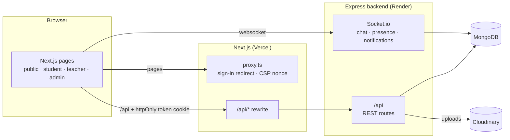
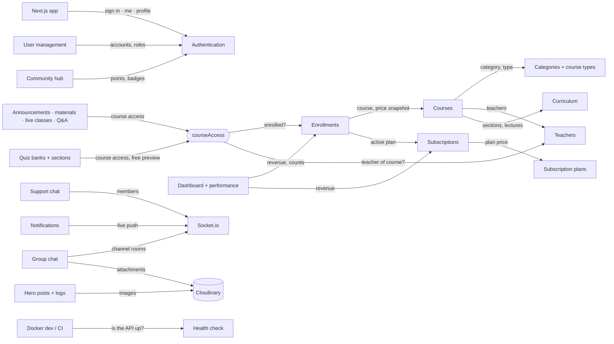
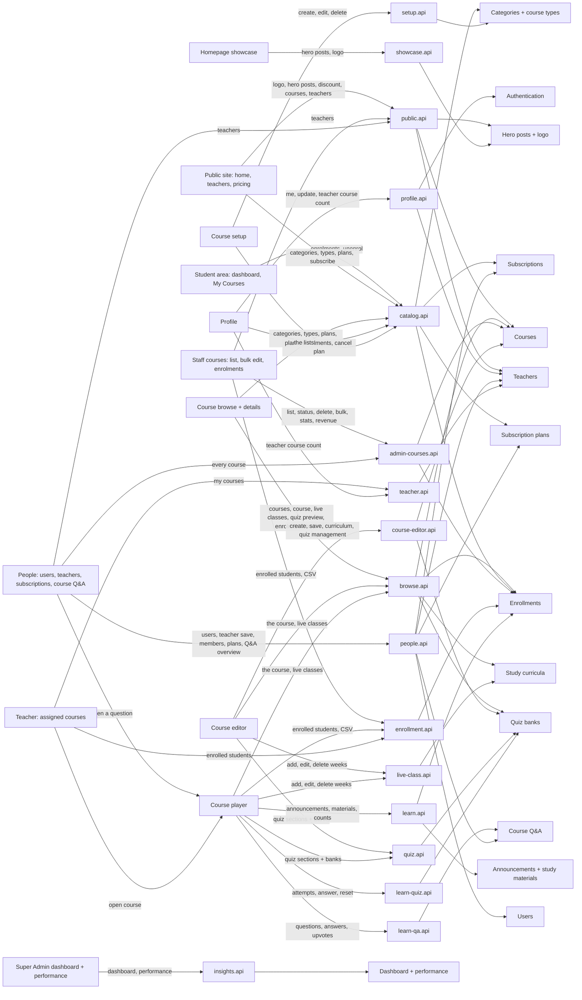
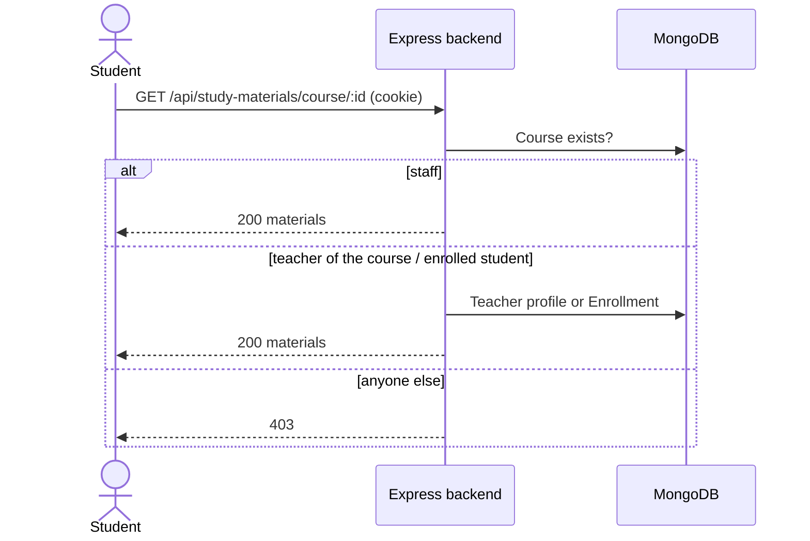
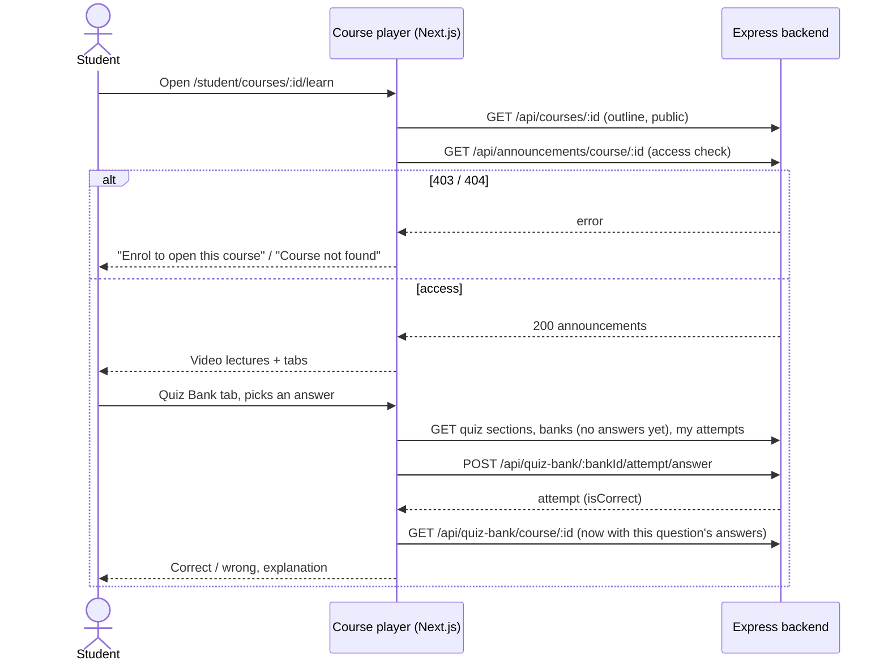

# Architecture overview

How the built parts fit together. Updated with every feature; shows only what exists.

Generated diagrams (never edited by hand): [database.md](database.md), [dependency-graph.md](dependency-graph.md).

## System



- **Hosting.** The Next.js app runs on Vercel, the Express backend on Render (`render.yaml`, database from
  `MONGO_URI`). Locally, `npm run dev` runs MongoDB and the backend in Docker and Next.js on the host.
- **How auth travels.** The browser only ever calls `/api/...` on the Next.js origin; `next.config.ts`
  rewrites it to the backend (`BACKEND_INTERNAL_URL`). The backend's httpOnly `token` cookie is therefore
  first-party: the browser sends it automatically and frontend code never reads, stores or sends the token.
  The signed-in user is the result of `GET /api/auth/me`.
- **Pages.** `proxy.ts` sends visitors without the session cookie away from `/admin`, `/student` and
  `/teacher` before the page renders, and gives every page a fresh Content-Security-Policy nonce.
  `RequireRole` then checks the role. Neither is the security boundary: the backend's `protect` and
  `authorize(...roles)` check every API call.
- **Socket.io** connects straight to the backend (`NEXT_PUBLIC_SOCKET_URL`), because Vercel rewrites cannot
  carry websockets.

## Feature map

Backend modules (all baselined with integration tests; details in [backend-features.md](backend-features.md)).
"A --> B" means A uses B.



Frontend features (Next.js, `frontend/src`): each screen group calls its own API module, and every read that
several screens share has ONE request and ONE query key, in one module: categories, course types, plans, the
student's enrolments and subscription (`catalog.api`); a course by id and its live classes (`browse.api`,
used by the course page, the course player and the course editor); teacher profiles (`public.api`); the staff
course list (`admin-courses.api`, also used by the Teachers page); a course's enrolled students
(`enrollment.api`); quiz sections and banks (`quiz.api`); the teacher's own courses (`teacher.api`, also the
profile's course count). So a change made on one screen refreshes every screen that shows it. Course lists
are refreshed together by `api/course-cache.ts`. "A --> B" means A uses B.



## Key flows

### Rich text and embeds

Rich text that users write (course descriptions, announcements, and so on) is stored as HTML and reaches the
page only through `components/common/SafeHtml`. It runs DOMPurify in the browser with an allow-list
(`utils/sanitizeHtml.ts`): formatting tags only, links only to `http(s):` or `mailto:`, no scripts, event
handlers, iframes or inline styles. Two DOMPurify hooks (added once) keep paragraph alignment (`text-align:
left|center|right|justify` and nothing else) and give `http(s)` links `target="_blank"` with `rel="noopener
noreferrer"`. Videos are never embedded from stored HTML: the course page reads the 11-character YouTube id
from a lecture's video address and builds the player address itself on `https://www.youtube-nocookie.com`;
the Content-Security-Policy (`utils/csp.ts`) allows frames only from YouTube (`frame-src`), so any other
embed is blocked by the browser too.

### Signing in

The sign-in form posts the email and password to `/api/auth/login` on the Next.js origin, which forwards
them to the backend. The backend checks the password (after 10 wrong passwords for one email within 15 minutes it answers 429 until the window ends), sets the httpOnly `token` cookie (7 days) and returns
the user. The app stores that user as the "me" query; `GuestGate` then opens the page from `?next=` if it is
a safe same-site page the role may open, otherwise the role's home page (Super Admin: `/admin/dashboard`,
Admin and Moderator: `/admin/courses`, Teacher: `/teacher/courses`, Student: `/student/dashboard`).

```mermaid
sequenceDiagram
    actor U as User
    participant N as Next.js (browser + /api rewrite)
    participant B as Express backend
    participant M as MongoDB
    U->>N: Email + password on /auth/login
    N->>B: POST /api/auth/login
    B->>B: Email locked (10 failures / 15 min)? -> 429
    B->>M: Find user, compare bcrypt hash
    M-->>B: User
    B-->>N: Set-Cookie token (httpOnly) + { success, data: user }
    N->>N: Cache user as "me"; GuestGate picks the next page
    N-->>U: Role home page (or the safe ?next= page)
    Note over N,B: Every later /api call carries the cookie automatically
```

### Signing out

The sidebar's sign-out button posts `/api/auth/logout`; the backend clears the cookie. Only then does the
app mark the user as signed out and drop every cached query; `RequireRole` sends the user to `/auth/login`
(without `?next=`, so the next person on a shared computer does not land on the previous user's page). If the
request fails, the user stays signed in and sees "Could not sign out".

### Opening course content

Lectures' videos, study materials, live classes, quizzes, announcements and Q&A belong to a course. Every such
request passes one check (`backend/src/utils/courseAccess.ts`): Super Admin, Admin and Moderator always pass;
a Teacher passes only for courses whose `teachers` list holds their teacher profile; a Student passes only
with an enrolment (a subscription enrolment only while the plan is active and still covers the course).
Free-preview quiz banks and preview lectures are the exceptions anyone may open. Quiz answers are removed
from every question the student has not answered yet.



### Course player

The player (`/student/courses/[id]/learn`, `/teacher/courses/[id]/learn`, `/admin/courses/[id]/learn`) first
reads the course outline, which is public (the same request and cache entry as the course page, read again
on open because video addresses depend on access). The announcements request is the access check of the
whole player: a 403 shows "Enrol to open this course", a 404 "Course not found". The other tabs load their
own lists only when opened. In the Quiz Bank tab the server marks every answer: the bank list arrives without
the correct answers of unanswered questions; after an answer the player stores the returned attempt and
reads the banks again, which now carry that question's correct answers and explanations. Staff open a
question from All Course Q & A straight in the player's Q&A tab (`?tab=qa&questionId=`).



### Changing a password

A password change (own profile or reset by a Super Admin/Admin) stores `passwordChangedAt`. Every token
issued before it is refused (HTTP and Socket.io), live socket connections of that user are closed, and the
browser that made the change gets a fresh cookie, so only that device stays signed in.

<!--
TEMPLATE: keep these three sections up to date (only what exists).
## System — services and how they talk.
## Feature map — one box per BUILT feature; "A --> B" = A uses B, label = what flows

(e.g. Enrollments -- "checks payment" --> Payments).

## Key flows — a sequence diagram per important journey (enrol in a course, finish a lesson, submit a quiz,

chat message), one short paragraph above each.
-->
