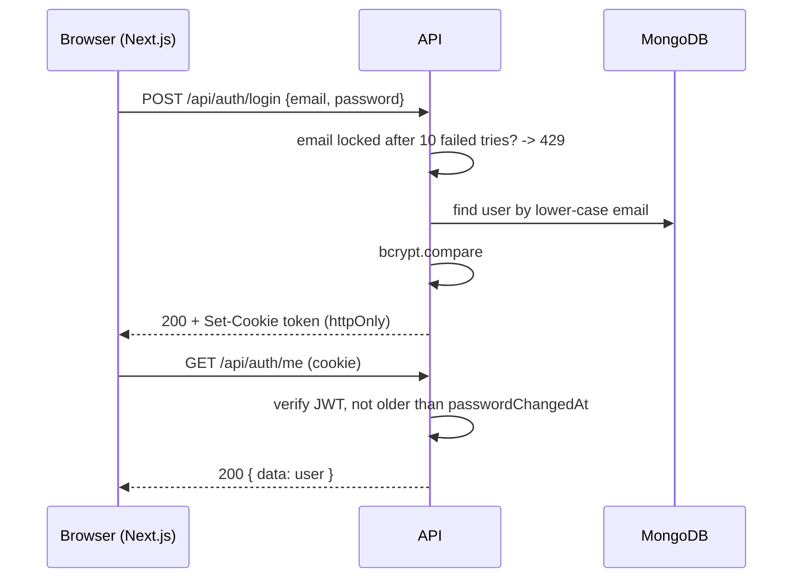
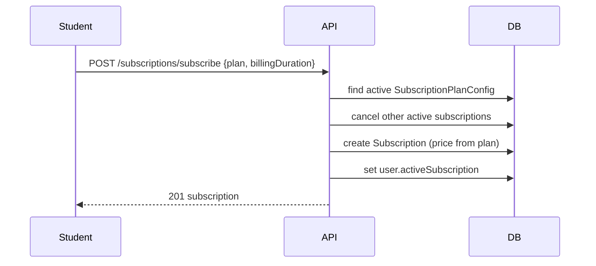
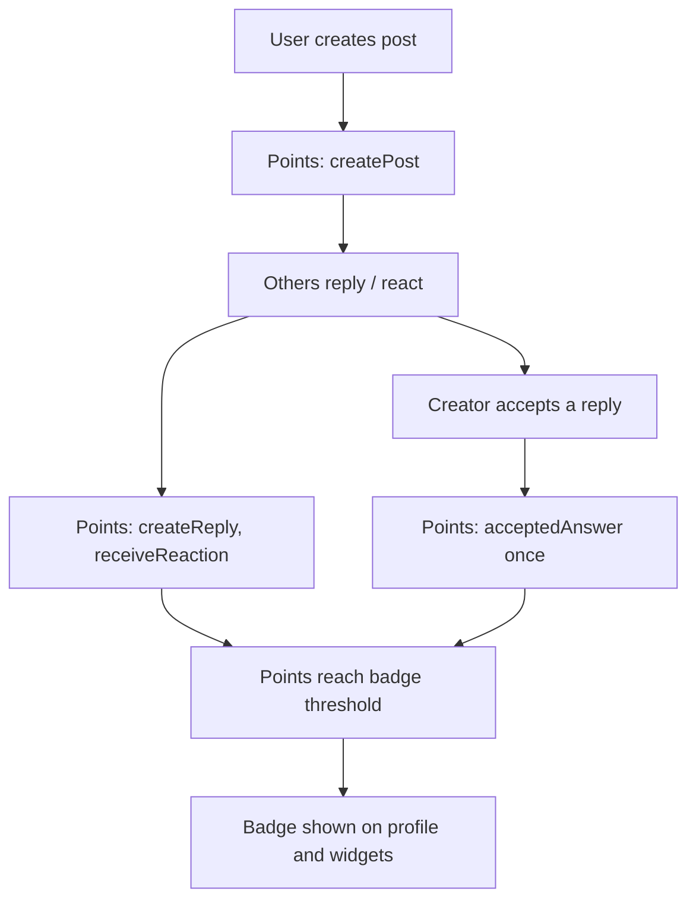
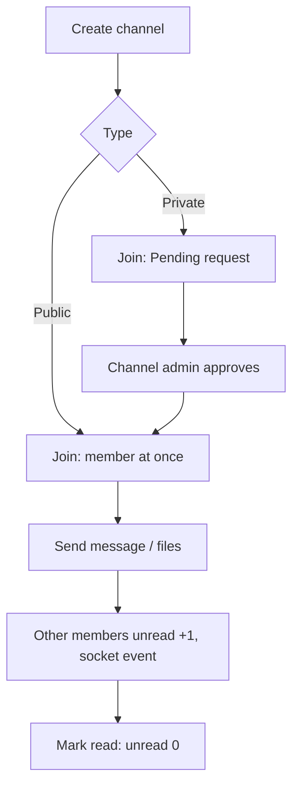

# Backend features (API)

Plain-language reference for every backend endpoint. Screens that use them: [frontend-features.md](frontend-features.md).

## Conventions

| Topic         | Rule                                                                                                                                                                                                                                                                                                           |
| ------------- | -------------------------------------------------------------------------------------------------------------------------------------------------------------------------------------------------------------------------------------------------------------------------------------------------------------- |
| Base URL      | `/api/...` (the Next.js app calls it on its own origin; `next.config.ts` forwards it to the backend)                                                                                                                                                                                                           |
| Auth          | JWT in the httpOnly `token` cookie, set by login/register (token lifetime `JWT_EXPIRE`, default 7 days; the cookie itself expires after a fixed 7 days; cookie `secure` + `sameSite=none` in production, `sameSite=strict` locally). `protect` reads the cookie first, then an `Authorization: Bearer` header. |
| Roles         | Super Admin, Admin, Moderator, Teacher, Student; `authorize(...roles)` per route. No token: 401. Wrong role: 403.                                                                                                                                                                                              |
| Success shape | `{ "success": true, "message"?: "...", "data": ..., "total"?, "page"?, "limit"? }`                                                                                                                                                                                                                             |
| Error shape   | `{ "success": false, "message": "..." }` (`AppError` + global error handler; Mongoose validation, duplicate key and bad id errors become 400)                                                                                                                                                                  |
| Lists         | `page`, `limit` query values; `total` in the response                                                                                                                                                                                                                                                          |
| Uploads       | `multipart/form-data` via Multer (memory storage), stored on Cloudinary. `upload`: images up to 5 MB; `uploadAnyFile`: up to 10 files of 10 MB                                                                                                                                                                 |

## Endpoints

| Method | Path                                                             | Roles                                                                                    | What it does                                                                                                                              |
| ------ | ---------------------------------------------------------------- | ---------------------------------------------------------------------------------------- | ----------------------------------------------------------------------------------------------------------------------------------------- |
| GET    | `/api/health`                                                    | Public                                                                                   | Says whether the API is running (used by Docker health checks)                                                                            |
| POST   | `/api/auth/register`                                             | Public                                                                                   | Create a Student account and sign in                                                                                                      |
| POST   | `/api/auth/login`                                                | Public                                                                                   | Sign in with email + password (sets the `token` cookie)                                                                                   |
| POST   | `/api/auth/logout`                                               | Public                                                                                   | Clear the `token` cookie                                                                                                                  |
| GET    | `/api/auth/me`                                                   | Signed in                                                                                | The signed-in user                                                                                                                        |
| PUT    | `/api/auth/me`                                                   | Signed in                                                                                | Update own profile, password, avatar, community privacy                                                                                   |
| POST   | `/api/users`                                                     | Super Admin, Admin                                                                       | Create a user with a role                                                                                                                 |
| GET    | `/api/users`                                                     | Super Admin, Admin                                                                       | Paged user list (search, role; Super Admin: spending filters)                                                                             |
| GET    | `/api/users/:id`                                                 | Super Admin, Admin                                                                       | One user                                                                                                                                  |
| PUT    | `/api/users/:id`                                                 | Super Admin, Admin                                                                       | Update name, email, role, password                                                                                                        |
| PUT    | `/api/users/:id/role`                                            | Super Admin, Admin                                                                       | Change only the role                                                                                                                      |
| DELETE | `/api/users/:id`                                                 | Super Admin                                                                              | Delete a user                                                                                                                             |
| GET    | `/api/categories`                                                | Public                                                                                   | List all categories (sorted by name)                                                                                                      |
| POST   | `/api/categories`                                                | Super Admin, Admin                                                                       | Create a category (slug built from the name)                                                                                              |
| PUT    | `/api/categories/:id`                                            | Super Admin, Admin                                                                       | Rename / describe a category                                                                                                              |
| DELETE | `/api/categories/:id`                                            | Super Admin, Admin                                                                       | Delete a category                                                                                                                         |
| GET    | `/api/course-types`                                              | Public                                                                                   | List all course types (sorted by name)                                                                                                    |
| POST   | `/api/course-types`                                              | Super Admin, Admin                                                                       | Create a course type                                                                                                                      |
| PUT    | `/api/course-types/:id`                                          | Super Admin, Admin                                                                       | Update a course type                                                                                                                      |
| DELETE | `/api/course-types/:id`                                          | Super Admin, Admin                                                                       | Delete a course type                                                                                                                      |
| GET    | `/api/teachers`                                                  | Public                                                                                   | List teacher profiles (sorted by name)                                                                                                    |
| GET    | `/api/teachers/my-courses`                                       | Teacher                                                                                  | Courses the signed-in teacher teaches                                                                                                     |
| GET    | `/api/teachers/:id`                                              | Public                                                                                   | One teacher profile                                                                                                                       |
| POST   | `/api/teachers`                                                  | Super Admin, Admin                                                                       | Create a teacher profile (optional photo, optional login link)                                                                            |
| PUT    | `/api/teachers/:id`                                              | Super Admin, Admin                                                                       | Update a teacher profile                                                                                                                  |
| DELETE | `/api/teachers/:id`                                              | Super Admin, Admin                                                                       | Delete a teacher profile and its photo                                                                                                    |
| GET    | `/api/courses`                                                   | Public (staff see more)                                                                  | Course list; staff: every course + enrolment statistics                                                                                   |
| GET    | `/api/courses/browse`                                            | Public                                                                                   | Public catalog: Published + Public courses, filters, counts, paging                                                                       |
| GET    | `/api/courses/discounts/active`                                  | Public                                                                                   | Summary of running discounts                                                                                                              |
| GET    | `/api/courses/:id`                                               | Public                                                                                   | One course with category, type, teachers, sections and lectures                                                                           |
| POST   | `/api/courses`                                                   | Super Admin, Admin                                                                       | Create a Draft course (optional cover image)                                                                                              |
| PUT    | `/api/courses/:id`                                               | Super Admin, Admin                                                                       | Update a course                                                                                                                           |
| PATCH  | `/api/courses/:id/status`                                        | Super Admin, Admin                                                                       | Publish or unpublish                                                                                                                      |
| DELETE | `/api/courses/:id`                                               | Super Admin, Admin                                                                       | Delete a course and everything that belongs to it                                                                                         |
| PATCH  | `/api/courses/bulk`                                              | Super Admin, Admin                                                                       | Update many courses and/or post one announcement to them                                                                                  |
| PATCH  | `/api/courses/bulk/discount`                                     | Super Admin, Admin                                                                       | Apply a percentage discount with an end date to many courses                                                                              |
| POST   | `/api/courses/:courseId/sections`                                | Super Admin, Admin                                                                       | Add a section                                                                                                                             |
| PUT    | `/api/courses/:courseId/sections/:sectionId`                     | Super Admin, Admin                                                                       | Rename a section                                                                                                                          |
| DELETE | `/api/courses/:courseId/sections/:sectionId`                     | Super Admin, Admin                                                                       | Delete a section and its lectures                                                                                                         |
| PUT    | `/api/courses/:courseId/sections/reorder`                        | Super Admin, Admin                                                                       | Reorder sections                                                                                                                          |
| POST   | `/api/courses/:courseId/sections/:sectionId/lectures`            | Super Admin, Admin                                                                       | Add a lecture                                                                                                                             |
| PUT    | `/api/courses/:courseId/sections/:sectionId/lectures/:lectureId` | Super Admin, Admin                                                                       | Update a lecture                                                                                                                          |
| DELETE | `/api/courses/:courseId/sections/:sectionId/lectures/:lectureId` | Super Admin, Admin                                                                       | Delete a lecture                                                                                                                          |
| PUT    | `/api/courses/:courseId/sections/:sectionId/lectures/reorder`    | Super Admin, Admin                                                                       | Reorder lectures                                                                                                                          |
| POST   | /api/enrollments/:courseId                                       | Student                                                                                  | Enrols the signed-in student in a published course (type and price decided by the server)                                                 |
| DELETE | /api/enrollments/:courseId                                       | Student                                                                                  | Removes the student's own enrolment                                                                                                       |
| GET    | /api/enrollments                                                 | Student                                                                                  | The student's enrolled courses, newest first                                                                                              |
| GET    | /api/enrollments/:courseId/check                                 | Student                                                                                  | Whether the student is enrolled in the course                                                                                             |
| GET    | /api/enrollments/admin/course/:courseId                          | Super Admin, Admin                                                                       | Enrolments of a course (optional `?type=free\|paid\|subscription`)                                                                        |
| GET    | /api/enrollments/admin/course/:courseId/stats                    | Super Admin, Admin                                                                       | Counts per type and earnings of a course                                                                                                  |
| GET    | /api/enrollments/course/:courseId/students                       | Super Admin, Admin, Moderator, Teacher (own courses only)                                | Enrolled students (teachers do not get emails)                                                                                            |
| GET    | /api/enrollments/course/:courseId/students/export                | Super Admin, Admin, Moderator                                                            | CSV of student names and emails                                                                                                           |
| GET    | /api/enrollments/course/:courseId/count                          | Signed in                                                                                | Number of students enrolled in a course                                                                                                   |
| GET    | /api/announcements/course/:courseId                              | Enrolled students, the course's teachers, Super Admin, Admin, Moderator                  | Announcements of a course, newest first                                                                                                   |
| POST   | /api/announcements/course/:courseId                              | Super Admin, Admin, Moderator, Teacher                                                   | Posts an announcement (teachers: only their own courses)                                                                                  |
| PUT    | /api/announcements/:id                                           | Super Admin, Admin, Moderator, Teacher                                                   | Edits an announcement (author or staff admin)                                                                                             |
| DELETE | /api/announcements/:id                                           | Super Admin, Admin, Moderator, Teacher                                                   | Deletes an announcement (author or staff admin)                                                                                           |
| GET    | /api/study-curricula/course/:courseId                            | Public (full data only for users with course access)                                     | Live classes (weekly curriculum) of a course, oldest first                                                                                |
| POST   | /api/study-curricula/course/:courseId                            | Super Admin, Admin, Teacher                                                              | Adds a live class (teachers: only their own courses)                                                                                      |
| PUT    | /api/study-curricula/:id                                         | Super Admin, Admin, Moderator, Teacher                                                   | Edits a live class (author or staff admin)                                                                                                |
| DELETE | /api/study-curricula/:id                                         | Super Admin, Admin, Moderator, Teacher                                                   | Deletes a live class (author or staff admin)                                                                                              |
| GET    | /api/study-materials/course/:courseId                            | Enrolled students, the course's teachers, Super Admin, Admin, Moderator                  | Study materials of a course, newest first                                                                                                 |
| POST   | /api/study-materials/course/:courseId                            | Super Admin, Admin, Moderator, Teacher                                                   | Adds a study material (teachers: only their own courses)                                                                                  |
| PUT    | /api/study-materials/:id                                         | Super Admin, Admin, Moderator, Teacher                                                   | Edits a study material (author or staff admin)                                                                                            |
| DELETE | /api/study-materials/:id                                         | Super Admin, Admin, Moderator, Teacher                                                   | Deletes a study material (author or staff admin)                                                                                          |
| GET    | /api/qa/questions/course/:courseId                               | Enrolled students, the course's teachers, Super Admin, Admin, Moderator                  | Questions of a course with answer counts                                                                                                  |
| POST   | /api/qa/questions/course/:courseId                               | Signed in (enrolled student, assigned teacher, staff admin)                              | Asks a question                                                                                                                           |
| GET    | /api/qa/questions/:id                                            | Enrolled students, the course's teachers, Super Admin, Admin, Moderator                  | One question with its answers                                                                                                             |
| PUT    | /api/qa/questions/:id                                            | Signed in (author or Super Admin, Admin, Moderator)                                      | Edits a question                                                                                                                          |
| DELETE | /api/qa/questions/:id                                            | Signed in (author or Super Admin, Admin, Moderator)                                      | Deletes a question and its answers                                                                                                        |
| PATCH  | /api/qa/questions/:id/resolve                                    | Signed in (author, assigned teacher, Super Admin, Admin, Moderator)                      | Marks a question resolved or reopens it                                                                                                   |
| PATCH  | /api/qa/questions/:id/upvote                                     | Enrolled students, the course's teachers, Super Admin, Admin, Moderator                  | Toggles the caller's upvote                                                                                                               |
| POST   | /api/qa/answers/question/:questionId                             | Signed in (enrolled student, assigned teacher, staff admin)                              | Answers a question                                                                                                                        |
| PUT    | /api/qa/answers/:id                                              | Signed in (author or Super Admin, Admin, Moderator)                                      | Edits an answer                                                                                                                           |
| DELETE | /api/qa/answers/:id                                              | Signed in (author or Super Admin, Admin, Moderator)                                      | Deletes an answer                                                                                                                         |
| PATCH  | /api/qa/answers/:id/upvote                                       | Enrolled students, the course's teachers, Super Admin, Admin, Moderator                  | Toggles the caller's upvote                                                                                                               |
| GET    | /api/qa/admin/course-questions                                   | Super Admin, Admin, Moderator                                                            | Unresolved questions of all courses, grouped by course                                                                                    |
| GET    | `/api/quiz-bank/public/courses`                                  | Public                                                                                   | Courses that have at least one free-preview quiz section or bank (filters: search, categories, courseTypes, pricing)                      |
| GET    | `/api/quiz-bank/public/course/:courseId`                         | Public                                                                                   | Free-preview quiz sections and banks of a course (without correct answers or explanations), plus counts of the locked banks and questions |
| POST   | `/api/quiz-bank/public/:id/questions/:qId/check`                 | Public                                                                                   | Check one answer of a free-preview bank; returns whether it is correct, the correct indices and the explanations; nothing is stored       |
| GET    | `/api/quiz-bank/course/:courseId`                                | Staff, teacher of the course, enrolled student (others: free-preview banks only)         | Quiz banks of a course                                                                                                                    |
| GET    | `/api/quiz-bank/course/:courseId/my-attempts`                    | Staff, teacher of the course, enrolled student (others: free-preview banks only)         | My own quiz attempts in a course                                                                                                          |
| GET    | `/api/quiz-bank/context/:contextType/:contextId`                 | Same as the course list                                                                  | Quiz banks attached to a Section, Announcement or Course                                                                                  |
| POST   | `/api/quiz-bank`                                                 | Super Admin, Admin, Moderator, Teacher of the course                                     | Create a quiz bank                                                                                                                        |
| GET    | `/api/quiz-bank/:id`                                             | Staff, teacher of the course, enrolled student, anyone signed in for a free-preview bank | One quiz bank with its questions                                                                                                          |
| PUT    | `/api/quiz-bank/:id`                                             | Super Admin, Admin, Moderator, Teacher of the course                                     | Edit title, description, free-preview flag                                                                                                |
| DELETE | `/api/quiz-bank/:id`                                             | Super Admin, Admin, Moderator, Teacher of the course                                     | Delete a bank and all attempts on it                                                                                                      |
| POST   | `/api/quiz-bank/:id/questions`                                   | Super Admin, Admin, Moderator, Teacher of the course                                     | Add a question (4 options, 1+ correct)                                                                                                    |
| PUT    | `/api/quiz-bank/:id/questions/:qId`                              | Super Admin, Admin, Moderator, Teacher of the course                                     | Edit a question                                                                                                                           |
| DELETE | `/api/quiz-bank/:id/questions/:qId`                              | Super Admin, Admin, Moderator, Teacher of the course                                     | Delete a question                                                                                                                         |
| GET    | `/api/quiz-bank/:id/attempt`                                     | Same as GET `/:id`                                                                       | My attempt on a bank (or null)                                                                                                            |
| POST   | `/api/quiz-bank/:id/attempt/answer`                              | Same as GET `/:id`                                                                       | Answer one question; the server marks it correct or wrong                                                                                 |
| DELETE | `/api/quiz-bank/:id/attempt`                                     | Same as GET `/:id`                                                                       | Reset (delete) my attempt                                                                                                                 |
| GET    | `/api/quiz-sections/course/:courseId`                            | Signed in                                                                                | Quiz sections of a course                                                                                                                 |
| POST   | `/api/quiz-sections`                                             | Super Admin, Admin, Moderator, Teacher of the course                                     | Create a quiz section                                                                                                                     |
| PUT    | `/api/quiz-sections/:id`                                         | Super Admin, Admin, Moderator, Teacher of the course                                     | Edit a quiz section                                                                                                                       |
| DELETE | `/api/quiz-sections/:id`                                         | Super Admin, Admin, Moderator, Teacher of the course                                     | Delete a section with its banks and attempts                                                                                              |
| GET    | `/api/subscriptions/my`                                          | Signed in                                                                                | My active subscription (or null)                                                                                                          |
| POST   | `/api/subscriptions/subscribe`                                   | Student                                                                                  | Subscribe to a plan (price from the plan configuration)                                                                                   |
| DELETE | `/api/subscriptions/cancel-my`                                   | Student                                                                                  | Cancel my active subscription                                                                                                             |
| GET    | `/api/subscriptions`                                             | Super Admin, Admin                                                                       | Paged list of all subscriptions with filters and status counts                                                                            |
| POST   | `/api/subscriptions/assign`                                      | Super Admin, Admin                                                                       | Give a user a plan until a chosen date                                                                                                    |
| PATCH  | `/api/subscriptions/:id/cancel`                                  | Super Admin, Admin                                                                       | Cancel any subscription                                                                                                                   |
| GET    | `/api/subscription-plans`                                        | Public                                                                                   | Active plans, cheapest first, with billing options and course count                                                                       |
| POST   | `/api/subscription-plans`                                        | Super Admin, Admin                                                                       | Create or update a plan by name                                                                                                           |
| DELETE | `/api/subscription-plans/:id`                                    | Super Admin, Admin                                                                       | Delete a plan                                                                                                                             |
| GET    | /api/dashboard/summary                                           | Super Admin                                                                              | Totals, revenue, charts, top courses and recent activity for the dashboard                                                                |
| GET    | /api/performance/overview                                        | Super Admin                                                                              | Enrolment and revenue numbers and chart for one course or all courses                                                                     |
| GET    | /api/performance/courses                                         | Super Admin                                                                              | All courses (title, price fields, status) for the performance filter                                                                      |
| GET    | /api/chat/conversations                                          | Signed in                                                                                | Staff: all support conversations; student: their own (created if missing)                                                                 |
| GET    | /api/chat/conversations/:id/messages                             | Signed in (staff or the conversation's student)                                          | Messages of one conversation, oldest first                                                                                                |
| GET    | /api/notifications                                               | Signed in                                                                                | My notifications, newest first, paginated, with read state                                                                                |
| GET    | /api/notifications/unread-count                                  | Signed in                                                                                | Number of my unread notifications                                                                                                         |
| PATCH  | /api/notifications/read-all                                      | Signed in                                                                                | Mark all my notifications as read                                                                                                         |
| PATCH  | /api/notifications/:id/read                                      | Signed in (recipient)                                                                    | Mark one of my notifications as read                                                                                                      |
| POST   | /api/notifications                                               | Super Admin, Admin                                                                       | Send a notification to every user of the chosen roles                                                                                     |
| GET    | /api/notifications/sent/all                                      | Super Admin, Admin                                                                       | All sent notifications, newest first, paginated                                                                                           |
| PUT    | /api/notifications/:id                                           | Super Admin, Admin                                                                       | Edit a notification (title, message, priority, target roles)                                                                              |
| DELETE | /api/notifications/:id                                           | Super Admin, Admin                                                                       | Delete a notification                                                                                                                     |
| GET    | /api/home-hero-posts/public                                      | Public                                                                                   | Public homepage hero images (applies due schedules)                                                                                       |
| GET    | /api/home-hero-posts/logo/public                                 | Public                                                                                   | The current site logo (or null)                                                                                                           |
| GET    | /api/home-hero-posts/logo                                        | Super Admin, Admin                                                                       | Site logo with who updated it                                                                                                             |
| PUT    | /api/home-hero-posts/logo                                        | Super Admin, Admin                                                                       | Upload or replace the site logo (field `logo`)                                                                                            |
| GET    | /api/home-hero-posts                                             | Super Admin, Admin                                                                       | All hero posts (Public and Private)                                                                                                       |
| POST   | /api/home-hero-posts                                             | Super Admin, Admin                                                                       | Upload one or more hero images (fields `images` / `image`)                                                                                |
| PATCH  | /api/home-hero-posts/reorder                                     | Super Admin, Admin                                                                       | Set the order from a list of ids                                                                                                          |
| PUT    | /api/home-hero-posts/:id                                         | Super Admin, Admin                                                                       | Change image, visibility, schedule or order                                                                                               |
| DELETE | /api/home-hero-posts/:id                                         | Super Admin, Admin                                                                       | Delete a hero post and its image                                                                                                          |
| GET    | /api/study-schedules                                             | Signed in                                                                                | My timers and reminders (filters `type`, `status`)                                                                                        |
| POST   | /api/study-schedules/timer                                       | Signed in                                                                                | Create a study timer                                                                                                                      |
| POST   | /api/study-schedules/reminder                                    | Signed in                                                                                | Create a reminder                                                                                                                         |
| PUT    | /api/study-schedules/:id                                         | Signed in (owner)                                                                        | Update progress, status, title or dates                                                                                                   |
| DELETE | /api/study-schedules/:id                                         | Signed in (owner)                                                                        | Delete a timer or reminder                                                                                                                |
| GET    | /api/community                                                   | Public (personalised when signed in)                                                     | Hub overview: channels, posts with replies, badges, counts, widgets. Guests get at most 10 posts.                                         |
| GET    | /api/community/users/:userId                                     | Public (personalised when signed in)                                                     | A member's community profile (stats, badges, discussions, answers). Private profiles show only name, avatar and role.                     |
| GET    | /api/community/settings                                          | Super Admin, Admin                                                                       | Read the hub title, description and header image.                                                                                         |
| PUT    | /api/community/settings                                          | Super Admin, Admin                                                                       | Update title, description and header image.                                                                                               |
| GET    | /api/community/admin/channels                                    | Super Admin, Admin                                                                       | List all hub channels, archived last.                                                                                                     |
| POST   | /api/community/channels                                          | Super Admin, Admin                                                                       | Create a hub channel (name, description, image).                                                                                          |
| PUT    | /api/community/channels/:id                                      | Super Admin, Admin                                                                       | Edit a hub channel.                                                                                                                       |
| PATCH  | /api/community/channels/:id/archive                              | Super Admin, Admin                                                                       | Archive a hub channel.                                                                                                                    |
| POST   | /api/community/posts                                             | Signed in                                                                                | Create a discussion (up to 8 images). Awards points.                                                                                      |
| GET    | /api/community/posts/:postId                                     | Public (personalised when signed in)                                                     | One discussion with replies and child replies.                                                                                            |
| GET    | /api/community/posts/:postId/replies                             | Public (personalised when signed in)                                                     | Page through a discussion's replies.                                                                                                      |
| PUT    | /api/community/posts/:postId                                     | Signed in (author or staff)                                                              | Edit a discussion.                                                                                                                        |
| POST   | /api/community/posts/:postId/replies                             | Signed in                                                                                | Reply to a discussion (images allowed). Awards points.                                                                                    |
| PATCH  | /api/community/posts/:postId/reactions                           | Signed in                                                                                | Add, change or remove your reaction on a discussion.                                                                                      |
| PATCH  | /api/community/posts/:postId/archive                             | Signed in (author or Super Admin, Admin, Moderator)                                      | Archive a discussion.                                                                                                                     |
| PATCH  | /api/community/posts/:postId/pin                                 | Super Admin, Admin, Moderator                                                            | Pin or unpin a discussion.                                                                                                                |
| PATCH  | /api/community/replies/:replyId/reactions                        | Signed in                                                                                | Add, change or remove your reaction on a reply.                                                                                           |
| PATCH  | /api/community/replies/:replyId/accepted                         | Signed in (discussion creator)                                                           | Mark or unmark a reply as the accepted answer.                                                                                            |
| PATCH  | /api/community/replies/:replyId/archive                          | Signed in (author or staff)                                                              | Delete (archive) a reply.                                                                                                                 |
| GET    | /api/community/replies/:replyId/replies                          | Public (personalised when signed in)                                                     | Page through the child replies of a reply.                                                                                                |
| POST   | /api/community/replies/:replyId/replies                          | Signed in                                                                                | Add a child reply to a reply.                                                                                                             |
| PATCH  | /api/community/answer-replies/:childReplyId/archive              | Signed in (author or staff)                                                              | Delete (archive) a child reply.                                                                                                           |
| GET    | /api/community/badges                                            | Super Admin, Admin                                                                       | List badges (archived last).                                                                                                              |
| POST   | /api/community/badges                                            | Super Admin, Admin                                                                       | Create a badge (name, points needed, image).                                                                                              |
| PUT    | /api/community/badges/:id                                        | Super Admin, Admin                                                                       | Edit a badge.                                                                                                                             |
| PATCH  | /api/community/badges/:id/archive                                | Super Admin, Admin                                                                       | Archive a badge.                                                                                                                          |
| GET    | /api/community/point-rules                                       | Super Admin, Admin                                                                       | Read the four point rules (created with defaults if missing).                                                                             |
| PUT    | /api/community/point-rules                                       | Super Admin, Admin                                                                       | Change the points per rule (known keys only, points 0 or more).                                                                           |
| GET    | /api/group-chat/channels                                         | Signed in                                                                                | Channels you belong to (staff: all; archived=true for archived).                                                                          |
| GET    | /api/group-chat/channels/discover                                | Signed in                                                                                | Find public and private channels to join (max 30). Non-members get only a public card per channel.                                        |
| POST   | /api/group-chat/channels                                         | Signed in                                                                                | Create a channel (Public or Private); you become its admin.                                                                               |
| PATCH  | /api/group-chat/channels/:channelId                              | Signed in (creator or staff)                                                             | Rename / change description and type.                                                                                                     |
| GET    | /api/group-chat/users/search                                     | Signed in                                                                                | Find users by name (max 20). Email shown to staff only.                                                                                   |
| POST   | /api/group-chat/channels/:channelId/join                         | Signed in                                                                                | Join a public channel, or send a join request to a private one.                                                                           |
| DELETE | /api/group-chat/channels/:channelId/join                         | Signed in                                                                                | Cancel your pending join request.                                                                                                         |
| POST   | /api/group-chat/channels/:channelId/approve/:userId              | Signed in (channel admin or staff)                                                       | Approve a join request.                                                                                                                   |
| POST   | /api/group-chat/channels/:channelId/members                      | Signed in (channel admin or staff)                                                       | Add users to a channel.                                                                                                                   |
| DELETE | /api/group-chat/channels/:channelId/members/:userId              | Signed in (channel admin or staff)                                                       | Remove a member (not the creator).                                                                                                        |
| POST   | /api/group-chat/channels/:channelId/leave                        | Signed in                                                                                | Leave a channel (not the creator).                                                                                                        |
| PATCH  | /api/group-chat/channels/:channelId/archive                      | Signed in (creator or staff)                                                             | Archive a channel.                                                                                                                        |
| PATCH  | /api/group-chat/channels/:channelId/block                        | Super Admin, Admin, Moderator                                                            | Block or unblock a channel.                                                                                                               |
| GET    | /api/group-chat/channels/:channelId/messages                     | Signed in (members; staff any)                                                           | The last 200 messages, oldest first.                                                                                                      |
| POST   | /api/group-chat/channels/:channelId/messages                     | Signed in (members; staff any)                                                           | Send text and/or up to 10 files.                                                                                                          |
| PATCH  | /api/group-chat/channels/:channelId/read                         | Signed in (members; staff any)                                                           | Reset your unread counter.                                                                                                                |

## Features

### Health check

**What it does:** answers "is the API running?" for Docker health checks, `npm run dev` and monitoring.

**How it works:**

1. Anyone calls `GET /api/health`; no sign-in, no database access.
2. The backend answers 200 with a fixed message and the server time.

**Endpoints**

| Method | Path          | Roles  | Description                |
| ------ | ------------- | ------ | -------------------------- |
| GET    | `/api/health` | Public | API status and server time |

**Example:**

```http
GET /api/health
```

```json
{ "success": true, "message": "Ed-Tech API is running", "timestamp": "2026-10-29T14:17:25.429Z" }
```

**Business rules:** public; never touches the database (so it answers even while MongoDB is down).

**Data model:** none.

**Errors:** an unknown path under `/api` answers 404 `{ "success": false, "message": ... }` (notFound
middleware).

**Fixed issues:** none.

**Tests:** `backend/tests/integration/health.get.test.ts` (200 for anyone; 404 shape for an unknown path).

### Authentication

**What it does:** creates Student accounts, signs people in and out, and lets everyone edit their own profile.

**How it works:**

1. Register or log in: the server checks the fields, hashes the password (bcrypt, cost 12) or compares it,
   and signs a JWT (`JWT_EXPIRE`, default 7 days).
2. The JWT is set as the httpOnly `token` cookie (production: `secure`, `sameSite=lax`; locally
   `sameSite=strict`) and, for the old client only, also returned as `token` in the body.
3. Every protected request: `protect` reads the cookie (or a Bearer header), verifies the JWT, loads the user
   and rejects tokens issued before the user's last password change.
4. Logout clears the cookie.



**Endpoints**

| Method | Path                 | Roles     | Description                                     |
| ------ | -------------------- | --------- | ----------------------------------------------- |
| POST   | `/api/auth/register` | Public    | Create a Student account, sign in               |
| POST   | `/api/auth/login`    | Public    | Sign in                                         |
| POST   | `/api/auth/logout`   | Public    | Sign out (clears the cookie)                    |
| GET    | `/api/auth/me`       | Signed in | The signed-in user                              |
| PUT    | `/api/auth/me`       | Signed in | Update own profile (JSON or multipart `avatar`) |

**Example:**

```http
POST /api/auth/login
Content-Type: application/json

{ "email": "student@example.com", "password": "Secret-pass-1" }
```

```json
{
  "success": true,
  "message": "Logged in successfully",
  "token": "<jwt, old client only>",
  "data": {
    "_id": "6720f0c2a1b2c3d4e5f60718",
    "name": "Asha",
    "email": "student@example.com",
    "role": "Student"
  }
}
```

**Business rules:**

- Register always creates a **Student** (a `role` in the body is ignored); password at least 6 characters;
  the email is stored trimmed and lower-case and must be unique.
- Login accepts the email in any letter case. Unknown email and wrong password give the same 401 message.
- After 10 wrong passwords for one email within 15 minutes, logins for that email answer 429 until the window
  ends (kept in memory); a successful login resets the count.
- Email and password must be strings: objects such as `{ "$ne": null }` are rejected with 400.
- `PUT /me`: name cannot be empty; only Students may change their email (others 403); the email must be
  free; a new password needs the correct current password and at least 6 characters. Changing the password
  signs out every other session (older tokens get 401) and gives this session a fresh cookie.
- Avatar: one image (`avatar`, images only, up to 5 MB) uploaded to Cloudinary `medhabee/users`; the old one
  is deleted; `removeAvatar=true` removes it. `isCommunityProfilePrivate=true|false` hides the community profile.
- Responses never include the password hash, `passwordChangedAt` or the avatar's Cloudinary id.

**Data model:** `users` (name, email unique lower-case, password hash `select: false`, passwordChangedAt
`select: false`, role, avatar, communityPoints, isCommunityProfilePrivate, activeSubscription,
purchasedCourses; indexes on createdAt and role+createdAt).

**Errors:** 400 missing/invalid fields, short password, email taken, wrong current password, non-image avatar;
401 no token / invalid, expired or revoked token / user deleted / wrong credentials; 403 non-student email
change; 429 too many failed logins.

**Fixed issues:**

- Production started with a hard-coded default JWT secret when `JWT_SECRET` was missing (tokens could be
  forged); it now refuses to start.
- A malformed or expired token gave 500; now 401.
- Login/register passed the raw `email` into the query (NoSQL operator injection); now strings only.
- Login failed for an email typed with capital letters; emails are normalised.
- No limit on password guessing; now 10 failed tries per email per 15 minutes.
- Tokens stayed valid after a password change; now revoked (HTTP and Socket.io).
- Cookie `sameSite=none` in production allowed cross-site requests with the cookie (CSRF); now `lax`
  (the Next.js app calls the API on its own origin).
- Register accepted any password length; now at least 6, as in the profile form.
- Mongoose "invalid id" errors echoed the raw input; now `Invalid <field>` only.

**Known limits:** logout only clears the cookie (a copied token stays valid until it expires or the password
changes); register says when an email is already registered; the token is still returned in the body for the
old client (removed when legacy-frontend/ is deleted).

**Tests:** `backend/tests/integration/auth.register.test.ts`, `auth.login.test.ts`, `auth.me.test.ts`
(cookie + Bearer, 401 cases incl. malformed/expired/foreign-secret tokens, injection, lockout, password
change revocation, avatar upload/removal with Cloudinary stubbed).

### User management

**What it does:** lets Super Admins and Admins create, list, edit, re-role and (Super Admin only) delete
accounts.

**How it works:**

1. An Admin or Super Admin calls the endpoint; `authorize` checks the role.
2. Create/update validate the fields, hash a new password, and refuse any change that creates, promotes to,
   or touches a Super Admin unless the caller is a Super Admin.
3. The list is paged (`page`, `limit` up to 100), newest first. For a Super Admin each user also gets an
   enrolment summary (free/paid/subscription) and a spending summary (paid courses + subscriptions), and the
   advanced filters work.

**Endpoints**

| Method | Path                  | Roles              | Description                        |
| ------ | --------------------- | ------------------ | ---------------------------------- |
| POST   | `/api/users`          | Super Admin, Admin | Create a user                      |
| GET    | `/api/users`          | Super Admin, Admin | Paged list with filters            |
| GET    | `/api/users/:id`      | Super Admin, Admin | One user                           |
| PUT    | `/api/users/:id`      | Super Admin, Admin | Update name, email, role, password |
| PUT    | `/api/users/:id/role` | Super Admin, Admin | Change the role                    |
| DELETE | `/api/users/:id`      | Super Admin        | Delete a user                      |

**Example:**

```http
GET /api/users?role=Student&search=asha&page=1&limit=10
```

```json
{
  "success": true,
  "data": [
    {
      "_id": "6720f0c2a1b2c3d4e5f60718",
      "name": "Asha",
      "email": "asha@example.com",
      "role": "Student",
      "communityPoints": 0
    }
  ],
  "total": 1,
  "totalUsers": 42,
  "pagination": {
    "page": 1,
    "limit": 10,
    "total": 1,
    "totalPages": 1,
    "hasNextPage": false,
    "hasPrevPage": false
  }
}
```

**Business rules:**

- Query values: `search` (name or email, case-insensitive, matched literally), `role` (ignored if unknown),
  `page`, `limit` (1-100, default 10; a page past the end returns the last page).
- Super Admin only filters: `subscriptionPlan`, `subscriptionStatus` (`active` | `expired` | `inactive`),
  `enrollmentFilter` (`has_|none_` + `total|free|paid|subscription`), `spendingFilter`
  (`has_|none_` + `total|paid_course|subscription`), `min/maxTotalSpent`, `min/maxPaidCourseSpend`,
  `min/maxSubscriptionSpend`. Ignored for Admins.
- Create: name, email, password required; email unique (any letter case); unknown role becomes Student.
- Only a Super Admin can create a Super Admin, promote someone to Super Admin, or edit/re-role a Super Admin
  account (Admin gets 403).
- A password set by an admin signs that user out everywhere.
- Only a Super Admin can delete.

**Data model:** `users`; summaries read `enrollments`, `subscriptions` and `subscriptionplanconfigs`.

**Errors:** 400 missing/invalid fields, invalid role, email in use, malformed id; 401; 403 wrong role or
Super Admin protection; 404 user not found.

**Fixed issues:**

- An Admin could create Super Admins, promote anyone to Super Admin, or reset a Super Admin's password and
  take over the account; now 403.
- The search text was used as a regular expression (regex injection, slow patterns); now matched literally.
- Non-string fields (e.g. `{ "$gt": "" }`) reached queries or crashed with 500; now 400.
- An admin password reset left the user's existing sessions signed in; now they are revoked.

**Tests:** `backend/tests/integration/user.manage.test.ts`, `user.list.test.ts` (every role, pagination,
filters, summaries, literal search, Super Admin protection, 400/401/403/404).

### Categories and course types

**What it does:** Admins keep two small lists, categories and course types, that courses are filed under. Anyone
can read them (the public catalog filters use them).

**How it works:**

1. Anyone calls `GET /api/categories` or `GET /api/course-types`; the list comes back sorted by name.
2. An admin posts a name (and an optional description). The server builds the slug (lower case, spaces to `-`,
   other symbols removed) and refuses a slug that already exists.
3. On rename the slug is rebuilt from the new name. Delete removes the document, but only when no course uses
   it (otherwise 400 `Category is used by N course(s)` / `Course type is used by N course(s)`).

**Endpoints:** see the first eight rows above.

**Example:**

```http
POST /api/categories
Cookie: token=...
{ "name": "Web Dev", "description": "All about the web" }
```

```json
{
  "success": true,
  "message": "Category created",
  "data": {
    "_id": "6720...",
    "name": "Web Dev",
    "slug": "web-dev",
    "description": "All about the web",
    "createdAt": "2026-10-29T10:00:00.000Z",
    "updatedAt": "2026-10-29T10:00:00.000Z"
  }
}
```

**Business rules:** read is public; write is Super Admin and Admin only (Moderator, Teacher, Student get 403;
no token gets 401). Name required. Slug unique (case and symbols ignored): "Maths" and "MATHS!" clash.
A name must be text and contain letters or digits (create and rename); a rename that clashes with another slug
is refused; a category or course type that courses use cannot be deleted.

**Data model:** `categories` (name, slug unique, description) and `coursetypes` (name, slug unique, description).

**Errors:** 400 name missing / duplicate / bad id; 401; 403; 404 `Category not found` / `Course type not found`.
400 also for a name that is not text or has no letters or digits, and for a delete while courses use it.

**Fixed issues:**

- Deleting a category or course type that courses use is refused (400 `... is used by N course(s)`).
- A name with no letters or digits (empty slug) answers 400 on create and rename; category rename clash 400.
- A non-string `name` answers 400 instead of 500.

**Tests:** `backend/tests/integration/category.crud.test.ts`, `course-type.crud.test.ts` (happy paths per role,
slug rules, duplicates, 400/401/403/404, in-use delete).

---

### Teachers

**What it does:** Admins manage public teacher profiles (name, bio, photo, expertise, social links) and may link
a profile to a login account with the Teacher role. A signed-in teacher can list the courses they teach.

**How it works:**

1. `GET /api/teachers` and `/:id` are public (sign-in optional); the linked login account id (`userId`) is only
   included for Super Admin and Admin.
2. `POST` / `PUT` accept multipart form data; an optional `profileImage` (image only, 5 MB) goes to Cloudinary;
   on replace the old image is deleted. `expertise` is a comma separated string; `socialLinks` is a JSON string.
3. `userId` links the profile to a user: the user must exist, have the Teacher role and not be linked already.
   An empty `userId` on update unlinks.
4. `GET /api/teachers/my-courses` finds the profile linked to the signed-in user and returns the courses that
   list that profile (newest first); no profile means an empty list.
5. `DELETE` removes the photo from Cloudinary, removes the teacher from every course that lists them, then
   deletes the profile.
6. Name, bio, `userId` and `socialLinks` are checked before the photo is uploaded (no orphan image).

**Endpoints:** rows above.

**Example:**

```http
GET /api/teachers/my-courses
Cookie: token=...
```

```json
{
  "success": true,
  "data": [
    {
      "_id": "6720...",
      "title": "Algebra 101",
      "category": { "_id": "...", "name": "Maths", "slug": "maths" },
      "courseType": { "_id": "...", "name": "Live", "slug": "live", "description": "" },
      "teachers": [{ "_id": "...", "name": "Ms Rahman" }]
    }
  ],
  "total": 1
}
```

**Business rules:** write routes Super Admin and Admin only; `my-courses` Teacher only; one login account can be
linked to one profile only.

**Data model:** `teachers` (name, bio, profileImage, profileImagePublicId (`select: false`: never sent, only
loaded by update/delete to remove the old photo), expertise[], socialLinks, userId unique sparse).

**Errors:** 400 missing name/bio, bad `userId`, wrong role, already linked, non-image upload; 401; 403; 404
`Teacher not found` / `User not found`.
400 also for invalid JSON in `socialLinks`.

**Fixed issues:**

- `userId` is only returned to Super Admin and Admin (hidden from guests, Moderators, Teachers, Students).
- Invalid JSON in `socialLinks` answers 400 instead of 500.
- Name, bio and `userId` are validated before the photo upload, so a refused request leaves no orphan image.
- Uploads are checked by their bytes (shared upload fix).
- Deleting a teacher removes them from the `teachers` list of every course.
- The Cloudinary id of the photo (`profileImagePublicId`) is never sent in any response (`select: false`).

**Tests:** `backend/tests/integration/teacher.crud.test.ts` (Cloudinary mocked at the SDK boundary).

---

### Courses

**What it does:** Admins create, edit, publish, discount and delete courses. Visitors browse the public catalog
and open course pages.

**How it works:**

1. `POST /api/courses` (JSON or multipart) creates a Draft course owned by the caller. Prices are computed on the
   server: Free means all prices 0; Paid keeps list price and discount price (discount never above list, never
   below 0) and sets `price` to the discount price. `teachers` and `allowedSubscriptionPlans` are JSON strings.
   Everything is checked before the cover image is uploaded: ids must be valid text ids, the category and course
   type must exist (404), every teacher must exist (400), JSON lists must parse, visibility and pricing must be
   valid.
2. `PUT` checks the sent fields the same way, then updates them, re-computes prices when pricing or prices are sent, and replaces the cover
   image (old one deleted from Cloudinary). Status can only change through `PATCH /:id/status`.
3. `PATCH /:id/status` sets Published (with `publishedAt`) or Draft (clears it).
4. `DELETE` first counts the course's enrolments: if there is at least one it answers 400 and deletes nothing
   (enrolments are revenue and learning history; unpublish the course instead). Without enrolments it removes the
   cover, lectures, sections, study curricula, study materials, announcements, quiz sections, quiz banks, quiz
   attempts, Q&A questions with their answers, and the course.
5. `GET /api/courses/browse` only ever returns Published + Public courses; supports `search`, `courseTypes`,
   `categories`, `pricing`, `subscriptionPlans`, `page`, `limit` (max 100, default 8, only when page or limit is
   sent) and returns `filterCounts`. The search text is matched literally. Lecture video addresses are only
   sent for free preview lectures.
6. `GET /api/courses` (sign-in optional): Super Admin, Admin and Moderator get every course with per-course
   enrolment statistics (total, this month, last month, lifetime earned); everyone else (guests, students,
   teachers) gets only Published + Public courses without statistics. Filters: `category`, `courseType`, `teacher`, `status`, `pricing`, `visibility`,
   `subscriptionPlans`, `search`, `enrollmentFilter`, `earningFilter`.
7. Before each read, discounts whose end time has passed are reset (price back to list price, percent 0).
8. `GET /api/courses/:id` (sign-in optional): a Draft or Private course answers 404 unless the caller is staff
   or one of the course's teachers. The video address of a lecture that is not a free preview is removed unless
   the caller may watch the course (staff, the course's teachers, enrolled students).
9. `GET /api/courses/discounts/active` summarises Published + Public Paid courses with a running discount.
10. `PATCH /bulk` checks everything first (ids, enums, price a number >= 0, the announcement), then updates a
    list of courses and/or posts an announcement to each (all or nothing). Pricing Paid sets price, list price and
    discount price to the sent price; Free sets them to 0; a price sent without a pricing change only reprices
    the Paid courses; `PATCH /bulk/discount` applies
    a percentage (1 to 99) with a future end date to the list price of every selected course.

**Workflow (bulk discount):**

```mermaid
flowchart TD
  A[Admin sends courseIds, percent, end date] --> B{Valid ids, 1-99 percent, future date?}
  B -- no --> E[400]
  B -- yes --> C{All courses found?}
  C -- no --> F[404]
  C -- yes --> D{Every list price above 0?}
  D -- no --> E
  D -- yes --> G[bulkWrite: discountPrice = list x (1 - percent/100), price = discountPrice]
  G --> H[200 updatedCount]
```

**Endpoints:** rows above.

**Example:**

```http
PATCH /api/courses/bulk/discount
Cookie: token=...
{ "courseIds": ["6720...a"], "discountPercent": 25, "discountEndsAt": "2026-12-01T00:00:00.000Z" }
```

```json
{
  "success": true,
  "message": "Discount applied to 1 course",
  "updatedCount": 1,
  "data": { "courseCount": 1, "discountPercent": 25, "discountEndsAt": "2026-12-01T00:00:00.000Z" }
}
```

**Business rules:** write routes Super Admin and Admin only (also for teachers' own courses); a new course is
always a Draft; the client cannot set status, owner or sections through create/update; prices come from the
server; the discount is computed from the stored list price; bulk discount is all or nothing; a course with
enrolments cannot be deleted; `GET /api/courses/:id` includes the teachers' linked login account (`userId`) only
for Super Admin and Admin; the cover's Cloudinary id (`coverImagePublicId`, `select: false`) is never sent by
reads.

**Data model:** `courses` (title, subtitle, description, cover, category, courseType, teachers[], visibility,
pricing, price, listPrice, discountPrice, discountPercent, discountEndsAt, includedInSubscription,
allowedSubscriptionPlans[], status, publishedAt, sections[], createdBy), `announcements` (bulk announcement).

**Errors:** 400 missing fields / bad enum / bad ids / bad discount values; 401; 403; 404 `Course not found`,
`One or more courses were not found`.
Create/update also answer 404 `Category not found` / `Course type not found` and 400
`One or more teachers were not found`.
Delete answers 400 `This course has N enrolment(s); unpublish it instead of deleting`.

**Fixed issues:**

- `GET /api/courses` shows drafts, private courses and enrolment / earning figures to staff only.
- `GET /api/courses/:id` hides Draft / Private courses (404) from everyone except staff and the course's teachers.
- Course pages and the catalog no longer send the video address of locked (non-preview) lectures.
- Search text is regex-escaped in the admin list and the catalog (no 500 on `[`, no regex injection).
- Create/update: malformed or non-string ids and bad JSON answer 400; unknown category / course type 404;
  unknown teachers 400; all checks run before the cover upload.
- Bulk update: everything is validated before any write (announcement too); invalid course type id 400; price
  must be a number >= 0; Paid sets price, list price and discount price together.
- Deleting a course also deletes its announcements, study materials, quiz sections, quiz banks, quiz attempts
  and Q&A questions with their answers; a course with enrolments is refused with 400 (enrolments are never
  deleted with a course).
- `GET /api/courses/:id` no longer sends the teachers' `userId` to guests, students, teachers or Moderators.
- `coverImagePublicId` is `select: false` (not sent by reads; update/delete select it to remove the old cover).

**Tests:** `backend/tests/integration/course.read.test.ts` (browse, list, by id, active discounts),
`course.create.test.ts` (create), `course.update.test.ts` (update, status, delete), `course.bulk.test.ts` (bulk update, bulk discount).

---

### Curriculum (sections and lectures)

**What it does:** Admins build a course outline: sections, each with lectures (title, description, video address,
preview flag, duration).

**How it works:**

1. Add: a new section or lecture gets `order` = how many already exist and is linked into the parent's list.
2. Update: title (and lecture fields) are changed; a section or lecture is looked up inside its own parent, so
   ids of another course or section answer 404.
3. Delete: a section removes its lectures and unlinks itself from the course; a lecture unlinks itself from its
   section.
4. Reorder: the body `{ "orderedIds": [...] }` must list every section of the course (or lecture of the section)
   exactly once; each `order` is set to its position and the parent's list is rewritten. Unknown course or
   section 404; malformed, foreign, missing or repeated ids 400.

**Endpoints:** rows above.

**Example:**

```http
POST /api/courses/6720...c/sections/6720...s/lectures
Cookie: token=...
{ "title": "Welcome", "videoUrl": "https://youtu.be/abc", "isPreview": true, "duration": 120 }
```

```json
{
  "success": true,
  "message": "Lecture added",
  "data": {
    "_id": "6720...l",
    "section": "6720...s",
    "title": "Welcome",
    "videoUrl": "https://youtu.be/abc",
    "isPreview": true,
    "duration": 120,
    "order": 0
  }
}
```

**Business rules:** Super Admin and Admin only; title required; a lecture or section can only be changed through
its own parent.

**Data model:** `sections` (course, title, order, lectures[]), `lectures` (section, title, description, videoUrl,
duration, order, isPreview).

**Errors:** 400 missing title / `orderedIds array is required`; 401; 403; 404 `Course not found`,
`Section not found`, `Lecture not found`.
400 also for a title that is not text and for reorder ids that are not exactly the parent's items.

**Fixed issues:**

- The reorder routes are declared before the `:sectionId` / `:lectureId` routes, so reorder works.
- Reorder checks that the course / section exists (404) and that the ids are exactly its items (400).
- A non-string title answers 400 instead of 500.

**Tests:** `backend/tests/integration/curriculum.sections.test.ts`, `curriculum.lectures.test.ts`.

### Enrollments

**What it does:** Students join a published course, leave it, and see their courses. Staff see who is enrolled, counts and earnings, and can export the student list as CSV.

**How it works:**

1. A student calls `POST /api/enrollments/:courseId`. The server loads the course (404 if missing, 400 if it is a draft or Private) and refuses a second enrolment (400).
2. Free course: type `free`, prices 0. Paid course: if the student has an active, not expired subscription whose plan is in the course's allowed plans and the course is `includedInSubscription`, the type is `subscription` (prices 0); otherwise `paid` and the price snapshot (list price, paid price, discount amount and percent, currency BDT) is copied from the course in the database. The request body is not used for prices. There is no payment gateway yet, so a `paid` enrolment is created at once.
3. `DELETE` removes the student's own enrolment. Lists and stats read the `enrollments` collection.
4. Course content (lectures, materials, announcements, live classes, quizzes, Q&A): a `free` or `paid` enrolment
   always gives access; a `subscription` enrolment only while the student's `activeSubscription` has an end date
   in the future, the course is still `includedInSubscription`, and its `allowedSubscriptionPlans` is empty or
   contains the plan (checked on every request in `utils/courseAccess.ts`).

**Endpoints:** see the table rows above.

**Example:** `POST /api/enrollments/66f0c0c0c0c0c0c0c0c0c0c0` as a signed-in Student:

```json
{ "success": true, "message": "Enrolled successfully" }
```

`GET /api/enrollments/admin/course/:courseId/stats`:

```json
{
  "success": true,
  "data": {
    "total": 4,
    "free": 1,
    "paid": 2,
    "subscription": 1,
    "lifetimeEarned": 180,
    "thisMonthCount": 4,
    "thisMonthEarned": 180
  }
}
```

**Business rules:** one enrolment per student and course (unique index); only Published, Public courses; price and type come from the database; students see only their own enrolments; a Teacher sees the student list only for courses they teach (403 otherwise) and without emails; CSV values are quoted, quotes doubled, and a value starting with `=`, `+`, `-`, `@`, tab or carriage return gets a leading `'` so spreadsheets do not run it as a formula; `?type=` accepts only free, paid, subscription (anything else is ignored).
Known issue (Stage B): students can enrol in paid courses without paying (no payment gateway yet).

**Data model:** `Enrollment` { student, course, enrollmentType free|paid|subscription, listPrice, paidPrice, discountAmount, discountPercent, currency, timestamps }, unique index (student, course).

**Errors:** 400 already enrolled / course not published or Private / malformed id; 401 not signed in; 403 wrong role, teacher of another course; 404 course or enrolment not found.

**Fixed issues:**

- A Teacher can read the student list only of courses they teach (was: any course).
- CSV export neutralises formula cells (`=`, `+`, `-`, `@`, tab, CR) with a leading `'`.
- Private courses can no longer be enrolled in (same 400 as a draft).
- A `subscription` enrolment stops giving course content access when the plan expires or the course leaves the
  plan (was: access forever).

**Tests:** `backend/tests/integration/enrollment.student.test.ts`, `enrollment.admin.test.ts`.

### Announcements

**What it does:** Teachers and staff post short announcements on a course page.

**How it works:**

1. `POST` checks title and description (trimmed, both required), loads the course (404) and, for a Teacher, checks that the teacher profile is assigned to the course (403).
2. The announcement is saved with `postedBy` and returned with the poster's name, avatar and role.
3. `PUT` and `DELETE` are allowed to the author or to Super Admin, Admin, Moderator. A Teacher author must still be
   a teacher of the course (403 `You are no longer a teacher of this course` otherwise).
4. `GET` is course content: enrolled students, the course's teachers and staff only (400 malformed id, 404 unknown course, 403 otherwise).

**Endpoints:** see the table rows above.

**Example:** `POST /api/announcements/course/:courseId` with `{ "title": "Exam date", "description": "Friday" }`:

```json
{
  "success": true,
  "message": "Announcement posted",
  "data": {
    "_id": "...",
    "course": "...",
    "title": "Exam date",
    "description": "Friday",
    "postedBy": { "_id": "...", "name": "Teacher 1", "role": "Teacher" },
    "createdAt": "...",
    "updatedAt": "..."
  }
}
```

**Business rules:** teachers post only to courses they are assigned to; only the author (while still a teacher of the course) or a staff admin edits/deletes; list is newest first.

**Data model:** `Announcement` { course, title, description, postedBy, timestamps }, index (course, createdAt desc).

**Errors:** 400 missing/blank/non-text title or description, malformed id; 401; 403 wrong role, other teacher, not the author, no access to the course; 404 course or announcement not found.

**Fixed issues:**

- `GET` checks course access (was: any signed-in user).
- A non-string title or description gives 400 (was: 500).
- A Teacher removed from the course can no longer edit or delete their old announcements (403).

**Tests:** `backend/tests/integration/announcement.crud.test.ts`.

### Study curricula (live classes)

**What it does:** A weekly plan of live classes for a course (week name, description, list of lectures with day and time).

**How it works:**

1. `POST` needs title, description, weekName; each lecture needs title, day and time (400 otherwise). Teachers must be assigned to the course.
2. `PUT` replaces the title, description, week name and the whole lectures list (author or staff admin).
3. `GET` lists the course's live classes oldest first (400 malformed id, 404 unknown course). It is public so the course page can show the schedule. Enrolled students, the course's teachers and staff get the full documents with the poster; guests and other users get only the public fields (title, description, week name, dates and lectures with title, description, day, time; no poster). Any link field added later stays hidden from them.

**Endpoints:** see the table rows above.

**Example:** `POST /api/study-curricula/course/:courseId`:

```json
{
  "title": "Week one",
  "description": "Live",
  "weekName": "Week 1",
  "lectures": [{ "title": "Intro", "day": "Monday", "time": "10:00" }]
}
```

Response (201): `{ "success": true, "message": "Live class added", "data": { "_id": "...", "weekName": "Week 1", "lectures": [{ "_id": "...", "title": "Intro", "description": "", "day": "Monday", "time": "10:00" }], "postedBy": { "name": "..." } } }`

**Business rules:** create is Super Admin, Admin, Teacher only (Moderator cannot create but can edit and delete); teachers only on their own courses; edit/delete by the author (a Teacher author must still be a teacher of the course, 403 `You are no longer a teacher of this course`) or a staff admin.

**Data model:** `StudyCurriculum` { course, title, description, weekName, lectures[{ title, description, day, time }], postedBy, timestamps }, index (course, createdAt).

**Errors:** 400 validation (also `lectures` not a list, non-text fields), malformed id; 401; 403; 404 (`Course not found`, `Live class not found`).

**Fixed issues:**

- `GET` checks the course id (400/404) and returns only the public fields to guests and users without course access.
- `lectures` that is not a list, or text fields that are not strings, give 400 (was: 500).
- A Teacher removed from the course can no longer edit or delete their old live classes (403).

**Tests:** `backend/tests/integration/studyCurriculum.crud.test.ts`.

### Study materials

**What it does:** Downloadable or linked notes for a course.

**How it works:** like announcements, with an optional `fileUrl` (trimmed; empty clears it; otherwise it must be an `http://` or `https://` URL, 400 otherwise). `GET` is course content: enrolled students, the course's teachers and staff only. The file itself is not uploaded here; the client sends a URL.

**Endpoints:** see the table rows above.

**Example:** `POST /api/study-materials/course/:courseId` with `{ "title": "Chapter 1", "description": "Read it", "fileUrl": "https://example.com/a.pdf" }` returns 201 `{ "success": true, "message": "Study material added", "data": { "title": "Chapter 1", "fileUrl": "https://example.com/a.pdf", "postedBy": { "name": "..." } } }`.

**Business rules:** teachers only on their own courses; author (a Teacher author must still be a teacher of the course, 403 `You are no longer a teacher of this course`) or staff admin edits/deletes; newest first.

**Data model:** `StudyMaterial` { course, title, description, fileUrl?, postedBy, timestamps }, index (course, createdAt desc).

**Errors:** 400 (blank/non-text fields, non-http(s) `fileUrl`, malformed id), 401, 403 (wrong role, other teacher, no course access), 404 (`Course not found`, `Study material not found`).

**Fixed issues:**

- `GET` checks course access (was: any signed-in user).
- `fileUrl` must be http(s) on create and update (`javascript:`, `data:` and others are rejected).
- Non-string fields give 400 (was: 500).
- A Teacher removed from the course can no longer edit or delete their old study materials (403).

**Tests:** `backend/tests/integration/studyMaterial.crud.test.ts`.

### Course Q&A

**What it does:** Students, teachers and staff ask and answer questions inside a course, upvote, and mark questions resolved. Staff get a list of unresolved questions grouped by course.

**How it works:**

1. Posting a question or answer needs access: the course must exist (400 malformed id, 404 unknown), then Super Admin, Admin, Moderator always; a Teacher assigned to the course; a Student enrolled in the course (403 otherwise). Reading the course questions, reading a question with its answers and upvoting need the same course access.
2. Lists add `answerCount`, `staffAnswerCount` (answers by Teacher/Admin/Super Admin/Moderator) and `hasStaffAnswer`.
3. Resolve: body `{ "isResolved": true|false }` (boolean required); allowed to staff admins, the assigned teacher, or the student who asked. Resolving stores `resolvedBy` and `resolvedAt`; reopening clears them.
4. Upvote toggles the caller's id in `upvotes`.
5. Deleting a question deletes its answers.

**Endpoints:** see the table rows above.

**Example:** `POST /api/qa/questions/course/:courseId` with `{ "title": "How?", "description": "Please explain" }`:

```json
{
  "success": true,
  "message": "Question posted",
  "data": {
    "_id": "...",
    "course": "...",
    "title": "How?",
    "description": "Please explain",
    "postedBy": { "_id": "...", "name": "Student 1", "role": "Student" },
    "upvotes": [],
    "isResolved": false,
    "answerCount": 0,
    "staffAnswerCount": 0,
    "hasStaffAnswer": false
  }
}
```

**Business rules:** see steps above; edit/delete by author or Super Admin, Admin, Moderator; admin list shows only unresolved questions, groups sorted by course title.

**Data model:** `Question` { course, title, description, postedBy, upvotes[], isResolved, resolvedBy?, resolvedAt?, timestamps }, index (course, createdAt desc); `Answer` { question, body, postedBy, upvotes[], timestamps }, index (question, createdAt).

**Errors:** 400 validation / malformed id; 401; 403 not enrolled, not assigned, not the author; 404 `Question not found`, `Answer not found`, `Course not found`.

**Fixed issues:**

- Reading questions/answers and upvoting questions and answers check course access (was: any signed-in user).
- Posting loads the course first, so staff also get 404 for an unknown course and 400 for a malformed id (was: question saved / 500).
- Non-string `title`, `description` or `body` give 400 (was: 500).

**Tests:** `backend/tests/integration/qa.questions.test.ts`, `qa.votes.test.ts` (resolve, upvote), `qa.admin.test.ts` (delete, admin list), `qa.answers.test.ts`.

### Quiz banks and quiz sections

**What it does:** Teachers and staff build multiple-choice quizzes. A course has quiz sections; a quiz bank (a set of questions) belongs to a section or to a context (a course section, an announcement or the whole course). Students answer one question at a time and the server marks each answer.

**How it works:**

1. Staff or the course's teacher creates a quiz section (`order` = number of sections already in the course) and quiz banks inside it, then adds questions: exactly 4 options, one or more correct indices (0 to 3).
2. A student answers a question: the server compares the sent indices with the stored correct indices (order does not matter, empty is always wrong), creates the student's single attempt for that bank if needed, and saves the answer with `isCorrect`. A question already answered in the attempt answers 409 (reset the attempt to try again). The client never sends or decides correctness.
3. A student can read their attempt, list their attempts for a course, or reset an attempt (deletes it).
4. Banks or sections marked `isFreePreview` of Published + Public courses are shown to anyone on the public endpoints (Draft or Private courses are left out of the public course list; their tree and answer check answer 404) (questions and options only); the rest only shows as locked counts. Guests check an answer with `POST /public/:id/questions/:qId/check`, which returns `{ isCorrect, correctOptionIndices, explanations }` (`explanations` = each option's explanation in order, `null` when there is none) and stores nothing.
5. Reading banks: staff and the course's teachers get the full questions. Everyone else (enrolled students, or any signed-in user on a free-preview bank) gets `correctOptionIndices` and option `explanation`s only for the questions they have already answered in their attempt, so answers never reach the browser before answering, and the review still works after a reload.
6. Deleting a bank deletes its attempts; deleting a section deletes its banks and their attempts.
7. `GET /api/quiz-sections/course/:courseId`: users with course access (staff, the course's teachers, enrolled
   students) get every section; anyone else gets only the free-preview sections of a Published + Public course,
   and 403 when there are none (400 malformed id, 404 unknown course).

**Endpoints:** see the rows above.

**Example:** `POST /api/quiz-bank/66f.../attempt/answer` with `{ "questionId": "66f...", "selectedOptionIndices": [1] }` answers

```json
{
  "success": true,
  "data": {
    "_id": "...",
    "student": "...",
    "quizBank": "...",
    "course": "...",
    "answers": [{ "questionId": "...", "selectedOptionIndices": [1], "isCorrect": true }]
  }
}
```

**Business rules:** bank reads, attempts and answers need course access (staff, the course's teachers, enrolled students); free-preview banks (the bank or its quiz section) are open to any signed-in user; otherwise 403. Each question can be answered once per attempt (409 `Question already answered; reset the attempt to try again`). Title, description, question text, option text and explanation must be text (400 otherwise). `selectedOptionIndices` must be an array of unique whole numbers 0 to 3 (empty = wrong answer); it is checked before any attempt is created. `contextType` must be Section, Announcement or Course. Creating a section or bank needs a valid, existing course id (400 / 404). Public search text is matched literally. Only Super Admin, Admin, Moderator and the teacher listed on the course may create, edit or delete sections, banks and questions (other teachers and students: 403). Each student has one attempt per bank (unique index). Correctness is computed on the server. Titles are trimmed; `title`/`course` required; a bank needs a `quizSection` or `contextType`+`contextId`.

**Data model:** `QuizBank` (course, quizSection, contextType, contextId, title, description, isFreePreview, questions[{question, options[4]{text, explanation}, correctOptionIndices[], order}], createdBy; indexes course, quizSection, contextType+contextId), `QuizSection` (course, title, order, isFreePreview, createdBy; index course+order), `QuizAttempt` (student, quizBank, course, answers[{questionId, selectedOptionIndices, isCorrect}]; unique student+quizBank).

**Errors:** 400 missing fields, non-text fields, wrong option count, bad indices or selection, bad contextType, malformed ids; 401; 403 not allowed to manage or no course access (sections: no access and no free-preview section); 404 bank, section, question, course not found (public: also a bank that is not free preview, or a Draft / Private course); 409 question already answered.

**Fixed issues:**

- Bank reads (`/course/:courseId`, `/context/...`, `/:id`) no longer send `correctOptionIndices` or option explanations of unanswered questions to students.
- Bank reads, attempts, answers and my-attempts now require course access (free-preview banks: any signed-in user); before, any signed-in user could read and answer any bank.
- The public free-preview tree no longer includes correct answers or explanations; guests use the new public check endpoint.
- `selectedOptionIndices` is validated (unique integers 0-3) before an attempt is created (no empty attempt left behind).
- Creating a quiz section or bank checks the course id (400 malformed or operator object, 404 unknown course).
- A bad `contextType` in the context list answers 400 instead of 500.
- Public course search is matched literally (regex characters escaped); operator objects in the query no longer answer 500.
- Answering an already answered question gives 409 (was: overwrite, so a student could retry after seeing the answer).
- Non-text title, description, question, option text or explanation on bank/question create and update give 400 (was: 500).
- Public endpoints (course list, course tree, answer check) only use Published + Public courses (was: drafts and private courses too).
- Quiz sections of a course are listed only to users with course access, others see only free-preview sections of a public course (was: any signed-in user saw every section).

**Tests:** `backend/tests/integration/quiz-section.manage.test.ts`, `quiz-bank.manage.test.ts`, `quiz-bank.read.test.ts`.

### Subscriptions and subscription plans

**What it does:** Admins define plans (name, billing options with price and months, features). Students subscribe at once (no payment gateway yet); admins can also assign or cancel plans for any user.

**How it works:**

1. Admin saves a plan with `POST /api/subscription-plans` (billing options, or price + duration which becomes one option). Saving a plan with an existing name updates it and re-activates it.
2. The public plan list shows active plans, cheapest first, with the number of published courses included in each plan.
3. A student calls `POST /api/subscriptions/subscribe` with a plan name and optional `billingDuration`. The price is read from the plan configuration (the request price is ignored), all the student's other active subscriptions are cancelled, a new active subscription is created with end date = now + duration months, and a summary is stored on the user (`activeSubscription`).
4. A student can cancel their own active subscription; admins can list (paged, filtered), assign (until a given end date) and cancel any subscription.

**Workflow:**



**Example:** `POST /api/subscriptions/subscribe` with `{ "plan": "Pro", "billingDuration": 12 }`

```json
{
  "success": true,
  "message": "Subscribed successfully",
  "data": {
    "_id": "...",
    "user": "...",
    "plan": "Pro",
    "billingDuration": 12,
    "billingLabel": "Yearly",
    "pricePaid": 4800,
    "status": "Active",
    "startDate": "...",
    "endDate": "...",
    "assignedBy": "<the student>"
  }
}
```

**Business rules:** `assign` needs a valid `endDate` in the future (400). Cancelling a subscription moves `user.activeSubscription` to the user's remaining active subscription (latest end date), or clears it when there is none. Plans: `plan` must be a non-empty string, `price` a number >= 0, `duration` a whole number >= 1, and each billing option needs a text label, a whole-number duration >= 1 and a price >= 0 (otherwise 400; mongoose validators also run on save). Price always from the plan configuration; inactive or unknown plan or billing duration: 404; one active subscription per user; only Students may subscribe or cancel their own; only Super Admin and Admin may list, assign, cancel others or manage plans; admin list `limit` is clamped to 1-100; `status` filter: active (Active and not past end date), cancelled, expired (Expired or Active past end date); search matches plan name, user name or email.

**Known issue:** subscriptions are not set to Expired automatically (only filtered as expired).

**Data model:** `Subscription` (user, plan, billingDuration, billingLabel, pricePaid, status Active/Expired/Cancelled, startDate, endDate, assignedBy; index user), `SubscriptionPlanConfig` (plan unique, price, duration, billingOptions[{label, duration, price}], features[], badge, color, isActive, createdBy), `User.activeSubscription` summary.

**Errors:** 400 missing plan/userId/endDate, invalid or past endDate, invalid price/duration/billing option; 401; 403 wrong role; 404 plan, user, subscription, billing option, "No active subscription found".

**Fixed issues:**

- `assign` rejects an invalid or past `endDate` (400) instead of 500 / saving an ended subscription.
- `PATCH /:id/cancel` no longer wipes the summary of another active subscription; it points at the remaining one.
- Admin list search is matched literally (regex characters escaped) and an operator object as `plan`/`search` is ignored.
- Plan upsert validates `plan`, `price`, `duration` and every billing option (400) instead of silently dropping bad options, and runs mongoose validators.

**Tests:** `backend/tests/integration/subscription.student.test.ts`, `subscription.admin.test.ts`, `subscription-plan.manage.test.ts`.

### Dashboard

**What it does:** gives the Super Admin one call with every number the dashboard shows.

**How it works:**

1. The Super Admin calls `GET /api/dashboard/summary`.
2. The server counts users, students, teacher profiles, courses (published/draft), categories, enrolments,
   this month's enrolments, active subscriptions (status Active and end date in the future) and unresolved
   questions.
3. It adds course revenue (paid enrolments: `paidPrice`, else the course price) and subscription revenue
   (`pricePaid`, else the plan price).
4. It builds a 30-day timeline (one entry per day, date key `month/day` in server time), the top 5 courses by
   enrolments, the 6 newest enrolments and the 6 newest users.

**Endpoints**

| Method | Path                     | Roles       | Description       |
| ------ | ------------------------ | ----------- | ----------------- |
| GET    | `/api/dashboard/summary` | Super Admin | Dashboard numbers |

**Example:** `GET /api/dashboard/summary`

```json
{
  "success": true,
  "data": {
    "totals": {
      "users": 7,
      "students": 3,
      "teachers": 1,
      "courses": 3,
      "publishedCourses": 2,
      "draftCourses": 1,
      "categories": 1,
      "enrollments": 5,
      "thisMonthEnrollments": 4,
      "activeSubscriptions": 1,
      "openQuestions": 2,
      "totalRevenue": 530,
      "thisMonthRevenue": 450,
      "courseRevenue": 390,
      "subscriptionRevenue": 140
    },
    "roleCounts": [{ "label": "Student", "value": 3 }],
    "courseStatusCounts": [{ "label": "Published", "value": 2 }],
    "coursePricingCounts": [{ "label": "Paid", "value": 2 }],
    "revenueTimeline": [
      {
        "date": "10/29",
        "enrollments": 2,
        "courseRevenue": 350,
        "subscriptionRevenue": 100,
        "totalRevenue": 450
      }
    ],
    "topCourses": [
      {
        "course": { "_id": "...", "title": "Course 2", "pricing": "Paid", "price": 200 },
        "enrollments": 3
      }
    ],
    "recentEnrollments": [
      {
        "_id": "...",
        "student": { "name": "Student 3", "email": "..." },
        "course": { "title": "Course 2" },
        "enrollmentType": "free",
        "createdAt": "..."
      }
    ],
    "recentUsers": [
      { "_id": "...", "name": "Student 3", "email": "...", "role": "Student", "createdAt": "..." }
    ]
  }
}
```

**Business rules:** Super Admin only; no password hashes in `recentUsers` or `recentEnrollments`; free
enrolments earn nothing; the timeline "enrollments" counts paid enrolments only.

**Data model:** reads User, Teacher, Course, Category, Enrollment, Subscription, SubscriptionPlanConfig, Question.

**Errors:** 401 not signed in; 403 any other role.

**Fixed issues:**

- "This month" revenue and the timeline's subscription revenue now use `pricePaid`, else the plan price, else 0
  (the same rule as the total), so the numbers agree when a price was changed or discounted.

**Tests:** `backend/tests/integration/dashboard.summary.test.ts` (401, 403 per role, Bearer, exact totals and
revenue, role/status/pricing groups, top courses, recent lists without passwords, 30-day timeline).

---

### Performance reports

**What it does:** shows enrolments and revenue for one course or all courses over 7 days, 30 days or lifetime.

**How it works:**

1. The Super Admin calls `GET /api/performance/overview?courseId=<id|all>&dateRange=<7d|30d|lifetime>`
   (defaults: all, 30d).
2. The server loads the enrolments, sums paid revenue (`paidPrice`, else course price), and builds chart
   buckets: one per day for 7d/30d, one per month (`YYYY-MM`) for lifetime.
3. `GET /api/performance/courses` lists all courses for the course filter.

**Endpoints**

| Method | Path                        | Roles       | Description                                         |
| ------ | --------------------------- | ----------- | --------------------------------------------------- |
| GET    | `/api/performance/overview` | Super Admin | Numbers, chart and free/paid/subscription breakdown |
| GET    | `/api/performance/courses`  | Super Admin | All courses, newest first                           |

**Example:** `GET /api/performance/overview?courseId=all&dateRange=7d`

```json
{
  "success": true,
  "data": {
    "thisMonthRevenue": 180,
    "totalRevenue": 255,
    "thisMonthCount": 4,
    "totalEnrollments": 6,
    "chartData": [{ "date": "10/29", "revenue": 180, "enrollments": 3 }],
    "breakdown": { "free": 1, "paid": 4, "subscription": 1 }
  }
}
```

**Business rules:** Super Admin only; totals and breakdown are all-time for the selection, the chart follows the
range; subscription and free enrolments earn no revenue here.

**Data model:** reads Enrollment (populating the course price) and Course.

**Errors:** 401; 403; 400 `Invalid date range` for a `dateRange` other than `7d`, `30d` or `lifetime`; 400
`Invalid course` for a malformed `courseId` (the raw value is not echoed).

**Fixed issues:**

- An unknown `dateRange` (e.g. `forever`) is now rejected with 400 `Invalid date range` instead of behaving like
  `lifetime` (no `dateRange` still means `30d`).
- `lifetime` for a selection with no enrolments now starts the chart at the current month (one entry) instead of
  building monthly entries back to 1970.

**Tests:** `backend/tests/integration/performance.overview.test.ts`.

---

### Support chat (REST part)

**What it does:** loads support conversations and their messages; sending messages happens over Socket.io.

**How it works:**

1. Staff (Super Admin, Admin, Moderator and Teacher) call `GET /api/chat/conversations` and get every
   conversation, most recent activity first.
2. A student gets their own single conversation; it is created empty the first time.
3. `GET /api/chat/conversations/:id/messages` returns the messages oldest first. A student may only open their
   own conversation (403 otherwise); staff may open any.

**Endpoints**

| Method | Path                                   | Roles     | Description                                |
| ------ | -------------------------------------- | --------- | ------------------------------------------ |
| GET    | `/api/chat/conversations`              | Signed in | List (staff) or own conversation (student) |
| GET    | `/api/chat/conversations/:id/messages` | Signed in | Messages                                   |

**Example:** `GET /api/chat/conversations` as a student

```json
{
  "success": true,
  "data": {
    "_id": "...",
    "student": { "_id": "...", "name": "Alice", "email": "alice@example.com" },
    "unreadByStaff": 0,
    "unreadByStudent": 0,
    "lastMessage": "",
    "lastMessageAt": "2026-10-29T10:00:00.000Z"
  }
}
```

**Business rules:** one conversation per student (unique index); the student object only has name, avatar and
email (a Teacher gets name and avatar only, no email). Teachers are support staff (decided: kept, the old app has a teacher chat page), so they see and can
answer every student's support conversation, like Super Admin, Admin and Moderator.

**Data model:** ChatConversation, ChatMessage.

**Errors:** 401; 403 student opening another student's conversation; 404 `Conversation not found`; 400 malformed id.

**Fixed issues:**

- Teachers no longer receive students' email addresses in the conversation list.

**Tests:** `backend/tests/integration/chat.rest.test.ts`.

---

### Notifications

**What it does:** admins send a message to all users of chosen roles; everyone reads and marks their own.

**How it works:**

1. Super Admin or Admin posts `title`, `message`, `priority` (Low, Normal, High, Urgent; default Normal) and
   `targetRoles`.
2. The server finds all users with those roles and stores them as recipients, then pushes a `notification:new`
   socket event to each `user:<id>` room.
3. Users list their notifications (`isRead`, `readAt` calculated for them; the `recipients` list is never sent to
   them, also not in the socket push), read the unread count and mark
   one or all as read. Only the recipient can mark one read (otherwise 404).
4. Admins can list everything sent, edit (changing roles rebuilds recipients and keeps existing read dates,
   `notification:updated` is pushed) or delete (`notification:deleted` is pushed).

**Endpoints**

| Method | Path                              | Roles              | Description                                          |
| ------ | --------------------------------- | ------------------ | ---------------------------------------------------- |
| GET    | `/api/notifications`              | Signed in          | My notifications (`page`, `limit` 1-100, default 10) |
| GET    | `/api/notifications/unread-count` | Signed in          | `{ count }`                                          |
| PATCH  | `/api/notifications/read-all`     | Signed in          | Mark all mine read                                   |
| PATCH  | `/api/notifications/:id/read`     | Signed in          | Mark one read                                        |
| POST   | `/api/notifications`              | Super Admin, Admin | Send                                                 |
| GET    | `/api/notifications/sent/all`     | Super Admin, Admin | All sent                                             |
| PUT    | `/api/notifications/:id`          | Super Admin, Admin | Edit                                                 |
| DELETE | `/api/notifications/:id`          | Super Admin, Admin | Delete                                               |

**Example:** `POST /api/notifications`

```json
{ "title": "Exam week", "message": "Good luck!", "priority": "High", "targetRoles": ["Student"] }
```

```json
{
  "success": true,
  "message": "Notification sent to 2 users",
  "data": {
    "_id": "...",
    "title": "Exam week",
    "message": "Good luck!",
    "priority": "High",
    "targetRoles": ["Student"],
    "sentBy": { "_id": "...", "name": "Admin 1", "role": "Admin" },
    "recipients": [{ "user": "..." }, { "user": "..." }]
  }
}
```

**Business rules:** title and message required (max 140 / 2000 characters); at least one valid role; at least
one user must have the role; unknown roles are dropped; recipients are fixed when sent.

**Data model:** Notification (`recipients[{ user, readAt }]`, indexes on createdAt, targetRoles, recipients.user).

**Errors:** 400 validation and malformed id (`Invalid notification id`), 401, 403 (Moderator, Teacher, Student on
admin routes), 404.

**Fixed issues:**

- A non-string `title` or `message` (number, object) on create or edit now gives 400 instead of 500.
- A recipient no longer receives the `recipients` array (other users' ids and read times), neither from the
  REST endpoints nor in `notification:new`.
- `PUT` now runs schema validation, so an edit has the same limits as sending (title 140, message 2000
  characters); a too-long value gives 400 and nothing changes.

**Tests:** `notification.mine.test.ts`, `notification.admin.test.ts`, `notification.noRecipients.test.ts`.

---

### Homepage hero posts and site logo

**What it does:** admins manage the homepage slider images and the site logo; the public reads the visible ones.

**How it works:**

1. Admin uploads one or more images (multipart `images`/`image`, images only, 5 MB); each goes to Cloudinary
   (`medhabee/home-hero`) and becomes a post (default Private).
2. A `publishAt` in the future keeps the post as it is now and stores the wanted visibility in
   `scheduledVisibility`; when the date has passed, the next public or admin list applies it.
3. `GET /public` returns Public posts (plus posts that are Public with a future switch to Private), sorted by
   `order`, then newest.
4. `PATCH /reorder` sets `order` to each id's position. `PUT /:id` can replace the image (old one deleted from
   Cloudinary). `DELETE /:id` removes the post and its image.
5. `PUT /logo` creates the single site logo the first time (201) and replaces it afterwards (200, old image
   deleted).

**Endpoints:** see the table rows above.

**Example:** `PATCH /api/home-hero-posts/reorder` with `{ "orderedIds": ["<id1>", "<id2>"] }`

```json
{ "success": true, "message": "Hero posts reordered" }
```

**Business rules:** Super Admin and Admin only for everything except the two public reads; the public reads
return only url, size and order (logo also `updatedAt`); a new post without `order` goes after the highest
existing order; an unknown `visibility` text becomes Private; unknown ids in `orderedIds` are ignored.

**Data model:** HomeHeroPost (imageUrl, imagePublicId, visibility, scheduledVisibility, publishAt, order,
createdBy), SiteLogo (one document used).

**Errors:** 400 no image / not an image / invalid `publishAt` / empty `orderedIds` / malformed id, 401, 403, 404.

**Fixed issues:**

- The file content is now checked by magic bytes: a file that only claims to be an image gives 400
  `Only image files are allowed` and nothing is uploaded (central fix in the upload code).
- A file over 5 MB gives 400 `File too large` instead of 500 (central fix in the upload middleware).
- A new post without `order` now gets the highest existing order + 1 (0 when there are no posts), instead of
  reusing the highest value.

**Tests:** `homeHeroPost.public.test.ts`, `homeHeroPost.admin.test.ts`, `siteLogo.admin.test.ts` (Cloudinary is
stubbed with `tests/helpers/cloudinary.ts`).

---

### Study schedules (timers and reminders)

**What it does:** every signed-in user keeps personal study timers and reminders.

**How it works:**

1. `POST /timer` needs `title` and `duration` (> 0); it starts `active` with 0 elapsed seconds.
2. `POST /reminder` needs `title` and `startDateTime`; `endDateTime` is optional and must be after the start;
   it starts `pending`.
3. `GET /` lists only my schedules, newest first, optionally filtered by `type` and `status`.
4. `PUT /:id` updates status (pending, active, paused, completed, cancelled), `elapsedSeconds`, `completedAt`,
   `firedAt`, title, description and dates (`endDateTime: null` clears the end).
5. `DELETE /:id` removes it. Only the owner can update or delete (403 for anyone else, including staff).

**Endpoints:** see the table rows above.

**Example:** `POST /api/study-schedules/timer`

```json
{ "title": "Read chapter 1", "duration": 1500 }
```

```json
{
  "success": true,
  "message": "Timer created",
  "data": {
    "_id": "...",
    "user": "...",
    "type": "timer",
    "title": "Read chapter 1",
    "description": "",
    "duration": 1500,
    "elapsedSeconds": 0,
    "status": "active"
  }
}
```

**Business rules:** the owner is always the signed-in user (a `user` in the body is ignored); text is trimmed;
a `type` value that does not exist simply matches nothing.

**Data model:** StudySchedule (index on user, type, status, createdAt).

**Errors:** 400 validation, 401, 403 not the owner, 404, 400 malformed id.

**Fixed issues:**

- A non-string `title` on create (timer, reminder) or update gives 400 `Title is required` instead of 500 (a
  non-string `description` on update gives 400 too).
- A non-string `description` on create (timer, reminder) gives 400 `Description must be text` (was: 500).
- Update: `elapsedSeconds` must be a number of 0 or more (400 otherwise).
- Update: the resulting end must be after the resulting start (the same rule as creating), also when only the
  start is moved; 400 `End time must be after start time` and nothing is saved.

**Tests:** `studySchedule.create.test.ts`, `studySchedule.manage.test.ts`.

### Community Hub

**What it does:** A public discussion area. Anyone can read; signed-in users post, reply, react and earn points and badges. Admins manage channels, badges, point rules and the page header.

**How it works:**

1. `GET /api/community` returns channels, the pinned-first post list, replies, badges, counts and widgets (most answered, top contributors, online members). Guests are limited to 10 posts and cannot page.
2. A signed-in user creates a post in an active channel (images go to Cloudinary). The server awards the `createPost` points.
3. Others reply (`createReply` points), add child replies, and react (one reaction per user per item; same type again removes it, another type changes it). The author gets `receiveReaction` points when someone else adds a reaction; removing it takes those points back (never below 0); changing the type gives nothing extra; reacting to your own post or reply gives nothing.
4. The discussion creator marks one or more replies as accepted; the answer's author gets `acceptedAnswer` points the first time only (no points when you accept your own reply on your own post).
5. Authors can archive their own posts and replies. Staff can archive anything and pin posts. Archiving hides the item everywhere except `archived=true` views (Super Admin, Admin only).
6. Profiles show stats and the badges whose required points are at most the user's points. A private profile shows only name, avatar and role, except to the owner, Admin and Super Admin.

**Workflow:**



**Endpoints:** see the Endpoints table rows above (`/api/community/...`).

**Example:** `PATCH /api/community/posts/665f.../reactions` with body `{ "type": "Like" }` returns

```json
{
  "success": true,
  "message": "Reaction saved",
  "data": {
    "_id": "665f...",
    "title": "How do loops work?",
    "reactions": [
      {
        "user": { "_id": "665a...", "name": "Student 3", "role": "Student" },
        "type": "Like",
        "createdAt": "2026-10-29T10:00:00.000Z"
      }
    ],
    "isPinned": false,
    "isArchived": false
  }
}
```

**Business rules:**

- Reaction types: Like, Love, Wow, Sad, Angry, Helpful; anything else is 400.
- Only Super Admin, Admin, Moderator can pin. Only Super Admin and Admin can see archived posts.
- Edit a post: the author or staff. Archive a post/reply/child reply: the author or staff.
- Only the discussion creator can accept an answer (even Admins get 403).
- Replies and reactions are not allowed on archived posts (404).
- Point rules (defaults when no rule is stored): acceptedAnswer 5, createPost 1, createReply 1, receiveReaction 0.
- Channel slug comes from the name; a duplicate slug is 400 "Channel already exists" (on create and on rename). Badge points must be a number of 0 or more.
- Point rules: every `key` must be one of acceptedAnswer, createPost, createReply, receiveReaction and `points` a finite number of 0 or more; otherwise 400 and nothing is changed.
- Text fields (channel name/description, post title/description, reply bodies) must be text: an object or array is 400.
- Search text is matched literally (regular-expression characters are escaped).
- Cloudinary public ids (`imagePublicId`) are never returned (badges, channels, settings, also on create/update).
- Public responses show only name, avatar, role and points of authors (no email, no password).

**Data model:** CommunityChannel, CommunityPost (reactions, images, isPinned, isArchived), CommunityReply (isAccepted, acceptedPointsAwarded), CommunityAnswerReply, CommunityBadge, CommunityPointRule (unique key), CommunitySetting; `User.communityPoints` and `User.isCommunityProfilePrivate`.

**Errors:** 400 missing/invalid input or malformed id; 401 not signed in; 403 not allowed (role, not the owner); 404 not found or archived.

**Fixed issues:**

- `GET /api/community?search=(` no longer answers 500: the search text is escaped and matched literally.
- `PUT /api/community/point-rules` rejects unknown keys, operator objects, negative or non-numeric points (400).
- Reaction points can no longer be farmed: no points for reacting to your own item, removal takes the points back, add/remove/add nets one award (posts and replies).
- Non-text `name`, `description`, `title`, `body` in channel, post and reply create/update answer 400 instead of 500.
- Renaming a channel to a name whose slug exists answers 400 "Channel already exists".
- `imagePublicId` is no longer returned when a channel or badge is created or updated.
- Accepting your own reply on your own discussion no longer gives `acceptedAnswer` points.

**Tests:** `backend/tests/integration/community.overview.test.ts`, `community.admin.test.ts`, `community.posts.test.ts`, `community.replies.test.ts`. They cover every endpoint: success and saved data, 400/401/403/404, role loops, privacy of profiles, points, uploads (Cloudinary mocked).

### Group chat (REST)

**What it does:** Group channels (Public or Private) for signed-in users: members chat with text and files; staff can see, archive and block channels. Live delivery uses Socket.io (not covered here).

**How it works:**

1. A user creates a channel and becomes its Admin member.
2. Others find it via discover. A public channel is joined at once; a private one gets a Pending join request that a channel admin (or staff) approves; the requester can cancel.
3. Channel admins add or remove members; the creator cannot be removed and cannot leave. A removed or leaving
   member's open sockets leave the channel's live room at once (no more `groupChat:*` events).
4. Members send messages (text and up to 10 files, each up to 10 MB, uploaded to Cloudinary). Every other member's unread counter goes up, the channel's last message is updated and a socket event is emitted.
5. Members mark the channel read (their counter goes to 0).
6. Staff can block a channel (members no longer see it and nobody can post; every member who is not Super Admin,
   Admin or Moderator is taken out of its live room) or archive it (creator can archive too).

**Workflow:**



**Endpoints:** see the Endpoints table rows above (`/api/group-chat/...`).

**Example:** `POST /api/group-chat/channels/665f.../messages` with `{ "content": "Hello team" }` returns

```json
{
  "success": true,
  "message": "Message sent",
  "data": {
    "_id": "665f...",
    "channel": "665e...",
    "sender": "665a...",
    "senderName": "Teacher 2",
    "senderRole": "Teacher",
    "senderAvatar": "",
    "content": "Hello team",
    "attachments": [],
    "createdAt": "2026-10-29T10:00:00.000Z"
  }
}
```

**Business rules:**

- Members only: reading, sending and marking read need membership; staff (Super Admin, Admin, Moderator) are allowed everywhere. Archived or blocked channels are closed to ordinary members; staff may read them but nobody can post in a blocked one.
- Sender name, role and avatar come from the account, never from the request.
- Only the creator or staff update or archive a channel. Only channel admins or staff approve, add or remove members. Only staff block.
- "Staff" for group chat includes Moderator.
- Channel creator cannot be removed or leave. Joining twice does nothing; a second private request is not duplicated.
- The channel list for non-staff shows only their channels; archived and blocked ones are hidden.
- User search needs text and matches the name only; it never returns the caller and returns at most 20 users (_id, name, avatar, role; email only for Super Admin, Admin, Moderator).
- Discover: for channels you are not a member of you get only `_id`, `name`, `description`, `type`, `memberCount`, `hasPendingRequest` and `lastMessageAt` (never the members or other users' join requests). Members get the full channel. The responses of a private join
  request and of cancelling it return the same public card.
- Adding members: every id must be a valid id of an existing user (400 otherwise, nothing added); a repeated id is added once.
- Attachments are checked by content before any upload (images, PDF, Office/ZIP, audio/video, plain text); any other file answers 400 "This file type is not allowed", nothing is uploaded and no message is saved.
- Channel name/description and message `content` must be text (400 otherwise). Search text is matched literally.

**Data model:** GroupChatChannel (members with role and unreadCount, joinRequests, isBlocked, isArchived, lastMessage), GroupChatMessage (attachments).

**Errors:** 400 missing name/type/users/message or malformed id; 401; 403 not a member / not allowed; 404 channel or request not found.

**Fixed issues:**

- Unsafe attachments (executables, scripts, HTML) are rejected with 400 before anything is uploaded, also in a mixed batch.
- Discover no longer exposes the member list or join requests of channels to non-members.
- Join-request and cancel-request responses return the public card (was: the full channel with members and other users' requests).
- Leaving, being removed or the channel being blocked removes the user's sockets from the live room (was: they kept receiving messages and typing until reconnect).
- User search no longer matches or returns email addresses for non-staff.
- `addMembers` rejects ids of users that do not exist and de-duplicates ids.
- Invalid regular expressions or a repeated `search` parameter no longer answer 500; non-text `name`/`description`/`content` answer 400 (no "[object Object]" messages).

**Tests:** `backend/tests/integration/groupChat.channels.test.ts`, `groupChat.members.test.ts`, `groupChat.messages.test.ts`, `socket.test.ts` (real Socket.io server and clients: auth incl. revoked tokens, bad payloads, private channel events, live room removal, long support messages), with factories in `backend/tests/factories/community.ts`.

<!--
TEMPLATE: one section per feature (module), in a stable order.

### <Feature name>

**What it does:** one or two plain sentences.

**How it works:**
1. Step by step: who calls what, what the server checks, what is saved, what else happens (socket events,
   emails, uploads).

**Workflow:** a mermaid diagram when there are more than three steps.

**Endpoints**

| Method | Path | Roles | Description |
| ------ | ---- | ----- | ----------- |

**Example:** one realistic request and response (real response shape).

**Business rules:** every rule the tests check.

**Data model:** collections/fields used (and indexes).

**Errors:** status codes and messages and when.

**Fixed issues:** bugs found by tests or agents and fixed (one line each).

**Tests:** where they are and what they cover.
-->
