# Frontend dependency graph

> Generated by `npm run docs:generate` (dependency-cruiser). Do not edit by hand.
> One box per folder of `frontend/src` (one per feature under `components/`); an arrow means
> "imports from". The same tool enforces the layer rules in `.dependency-cruiser.cjs`
> (`npm run arch:check`). The backend keeps its own structure and is not drawn here.

```mermaid
flowchart LR

subgraph frontend["frontend"]
  subgraph frontend_src["src"]
    frontend_src_api["api"]
    frontend_src_app["app"]
    subgraph frontend_src_components["components"]
      frontend_src_components_admin_courses["admin-courses"]
      frontend_src_components_auth["auth"]
      frontend_src_components_browse["browse"]
      frontend_src_components_common["common"]
      frontend_src_components_course_card["course-card"]
      frontend_src_components_course_editor["course-editor"]
      frontend_src_components_course_fields["course-fields"]
      frontend_src_components_enrollments["enrollments"]
      frontend_src_components_errors["errors"]
      frontend_src_components_i18n["i18n"]
      frontend_src_components_insights["insights"]
      frontend_src_components_layout["layout"]
      frontend_src_components_learn["learn"]
      frontend_src_components_live_class["live-class"]
      frontend_src_components_people["people"]
      frontend_src_components_permissions["permissions"]
      frontend_src_components_profile["profile"]
      frontend_src_components_public["public"]
      frontend_src_components_setup["setup"]
      frontend_src_components_showcase["showcase"]
      frontend_src_components_student["student"]
      frontend_src_components_teacher["teacher"]
    end
    frontend_src_context["context"]
    frontend_src_hooks["hooks"]
    frontend_src_i18n["i18n"]
    frontend_src_proxy_ts["proxy.ts"]
    frontend_src_schemas["schemas"]
    frontend_src_services["services"]
    frontend_src_theme["theme"]
    frontend_src_types["types"]
    frontend_src_utils["utils"]
  end
end
frontend_src_api-->frontend_src_schemas
frontend_src_api-->frontend_src_services
frontend_src_api-->frontend_src_types
frontend_src_app-->frontend_src_components_browse
frontend_src_app-->frontend_src_components_public
frontend_src_app-->frontend_src_components_setup
frontend_src_app-->frontend_src_components_people
frontend_src_app-->frontend_src_components_course_editor
frontend_src_app-->frontend_src_components_learn
frontend_src_app-->frontend_src_components_admin_courses
frontend_src_app-->frontend_src_components_insights
frontend_src_app-->frontend_src_components_permissions
frontend_src_app-->frontend_src_utils
frontend_src_app-->frontend_src_components_showcase
frontend_src_app-->frontend_src_components_layout
frontend_src_app-->frontend_src_components_common
frontend_src_app-->frontend_src_components_profile
frontend_src_app-->frontend_src_components_auth
frontend_src_app-->frontend_src_components_errors
frontend_src_app-->frontend_src_i18n
frontend_src_app-->frontend_src_theme
frontend_src_app-->frontend_src_api
frontend_src_app-->frontend_src_components_i18n
frontend_src_app-->frontend_src_context
frontend_src_app-->frontend_src_components_student
frontend_src_app-->frontend_src_components_teacher
frontend_src_components_admin_courses-->frontend_src_components_browse
frontend_src_components_admin_courses-->frontend_src_components_common
frontend_src_components_admin_courses-->frontend_src_api
frontend_src_components_admin_courses-->frontend_src_hooks
frontend_src_components_admin_courses-->frontend_src_utils
frontend_src_components_admin_courses-->frontend_src_schemas
frontend_src_components_admin_courses-->frontend_src_components_course_card
frontend_src_components_admin_courses-->frontend_src_components_course_fields
frontend_src_components_admin_courses-->frontend_src_services
frontend_src_components_admin_courses-->frontend_src_components_enrollments
frontend_src_components_auth-->frontend_src_components_common
frontend_src_components_auth-->frontend_src_hooks
frontend_src_components_auth-->frontend_src_utils
frontend_src_components_auth-->frontend_src_api
frontend_src_components_auth-->frontend_src_schemas
frontend_src_components_browse-->frontend_src_api
frontend_src_components_browse-->frontend_src_hooks
frontend_src_components_browse-->frontend_src_schemas
frontend_src_components_browse-->frontend_src_components_common
frontend_src_components_browse-->frontend_src_utils
frontend_src_components_browse-->frontend_src_components_course_card
frontend_src_components_browse-->frontend_src_components_permissions
frontend_src_components_browse-->frontend_src_services
frontend_src_components_common-->frontend_src_utils
frontend_src_components_common-->frontend_src_schemas
frontend_src_components_course_card-->frontend_src_utils
frontend_src_components_course_card-->frontend_src_hooks
frontend_src_components_course_editor-->frontend_src_components_permissions
frontend_src_components_course_editor-->frontend_src_utils
frontend_src_components_course_editor-->frontend_src_schemas
frontend_src_components_course_editor-->frontend_src_hooks
frontend_src_components_course_editor-->frontend_src_components_common
frontend_src_components_course_editor-->frontend_src_api
frontend_src_components_course_editor-->frontend_src_components_course_fields
frontend_src_components_course_editor-->frontend_src_components_course_card
frontend_src_components_course_editor-->frontend_src_components_live_class
frontend_src_components_course_fields-->frontend_src_components_common
frontend_src_components_enrollments-->frontend_src_components_common
frontend_src_components_enrollments-->frontend_src_schemas
frontend_src_components_enrollments-->frontend_src_utils
frontend_src_components_i18n-->frontend_src_i18n
frontend_src_components_i18n-->frontend_src_utils
frontend_src_components_insights-->frontend_src_api
frontend_src_components_insights-->frontend_src_components_common
frontend_src_components_insights-->frontend_src_hooks
frontend_src_components_insights-->frontend_src_utils
frontend_src_components_insights-->frontend_src_schemas
frontend_src_components_insights-->frontend_src_services
frontend_src_components_layout-->frontend_src_types
frontend_src_components_layout-->frontend_src_utils
frontend_src_components_layout-->frontend_src_hooks
frontend_src_components_layout-->frontend_src_api
frontend_src_components_learn-->frontend_src_hooks
frontend_src_components_learn-->frontend_src_schemas
frontend_src_components_learn-->frontend_src_types
frontend_src_components_learn-->frontend_src_utils
frontend_src_components_learn-->frontend_src_api
frontend_src_components_learn-->frontend_src_components_browse
frontend_src_components_learn-->frontend_src_components_common
frontend_src_components_learn-->frontend_src_components_live_class
frontend_src_components_learn-->frontend_src_components_enrollments
frontend_src_components_live_class-->frontend_src_schemas
frontend_src_components_live_class-->frontend_src_api
frontend_src_components_live_class-->frontend_src_components_common
frontend_src_components_live_class-->frontend_src_hooks
frontend_src_components_live_class-->frontend_src_utils
frontend_src_components_people-->frontend_src_api
frontend_src_components_people-->frontend_src_components_common
frontend_src_components_people-->frontend_src_components_permissions
frontend_src_components_people-->frontend_src_utils
frontend_src_components_people-->frontend_src_schemas
frontend_src_components_people-->frontend_src_hooks
frontend_src_components_people-->frontend_src_services
frontend_src_components_people-->frontend_src_types
frontend_src_components_permissions-->frontend_src_hooks
frontend_src_components_permissions-->frontend_src_types
frontend_src_components_permissions-->frontend_src_components_common
frontend_src_components_permissions-->frontend_src_components_errors
frontend_src_components_permissions-->frontend_src_utils
frontend_src_components_profile-->frontend_src_api
frontend_src_components_profile-->frontend_src_components_common
frontend_src_components_profile-->frontend_src_hooks
frontend_src_components_profile-->frontend_src_schemas
frontend_src_components_profile-->frontend_src_utils
frontend_src_components_profile-->frontend_src_components_auth
frontend_src_components_profile-->frontend_src_types
frontend_src_components_public-->frontend_src_api
frontend_src_components_public-->frontend_src_hooks
frontend_src_components_public-->frontend_src_utils
frontend_src_components_public-->frontend_src_components_common
frontend_src_components_public-->frontend_src_schemas
frontend_src_components_public-->frontend_src_components_course_card
frontend_src_components_setup-->frontend_src_components_common
frontend_src_components_setup-->frontend_src_components_permissions
frontend_src_components_setup-->frontend_src_schemas
frontend_src_components_setup-->frontend_src_utils
frontend_src_components_setup-->frontend_src_api
frontend_src_components_setup-->frontend_src_hooks
frontend_src_components_showcase-->frontend_src_components_common
frontend_src_components_showcase-->frontend_src_components_permissions
frontend_src_components_showcase-->frontend_src_utils
frontend_src_components_showcase-->frontend_src_api
frontend_src_components_showcase-->frontend_src_hooks
frontend_src_components_showcase-->frontend_src_schemas
frontend_src_components_showcase-->frontend_src_services
frontend_src_components_student-->frontend_src_components_course_card
frontend_src_components_student-->frontend_src_schemas
frontend_src_components_student-->frontend_src_api
frontend_src_components_student-->frontend_src_components_common
frontend_src_components_student-->frontend_src_hooks
frontend_src_components_student-->frontend_src_components_profile
frontend_src_components_student-->frontend_src_utils
frontend_src_components_student-->frontend_src_services
frontend_src_components_teacher-->frontend_src_api
frontend_src_components_teacher-->frontend_src_components_common
frontend_src_components_teacher-->frontend_src_hooks
frontend_src_components_teacher-->frontend_src_schemas
frontend_src_components_teacher-->frontend_src_components_enrollments
frontend_src_components_teacher-->frontend_src_components_course_card
frontend_src_components_teacher-->frontend_src_utils
frontend_src_context-->frontend_src_components_common
frontend_src_context-->frontend_src_api
frontend_src_hooks-->frontend_src_context
frontend_src_hooks-->frontend_src_api
frontend_src_hooks-->frontend_src_schemas
frontend_src_hooks-->frontend_src_services
frontend_src_hooks-->frontend_src_types
frontend_src_hooks-->frontend_src_utils
frontend_src_proxy_ts-->frontend_src_utils
frontend_src_schemas-->frontend_src_utils
frontend_src_services-->frontend_src_i18n
frontend_src_services-->frontend_src_types
frontend_src_utils-->frontend_src_types
frontend_src_utils-->frontend_src_i18n
```

