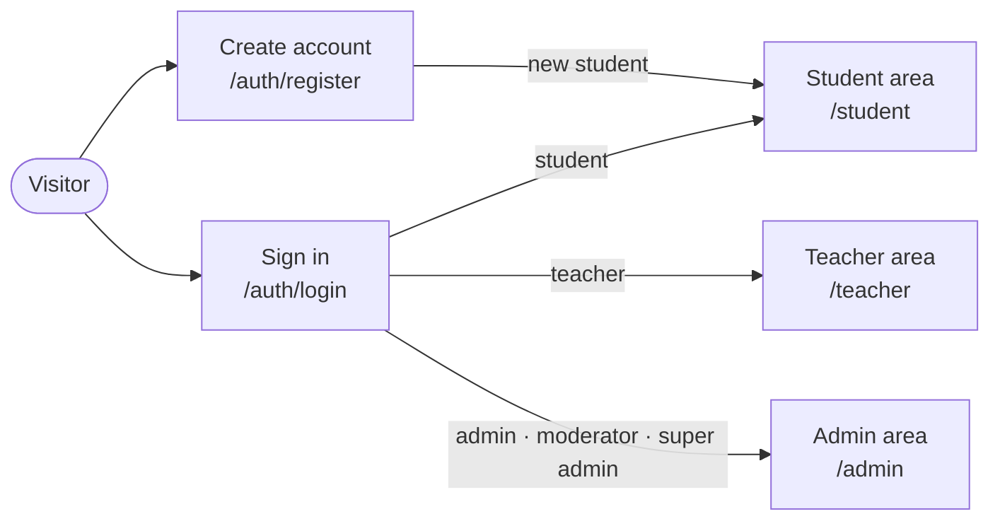

# Frontend features (Next.js)

Plain-language reference for every screen. Endpoints: [backend-features.md](backend-features.md).

## User workflow

## Screens

| Route                                                    | Screen                                                                                                                                  | Who can use it                                                      |
| -------------------------------------------------------- | --------------------------------------------------------------------------------------------------------------------------------------- | ------------------------------------------------------------------- |
| `/auth/login`                                            | Sign in                                                                                                                                 | Visitors who are not signed in                                      |
| `/auth/register`                                         | Create account                                                                                                                          | Visitors who are not signed in                                      |
| `/admin/*`, `/student/*`, `/teacher/*`                   | Signed-in shell (menu, user, sign out)                                                                                                  | The area's roles                                                    |
| `/`                                                      | Home                                                                                                                                    | Everyone                                                            |
| `/teachers`                                              | Our Instructors                                                                                                                         | Everyone                                                            |
| `/pricing`                                               | Choose Your Plan (subscription plans)                                                                                                   | Everyone; only Students can subscribe                               |
| `/courses`                                               | Course catalog (search, filters, pages)                                                                                                 | Everyone                                                            |
| `/free-courses`                                          | Free courses by course type                                                                                                             | Everyone                                                            |
| `/courses/[id]`                                          | Course page (details, previews, enrolment)                                                                                              | Everyone; actions depend on the role                                |
| `/student/dashboard`                                     | Student dashboard                                                                                                                       | Students                                                            |
| `/student/courses`                                       | My Courses                                                                                                                              | Students                                                            |
| `/admin/profile`, `/student/profile`, `/teacher/profile` | My Profile                                                                                                                              | Everyone signed in (each in their own area)                         |
| `/admin/categories`                                      | Course setup: categories                                                                                                                | Super Admin, Admin                                                  |
| `/admin/course-types`                                    | Course setup: course types                                                                                                              | Super Admin, Admin                                                  |
| `/admin/homepage-showcase`                               | Homepage showcase (logo + slider)                                                                                                       | Super Admin, Admin                                                  |
| `/admin/courses`                                         | Courses (staff list, filters, bulk edit)                                                                                                | Super Admin, Admin; Moderator (published courses, no manager tools) |
| `/admin/courses/[id]`                                    | Course details (staff view of the course page)                                                                                          | Super Admin, Admin, Moderator                                       |
| `/admin/enrollments/[courseId]`                          | Course enrolments (students, revenue, CSV export)                                                                                       | Super Admin, Admin; Moderator (students + CSV only)                 |
| `/admin/courses/create`                                  | Create a new course (details, cover, learning content) as a Draft                                                                       | Super Admin, Admin                                                  |
| `/admin/courses/[id]/edit`                               | Edit a course: details, cover, learning content, curriculum, live classes, quiz banks; publish                                          | Super Admin, Admin                                                  |
| `/student/courses/[courseId]/learn`                      | The course player: video lectures, live classes, announcements, study materials, Q&A and quiz practice (full screen, no sidebar)        | Student (enrolled, or with an active plan that covers the course)   |
| `/teacher/courses/[courseId]/learn`                      | The same player inside the teacher area; the teacher can also post announcements, study materials and live classes and see the students | Teacher of the course                                               |
| `/admin/courses/[id]/learn`                              | The same player inside the admin area; staff manage the course content and can download the student list                                | Super Admin, Admin, Moderator                                       |
| `/admin/users`                                           | Find, create, edit, re-role and (Super Admin) delete user accounts                                                                      | Super Admin, Admin                                                  |
| `/admin/teachers`                                        | Manage public teacher profiles and link them to Teacher login accounts                                                                  | Super Admin, Admin                                                  |
| `/admin/subscriptions`                                   | Configure subscription plans; list, assign and cancel member subscriptions                                                              | Super Admin, Admin                                                  |
| `/admin/course-qa`                                       | See unresolved course questions of every course; open each in the course player to answer and resolve it                                | Super Admin, Admin, Moderator                                       |
| `/teacher/courses`                                       | The courses the teacher is assigned to, their enrolled students and the way into each course                                            | Teacher                                                             |
| `/admin/dashboard`                                       | Snapshot of the whole platform: totals, revenue, charts, top courses, newest enrolments                                                 | Super Admin                                                         |
| `/admin/performance`                                     | Revenue and enrolment report for all courses or one course over 7 days, 30 days or lifetime                                             | Super Admin                                                         |
| any unknown address                                      | Page not found                                                                                                                          | Everyone                                                            |
| any page that crashes                                    | Something went wrong                                                                                                                    | Everyone                                                            |

## Screen details

### Sign in

**Route:** `/auth/login` · **Menu:** none (public)

**Who can use it:** visitors who are not signed in. A signed-in user who opens it is sent to their home page.

**What it is for:** signing in with email and password.

**How to use it:**

1. Enter the email and password and press **Sign in**. Empty fields show "This field is required"; a badly
   formed email shows "Enter a valid email address" (nothing is sent to the server).
2. A wrong email or password shows the server's message ("Invalid credentials") above the form.
3. On success a toast says "Logged in successfully" and the app opens the page that asked for sign-in
   (`?next=`, only same-site pages the role may open) or the role's home page: Super Admin
   `/admin/dashboard`, Admin and Moderator `/admin/courses`, Teacher `/teacher/courses`, Student
   `/student/dashboard`.
4. "Create an account" opens the register page.

**On mobile:** the card fills the screen width; the illustrated left panel and the corner art are hidden.

**API endpoints used:** `GET /api/auth/me`, `POST /api/auth/login`.

**Code:** `frontend/src/app/auth/login/page.tsx`, `frontend/src/components/auth/` (`LoginForm`, `GuestGate`,
`AuthLayout`), `frontend/src/api/auth.api.ts`, `frontend/src/utils/safe-redirect.ts`.

**Tests:** `components/auth/__tests__/LoginForm.test.tsx`, `GuestGate.test.tsx`,
`utils/__tests__/safe-redirect.test.ts`; Playwright `frontend/e2e/auth.spec.ts` (desktop + mobile).

### Create account

**Route:** `/auth/register` · **Menu:** none (public)

**Who can use it:** visitors who are not signed in. The new account is always a Student.

**What it is for:** a student signs up and is signed in at once.

**How to use it:**

1. Enter full name, email and a password of at least 6 characters, then press **Create account**.
2. An email that already has an account shows "Email is already registered".
3. On success a toast says "Account created successfully" and the student dashboard opens.

**On mobile:** same as Sign in.

**API endpoints used:** `GET /api/auth/me`, `POST /api/auth/register`.

**Code:** `frontend/src/app/auth/register/page.tsx`, `frontend/src/components/auth/RegisterForm.tsx`.

**Tests:** `components/auth/__tests__/RegisterForm.test.tsx`; Playwright `frontend/e2e/auth.spec.ts`.

### Signed-in shell (admin, student, teacher)

**Route:** every page under `/admin`, `/student` and `/teacher` · **Menu:** the sidebar itself

**Who can use it:** `/admin`: Super Admin, Admin, Moderator (`/admin/dashboard`: Super Admin only, others
are sent to `/admin/courses`); `/student`: Students; `/teacher`: Teachers. Visitors who are not signed in
are sent to `/auth/login?next=<page>`; other roles are sent to their own home page.

**What it is for:** the frame around every signed-in page: the menu of the area, the signed-in user and the
sign-out button.

**How to use it:**

1. The menu shows only the items the role may open (for example, Moderators do not see Dashboard, Teachers,
   User List, Subscriptions or Performance; Performance appears under "Analytics" for Super Admins).
2. The current page is highlighted. On desktop the arrow button collapses the menu to icons (tooltips show
   the names); course create/edit and course player pages start collapsed.
3. **Logout** signs out and opens `/auth/login`. If the server cannot be reached, the user stays signed in and
   sees "Could not sign out".

**On mobile:** a top bar with a menu button replaces the sidebar; the menu slides in as a drawer and closes
after choosing a page.

**API endpoints used:** `GET /api/auth/me`, `POST /api/auth/logout`.

**Code:** `frontend/src/app/{admin,student/(shell),teacher}/layout.tsx`, `frontend/src/components/layout/`
(`AppShell`, `SidebarContent`, `nav-items.ts`), `frontend/src/components/permissions/RequireRole.tsx`,
`frontend/src/proxy.ts`.

**Tests:** `components/layout/__tests__/SidebarContent.test.tsx`,
`components/permissions/__tests__/RequireRole.test.tsx`, `src/__tests__/proxy.test.ts`; Playwright
`frontend/e2e/shell.spec.ts` and the access rules in `auth.spec.ts`.

### Public site frame (discount banner, navbar, footer)

**Route:** every page under `frontend/src/app/(public)/` (home, catalog, course page, teachers, pricing, and
later practice quiz and community hub) · **Menu:** the public navbar

**Who can use it:** everyone, signed in or not.

**What it is for:** the common top and bottom of the public site.

**How to use it:**

1. **Discount banner** (red, above the navbar): shown only while a course discount runs. It says "Up to N% off",
   how many courses are in the offer, and counts down to the end ("ENDS IN 1d 4h 3m 2s", every second). It
   hides itself when the time is up. "View discounted courses" opens `/courses`.
2. **Navbar** (sticks to the top): the site logo uploaded by admins on the Homepage Showcase page (or the
   MedhaBee name when there is none) links home. The search box opens the catalog with the text
   (`/courses?search=...`) and shows the catalog's current search when you are on `/courses`.
3. Links: All Courses, Free Courses, Pricing, Teachers, Practice Quiz, Community Hub. The current page is
   highlighted.
4. Visitors see **Sign In** and **Sign Up**. A signed-in user sees **Dashboard** (their role's home page: Super
   Admin `/admin/dashboard`, Admin and Moderator `/admin/courses`, Teacher `/teacher/courses`, Student
   `/student/dashboard`) and their initial in a round avatar (name on hover).
5. **Footer:** app name, links to Courses, Free Courses, Teachers, Pricing, and the copyright line.

**On mobile:** below 1200 px the links move into a menu drawer opened with the menu button ("Open site menu")
on the right; the drawer also holds Dashboard or Sign In / Sign Up. On phones narrower than 600 px the navbar
shows only the logo icon, the search box, the avatar (when signed in) and the menu button. The banner wraps
onto several lines. Every button is at least 44 px high.

**API endpoints used:** `GET /api/auth/me`, `GET /api/home-hero-posts/logo/public`,
`GET /api/courses/discounts/active`.

**Code:** `frontend/src/app/(public)/layout.tsx`, `frontend/src/components/public/PublicLayout.tsx`,
`frontend/src/components/public/layout/` (`PublicNavbar`, `NavSearch`, `NavAuthActions`, `NavDrawer`,
`SiteLogo`, `DiscountBanner`, `DiscountCountdown`, `PublicFooter`), `frontend/src/api/public.api.ts`,
`frontend/src/schemas/public.schema.ts`.

**Tests:** `components/public/__tests__/PublicLayout.test.tsx`; Playwright `frontend/e2e/public.spec.ts`
(desktop + mobile).

### Home

**Route:** `/` · **Menu:** the logo in the public navbar

**Who can use it:** everyone.

**What it is for:** the landing page: showcase images, subjects, popular courses, the learning formats, the
learning paths and the teachers.

**How to use it:**

1. **Showcase slider:** the public images admins put on the Homepage Showcase page, one after another every
   5 seconds. Arrows and dots switch images by hand. The slider holds still while the mouse is over it or a
   control in it has keyboard focus; the pause/play button stops it for good. For people who turn off
   animations (prefers-reduced-motion) it starts paused. Without images a blue banner is shown.
2. **Explore by Category:** one tile per category. A tile opens the catalog filtered by that category
   (`/courses?categories=<id>`). "View all courses" opens `/courses`.
3. **Popular Courses:** the newest public courses, 8 per page, with page buttons underneath. Each card shows the
   cover, course type, title, teachers, price (struck-through list price and "N% off" while a discount runs,
   or "Free") and category, and opens the course page. A signed-in Student also sees **Continue Learning** on
   courses they are enrolled in (opens the course player). Filters and search are on `/courses`.
4. **Complete learning ecosystem:** a dark band with the learning formats and an animated 3D scene.
5. **Learn what matches your ambition:** one card per course type ("Path 1", "Path 2", …) that opens the
   catalog filtered by it (`/courses?courseTypes=<id>`).
6. **Our Instructors:** two rows of teacher cards scrolling in opposite directions (they pause on hover and stand
   still for people who turn off animations), with a link to `/teachers`.

**On mobile:** one card per row (two on tablets); the slider is 320 px high; the 3D scene is 300 px high and
its three labels stack; the teacher rows still scroll sideways inside their band without making the page
scroll sideways.

**API endpoints used:** `GET /api/home-hero-posts/public`, `GET /api/categories`, `GET /api/course-types`,
`GET /api/courses/browse?page&limit=8`, `GET /api/teachers`, `GET /api/enrollments` (signed-in Students only).

**Code:** `frontend/src/app/(public)/page.tsx`, `frontend/src/components/public/home/` (`HomePage`,
`HomeHeroSlider`, `HeroSliderControls`, `HomeCategoryGrid`, `CategoryCard`, `HomeCourses`, `EcosystemBand`,
`EcosystemVisual`, `ThreeLearningScene` + `three-scene.ts` loaded with `next/dynamic` (browser only),
`CourseTypePaths`, `CourseTypeCard`, `TeacherMarqueeSection`, `TeacherMarqueeRow`, `TeacherMarqueeCard`),
`frontend/src/components/public/common/` (`CourseGrid`, `CourseCard`, helpers), the shared card parts in
`frontend/src/components/course-card/`, `frontend/src/api/catalog.api.ts` (categories, course types, enrolments).

**Tests:** `components/public/__tests__/HomePage.test.tsx`, `public-utils.test.ts`; Playwright
`frontend/e2e/public.spec.ts`.

### Our Instructors

**Route:** `/teachers` · **Menu:** Teachers (public navbar)

**Who can use it:** everyone.

**What it is for:** meet every teacher.

**How to use it:**

1. The page lists every teacher profile: photo (or initial), name, up to four subjects ("+N" for more), a short
   bio and links to Twitter, LinkedIn, website and YouTube when the teacher has them (opened in a new tab; only
   normal web addresses are shown).
2. "No teachers found." when there are none; an error message with **Try again** when the list cannot load.

**On mobile:** one card per row (two on tablets, four on wide screens).

**API endpoints used:** `GET /api/teachers`.

**Code:** `frontend/src/app/(public)/teachers/page.tsx`, `frontend/src/components/public/teachers/`
(`PublicTeachersPage`, `TeacherProfileCard`, `TeacherAvatar`, `ExpertiseChips`, `TeacherSocialLinks`).

**Tests:** `components/public/__tests__/PublicTeachersPage.test.tsx`; Playwright `frontend/e2e/public.spec.ts`.

### Choose Your Plan (pricing)

**Route:** `/pricing` · **Menu:** Pricing (public navbar)

**Who can use it:** everyone can look; only Students can subscribe (same rule as the server).

**What it is for:** compare subscription plans and subscribe. There is no payment gateway yet: subscribing
activates the plan at once and the server takes the price from the plan, never from the browser.

**How to use it:**

1. When plans offer more than one billing period, a switch (Monthly / 3 months / 6 months / Yearly …) chooses
   the period; monthly is chosen first when offered.
2. Each plan card shows its badge, name, the price for that period ("BDT 4,800 for 12 months"), the saving
   against paying monthly ("Save BDT 1,200 (20%)", "BDT 400/mo equivalent"), how many courses are included,
   and its features. A plan without the chosen period says "Not available".
3. **View Included Courses (N)** opens a dialog with the plan's courses, a search box and Category, Course type
   and Pricing filters. "Clear filters" resets them.
4. Visitors see **Get Started** (and "Already have an account?" under the plans): it opens sign-in and comes back
   to `/pricing` afterwards.
5. A Student presses **Subscribe**; a toast says "Subscribed to <plan> plan!". The header then shows "Current
   plan: <plan> - Expires <date>" and that card shows "Current Plan" and a disabled **Active Plan** button.
   With a running plan, the other cards offer **Switch Plan** (or **Switch Billing** for another period of the
   same plan); switching cancels the old subscription on the server.
6. Signed-in staff and teachers see "Only students can subscribe to plans" instead of a button.

**On mobile:** one plan per row (two on tablets); the period switch wraps; the included-courses dialog is full
screen with the filters stacked above the courses.

**API endpoints used:** `GET /api/subscription-plans`, `GET /api/subscriptions/my` (Students),
`POST /api/subscriptions/subscribe` (`{ plan, billingDuration }`), `GET /api/courses/browse?subscriptionPlans=…`
(dialog), `GET /api/categories`, `GET /api/course-types`, `GET /api/enrollments` (Students).

**Code:** `frontend/src/app/(public)/pricing/page.tsx`, `frontend/src/components/public/pricing/`
(`PricingPage`, `PricingHero`, `BillingToggle`, `PlanCard`, `PlanCardContent`, `PlanPrice`, `PlanFeatures`,
`PlanAction`, `PlanCoursesModal`, `PlanCoursesFilters`, `PlanCoursesResults`, `GuestSignInBox`,
`pricing.utils.ts`), `frontend/src/hooks/usePublicSubscribe.ts`, `frontend/src/hooks/useDebouncedValue.ts`,
`frontend/src/components/common/FilterSelect.tsx`.

**Tests:** `components/public/__tests__/PricingPage.test.tsx`, `public-utils.test.ts`; Playwright
`frontend/e2e/public.spec.ts` (guest is sent to sign in, a new Student subscribes).

### Course catalog (`/courses`)

- **Route:** `/courses` (inside the public layout: navbar + footer).
- **Who can use it:** everyone. A signed-in Student also sees "Go to this course" on courses they are enrolled in.
- **What it is for:** finding a course among all Published + Public courses.
- **Step by step:**
  1. The page shows "All Courses" and how many courses match ("12 courses found").
  2. Type in **Search** (the list updates shortly after you stop typing), tick course types, categories,
     Free / Paid, or subscription plans. Each option shows how many public courses it has.
  3. The filters and the page number are kept in the address bar with the backend's own names, so a link can
     be shared or bookmarked: `?search=react&categories=<id>,<id>&courseTypes=<id>&pricing=Free&subscriptionPlans=Premium&page=2`.
     The public navbar search and the home page tiles link here the same way.
  4. "N active" (in the filter panel) or "Clear filters" (when nothing matches) removes every filter.
  5. Click a card to open the course page. On a computer, hovering a card shows a preview (summary, what you
     will learn, plans that include it, "View Details").
  6. 12 courses per page; the page buttons are under the cards.
- **Mobile behaviour:** one card per row on phones, two on tablets, three or four on desktop. The filter
  sidebar becomes a **Filters** button (with the number of active filters) that opens a drawer; "Show courses
  (N)" closes it. No hover preview on touch screens.
- **API endpoints used:** `GET /api/courses/browse` (filters, `page`, `limit=12`, `filterCounts`),
  `GET /api/categories`, `GET /api/course-types`, `GET /api/subscription-plans`, and for Students
  `GET /api/enrollments` (their course ids).
- **Code:** `frontend/src/app/(public)/courses/page.tsx`, `frontend/src/components/browse/catalog/*`,
  `frontend/src/components/browse/card/*`, `frontend/src/hooks/useBrowseParams.ts`,
  `frontend/src/api/browse.api.ts`, `frontend/src/api/catalog.api.ts` (categories, course types, plans,
  enrolments), `frontend/src/schemas/browse.schema.ts`, `frontend/src/schemas/catalog.schema.ts`, the shared
  card parts and search box in `frontend/src/components/course-card/`, prices in `frontend/src/utils/price.ts`.
- **Tests:** `frontend/src/components/browse/__tests__/CourseBrowseView.test.tsx`, `e2e/browse.spec.ts`.

### Free courses (`/free-courses`)

- **Route:** `/free-courses`.
- **Who can use it:** everyone (enrolled Students see "Go to this course" on their courses).
- **What it is for:** a quick list of every free public course.
- **Step by step:**
  1. The page shows how many free courses there are.
  2. Courses are grouped by course type (with the type's description); courses without a type come last under
     "Other Free Courses".
  3. Each group shows up to six cards; "See all <type> courses" opens `/courses?courseTypes=<id>&pricing=Free`.
- **Mobile behaviour:** one card per row on phones, two on tablets, three on desktop.
- **API endpoints used:** `GET /api/courses/browse?pricing=Free`, `GET /api/course-types`,
  `GET /api/enrollments` (Students only).
- **Code:** `frontend/src/app/(public)/free-courses/page.tsx`, `frontend/src/components/browse/free/*`.
- **Tests:** `frontend/src/components/browse/__tests__/FreeCoursesView.test.tsx`, `e2e/browse.spec.ts`.

### Course page (`/courses/[id]`)

- **Route:** `/courses/[id]`.
- **Who can use it:** everyone for Published + Public courses. Drafts and private courses answer "Course not
  found." except for staff and the course's teachers (the backend decides).
- **What it is for:** everything about one course and how to get it.
- **Step by step:**
  1. The dark banner shows the breadcrumb, title, subtitle, status, price (with discount), course type,
     "Subscription" and the teachers.
  2. Below: course type and start / end dates, "What you'll learn", "This course includes", **Course content**,
     requirements, "About this course" (rich text, sanitised) and "Your Instructors".
  3. **Course content** has up to three lists, switched with buttons: **Recorded Lectures** (sections with
     lecture count and length; "Expand all sections"), **Live Class** (weekly plan with each class's day and
     time, as the teacher wrote them) and **Quizzes** (free-preview quiz banks, each opening
     `/practice-quiz?courseId=…&bankId=…`).
  4. A lecture marked "Free Preview" with a YouTube video opens the preview player (with the list of every
     other free preview). Locked lectures have no video address for viewers without access.
  5. The card on the right (top on phones) depends on the viewer:
     - **Visitor:** price, "Enroll Free" / "Get Started" (to sign-up) and "Sign In".
     - **Student, not enrolled:** "Enroll Now – Free" / "Buy Now". When the course is part of subscription
       plans there are two choices: **Subscribe and save** (cheapest plan price; "Enroll with Subscription"
       when the student's running plan includes the course, "Upgrade Subscription" when it does not, otherwise
       a link to the plans) or **Buy this course** (always a direct, paid enrolment).
     - **Student, enrolled:** "Go to this course" (`/student/courses/[id]/learn`), the enrolment date and
       "Leave this course" (asks for confirmation).
     - **Super Admin / Admin:** "Edit Course" and "Student View"; **Moderator:** "Student View" only.
     - **Teacher:** the price only.
  6. If the course has a "Course introduction" lecture (or any free preview) on YouTube, the card's picture plays it.
- **Mobile behaviour:** single column; the enrolment card comes right after the banner; the preview player
  opens full screen with the preview list under the video.
- **API endpoints used:** `GET /api/courses/:id`, `GET /api/study-curricula/course/:id` (public fields for
  guests), `GET /api/quiz-bank/public/course/:id`, `GET /api/subscription-plans`; Students:
  `GET /api/enrollments/:courseId/check`, `GET /api/subscriptions/my`, `POST /api/enrollments/:courseId`
  (body `{ enrollmentType: 'paid' }` when buying a paid course directly), `DELETE /api/enrollments/:courseId`.
- **Security:** YouTube is the only embedded site (CSP `frame-src https://www.youtube.com
https://www.youtube-nocookie.com`, thumbnails `img-src https://i.ytimg.com`); videos are embedded from the
  11-character id only, through the privacy-enhanced domain. Cover and teacher pictures are shown only from
  Cloudinary. Rich text goes through `SafeHtml`.
- **Code:** `frontend/src/app/(public)/courses/[id]/page.tsx`, `frontend/src/components/browse/detail/*`
  (`content/` = course content lists, `enrollment/` = the enrolment card), `frontend/src/utils/csp.ts`.
- **Tests:** `frontend/src/components/browse/__tests__/CourseDetailView.test.tsx`,
  `frontend/src/components/browse/__tests__/course-utils.test.ts`, `frontend/src/utils/__tests__/csp.test.ts`,
  `e2e/browse.spec.ts`.

### Student dashboard

**Route:** `/student/dashboard` · **Menu:** Dashboard (student menu)

**Who can use it:** students. It is where a student lands after signing in.

**What it is for:** a quick start: a welcome, how many courses the student is in, the running plan, and the
newest courses to continue.

**How to use it:**

1. The header says "Welcome back, <name>. Continue your courses from the course page."
2. Two cards show the number of **Enrolled courses** and the **Subscription** (plan name and "Expires
   <date>", or "None / No active plan"). A plan whose end date has passed counts as none.
3. Without a running plan a **View Plans** button opens `/pricing`.
4. **Continue learning** lists the four newest enrolments (with "Free course", "Purchased course" or "Enrolled
   with subscription"); a click opens the course player `/student/courses/<id>/learn`. **All my courses**
   opens `/student/courses`. With no enrolments it says "You haven't enrolled in any courses yet." and offers
   **Browse Courses** (`/courses`).
5. Loading shows skeletons; a failed load shows the server message with **Try again**.

**On mobile:** the two cards stack in one column; list rows are at least 56 px high.

**API endpoints used:** `GET /api/auth/me`, `GET /api/enrollments`.

**Code:** `frontend/src/app/student/(shell)/dashboard/page.tsx`, `frontend/src/components/student/`
(`StudentDashboard`, `DashboardStatCard`, `ContinueLearning`), `frontend/src/api/catalog.api.ts`,
`frontend/src/api/profile.api.ts`.

**Tests:** `components/student/__tests__/StudentDashboard.test.tsx`; Playwright `frontend/e2e/student.spec.ts`.

### My Courses

**Route:** `/student/courses` (`?search=` keeps the search box) · **Menu:** My Courses (student menu)

**Who can use it:** students (only their own enrolments).

**What it is for:** every course the student is enrolled in, opening the course player, and leaving a course.

**How to use it:**

1. The courses come in two groups, each with its count: **Free & Paid Courses** and **Enrolled with
   Subscription** (cards with a purple "Subscription" badge). An empty group says "No free or paid courses
   enrolled yet." / "No subscription courses enrolled yet."
2. Each card shows the cover, course type badge, title, teachers, the price ("Free", or the price with the
   struck-through list price and "% off" while a discount runs) and the category. A click opens
   `/student/courses/<id>/learn`.
3. **Search courses...** filters by title as you type; the address (`?search=`) follows once you stop typing; nothing found shows
   `No courses match "<text>".`
4. The bin button on a card ("Remove from my courses") asks "Are you sure you want to remove "<title>" from
   your courses?"; **Remove** deletes the enrolment, shows `Removed from "<title>"` and drops the card.
   An error shows the server message as a toast.
5. No enrolments at all: "You haven't enrolled in any courses yet."

**On mobile:** one card per row (two on tablets, three to four on desktops); the search box is full width; the
remove button is 44 px.

**API endpoints used:** `GET /api/enrollments`, `DELETE /api/enrollments/:courseId`.

**Code:** `frontend/src/app/student/(shell)/courses/page.tsx`, `frontend/src/components/student/`
(`MyCoursesPage`, `EnrolledCourseSection`, `EnrolledCourseCard`, `CourseBadges`, `CourseCardSkeletons`,
`useRemoveEnrollment`, `enrolledCourse.utils.ts`), the shared `CourseCover`, `CourseCardBody`, `CoursePrice`
and `CourseSearchField` in `frontend/src/components/course-card/`, `frontend/src/api/catalog.api.ts`,
`frontend/src/schemas/catalog.schema.ts`, `frontend/src/schemas/student.schema.ts`.

**Tests:** `components/student/__tests__/MyCoursesPage.test.tsx`; Playwright `frontend/e2e/student.spec.ts`.

### My Profile

**Route:** `/admin/profile`, `/student/profile`, `/teacher/profile` · **Menu:** Profile

**Who can use it:** every signed-in user, in their own area (Super Admin, Admin, Moderator under `/admin`).
Only their own account.

**What it is for:** seeing the account, plan and role, and editing name, avatar, community privacy, password
and (students only) email.

**How to use it:**

1. The banner shows the role, avatar (or the first letter in the role's colour), name and what the role is
   for; below are email, role, joined and last-updated dates.
2. Summary cards: **Enrolled courses** (students) or **Assigned courses** (teachers), **Purchased courses**,
   **Subscription** (plan and expiry) and **Profile status** (Complete with an avatar, otherwise Basic).
3. Students also see the **Subscription** card: the running plan with start/expiry dates, the number of
   courses and features of the plan, **Change Plan** (`/pricing`) and **Cancel Subscription** (asks first,
   then "Subscription cancelled"); without a plan "You do not have an active subscription." and **View
   Plans**. Everyone sees **Role details** (role, kind of access, description).
4. **Edit Profile** opens a dialog:
   - **Upload Avatar** (JPG, PNG, WEBP or GIF up to 5MB, checked before upload) shows a preview;
     **Remove** removes the picture.
   - **Name** is required. **Email** can be changed by students only; for other roles it is read-only.
   - **Private community profile** hides the community stats, discussions and answers from others.
   - **Change password**: current password, new password (6-72 characters) and confirmation. Leave empty to
     keep the password. A student who changes the email must also type the current password.
   - **Save Changes** sends only what changed ("Make at least one change before saving." otherwise). Errors
     from the server (wrong current password, email in use) appear above the fields. On success a toast says
     "Profile updated", the dialog closes and the name/avatar update at once (also in the sidebar).
     Changing the password signs out other devices; this browser gets a fresh session cookie.

**On mobile:** cards stack in one column; the dialog is full screen; the two new-password fields stack.

**API endpoints used:** `GET /api/auth/me`, `PUT /api/auth/me` (multipart), `GET /api/enrollments`
(students), `GET /api/teachers/my-courses` (teachers), `GET /api/subscription-plans` and
`DELETE /api/subscriptions/cancel-my` (students with a plan).

**Code:** `frontend/src/app/{admin,student/(shell),teacher}/profile/page.tsx`,
`frontend/src/components/profile/` (`ProfilePage`, `ProfileHero`, `ProfileFacts`, `ProfileStats`,
`SubscriptionCard`, `ActivePlanDetails`, `RoleDetailsCard`, `EditProfileModal`, `AvatarPicker`,
`AvatarUploadButton`, `CommunityPrivacySwitch`, `ProfilePasswordFields`, `useProfileForm`,
`useAvatarChoice`, `profileFormData.ts`), `frontend/src/api/profile.api.ts`, `frontend/src/api/catalog.api.ts`
(plans, enrolments, cancelling the subscription), `frontend/src/api/teacher.api.ts` (a teacher's course count,
the same request as Assigned courses),
`frontend/src/schemas/profile.schema.ts`.

**Tests:** `components/profile/__tests__/ProfilePage.test.tsx`, `EditProfileModal.test.tsx`; Playwright
`frontend/e2e/profile.spec.ts` (desktop + mobile).

### Course setup (categories and course types)

**Route:** `/admin/categories` (Categories tab) and `/admin/course-types` (Course Types tab) · **Menu:**
"Course Setup" (opens the Categories tab)

**Who can use it:** Super Admin and Admin. A Moderator (or any other role) who opens the address is sent to
their own home page; the backend refuses their requests too (403).

**What it is for:** keeping the two short lists that courses are filed under: categories (subject areas)
and course types (live course, recorded course, seminar, ...). The public catalog filters use them.

**How to use it:**

1. Pick a tab: **Categories** or **Course Types**. Each tab has its own address, so it can be bookmarked.
2. The list shows each item's name, slug (made by the server from the name) and description, plus how many
   items there are.
3. **Add Category** / **Add Course Type** opens a form: name (required, must contain letters or numbers) and
   an optional description. **Save** creates it; a toast confirms it. A name that clashes with an existing
   one shows the server's message in the form.
4. The row menu (⋮) has **Edit** (same form, filled in; **Update** saves) and **Delete** (asks "Delete
   "<name>"? This cannot be undone." first).
5. An item that courses still use cannot be deleted: the server's message is shown as a toast, for example
   "Category is used by 3 course(s)".

**On mobile:** the tabs fill the width; each item is a card (name, slug, description, ⋮ menu) instead of a
table row; the form opens full screen.

**API endpoints used:** `GET/POST /api/categories`, `PUT/DELETE /api/categories/:id`,
`GET/POST /api/course-types`, `PUT/DELETE /api/course-types/:id`.

**Code:** `frontend/src/app/admin/categories/page.tsx`, `frontend/src/app/admin/course-types/page.tsx`,
`frontend/src/components/setup/` (`CourseSetupPage`, `SetupTabs`, `SetupManager`, `SetupManagerHeader`,
`SetupItemFormModal`, `SetupRowMenu`, `useSetupColumns`), `frontend/src/api/setup.api.ts` (the list is the
shared read in `frontend/src/api/catalog.api.ts`, so a save also refreshes the public pages),
`frontend/src/schemas/setup.schema.ts`.

**Tests:** `components/setup/__tests__/CourseSetupPage.test.tsx` (list, empty, error, create, validation,
duplicate error, edit, delete, in-use delete refused, course types tab, Moderator sent away); Playwright
`frontend/e2e/setup.spec.ts` (desktop + mobile: add/edit/delete a category, add a course type from the tab,
Moderator blocked).

### Homepage showcase

**Route:** `/admin/homepage-showcase` · **Menu:** "Homepage Showcase"

**Who can use it:** Super Admin and Admin (others are sent to their home page; the backend answers 403).

**What it is for:** managing the public site logo and the wide banner images of the homepage slider: upload,
show or hide, schedule, reorder and delete.

**How to use it:**

1. **Site logo:** the current logo is shown (or "No logo uploaded yet."). **Choose logo image** picks a PNG,
   JPEG, GIF or WEBP file up to 5 MB; its name and size appear. **Save Logo** (or **Update Logo** when one
   exists) uploads it and replaces the old one. A wrong file type or a file over 5 MB is refused at once with
   a message, before anything is sent.
2. **Header slider images:** every image is listed in slider order with its position (#1, #2, ...),
   visibility (Public / Private), a "Scheduled to ..." chip when a change is pending, its size in pixels and
   when it publishes ("Publishes immediately when public", "Publishes <date>" or "Changes to Public
   <date>", in your own time zone).
3. **Upload Images** opens a form: choose one or more images (up to 10, each PNG/JPEG/GIF/WEBP up to 5 MB),
   visibility, an optional publish date and time (a future date keeps the image as it is until then, then
   applies the chosen visibility), and a position (lower numbers come first; it starts after the last image).
   **Upload** is enabled once at least one valid image is chosen.
4. Change the order by dragging an image by its handle (⋮⋮), or with **Move Up** / **Move Down** in its menu.
   The new order shows at once and is saved; if saving fails, the old order comes back and an error toast is
   shown. Keyboard: focus the handle, press space, move with the arrow keys, press space again.
5. The image menu (⋮) also has **View Details** (large preview with visibility, size, position and schedule;
   clicking the thumbnail does the same), **Edit** (replace the image, change visibility, date or position;
   clearing the date applies the visibility now), **Make Public** / **Make Private** (applies at once and
   cancels a pending schedule) and **Delete** (asks first).
6. Server errors (for example "Only image files are allowed" for a file whose content is not a real image)
   are shown in the form or as a toast.

**On mobile:** the logo preview sits above the logo controls; each slider image is a card with the full-width
banner on top and the handle, details and menu below; dialogs open full screen.

**API endpoints used:** `GET/PUT /api/home-hero-posts/logo`, `GET/POST /api/home-hero-posts`,
`PUT/DELETE /api/home-hero-posts/:id`, `PATCH /api/home-hero-posts/reorder`.

**Code:** `frontend/src/app/admin/homepage-showcase/page.tsx`, `frontend/src/components/showcase/`
(`HomepageShowcasePage`, `SiteLogoPanel`, `LogoPreview`, `LogoPicker`, `HeroPostsPanel`,
`HeroPostSortableList` (drag and drop, loaded with `next/dynamic`), `HeroPostRow`, `HeroPostThumbnail`,
`HeroPostMenu`, `HeroPostFormModal`, `HeroPostFormFields`, `HeroFilePicker`, `HeroPostDetailsModal`,
`useHeroPostActions`, `useHeroText`, `useImageFiles`, `hero-form.ts`, `hero-schedule.ts`, `image-files.ts`,
`common/`), `frontend/src/api/showcase.api.ts`, `frontend/src/schemas/showcase.schema.ts`.

**Tests:** `components/showcase/__tests__/HomepageShowcasePage.test.tsx` (logo + list with details, empty
states, list error, logo upload, wrong logo type refused, multi-image upload body, upload refused by the
server, edit, make public, move down (reorder body), Move Up disabled on the first image, delete, details
dialog, Moderator sent away); Playwright `frontend/e2e/showcase.spec.ts` (desktop + mobile: page sections,
non-image file refused in the upload dialog, Moderator blocked). Real uploads are not run end to end because
the e2e stack has no Cloudinary account.

### Courses (staff list)

**Route:** `/admin/courses` · **Menu:** "Courses" (the landing page of Admin and Moderator)

**Who can use it:** Super Admin, Admin and Moderator. Super Admin and Admin get every course (drafts and
private courses too) with this month's figures and the manager tools. A Moderator sees published courses only
(as in the old client) and no manager tools; the backend refuses status, delete and bulk changes from them (403).

**What it is for:** finding a course and acting on it: open its details, its enrolments, the course player
(student view) or the editor; publish or unpublish it; delete it; change many courses at once.

**How to use it:**

1. The page lists the courses as cards: cover with the course type badge, title (opens the course details),
   subtitle, status ("Published • date" or "Draft"), price, category, visibility, "Subscription" when the
   course is part of the subscription, and its teachers.
2. Super Admin / Admin cards also show **Earned this month** and **Enrollments this month**; both open the
   course's enrolments page.
3. **Filter courses** shows how many courses match. **Show filters** opens: search, course type, category,
   teacher, status (not for Moderators), pricing, visibility, subscription plan, enrolment activity (has / no
   students ever, this month, previous month) and earning activity (same choices). Filters are kept in the
   address (`?search=...&status=...`), so reloading or sharing the link keeps them. **Clear filters** resets all.
4. Card buttons: **Student view** (eye, opens `/admin/courses/[id]/learn`) and **Edit course** (pencil, opens
   `/admin/courses/[id]/edit`) for Super Admin / Admin; a **View** button (student view) for Moderators.
5. The ⋮ menu: **View details**, **Enrollments**, and for Super Admin / Admin **Publish** / **Unpublish**
   (unpublishing asks first) and **Delete** (asks "Delete "<title>"? This cannot be undone."). A course that
   has enrolments cannot be deleted: the server's message ("This course has N enrolment(s); unpublish it
   instead of deleting") is shown as a toast.
6. **Create Course** opens `/admin/courses/create`.
7. **Bulk Edit** (Super Admin / Admin) opens a dialog. Left: search and filters (status, visibility, pricing,
   category, course type), **Select all**, and a checkbox per course of the list. Right, three tabs:
   - **Update Fields**: course type (or "Clear course type"), category, status, visibility, pricing (+ price
     for Paid), subscription (include + allowed plans; sent only when touched), teachers (replace), start and
     end date. Every field starts at "No change"; only filled fields are sent.
   - **Discount Campaign**: a percentage (1 to 99) off each selected course's list price until a future date
     and time (entered in your own time zone).
   - **Post Announcement**: one announcement (title + rich text, the same editor as the course player)
     posted to every selected course.
     **Apply to N courses** sends it; a toast confirms ("Updated N courses", "Discount applied to N courses")
     or shows the reason (missing selection, invalid price or percentage, server message).

**On mobile:** cards stack one per row and hide the cover; the filters are one column; the bulk dialog opens
full screen with the course picker on top of the tabs; every button is at least 44 px high.

**API endpoints used:** `GET /api/courses` (staff view with filters and `enrollmentStats`),
`PATCH /api/courses/:id/status`, `DELETE /api/courses/:id`, `PATCH /api/courses/bulk`,
`PATCH /api/courses/bulk/discount`; dropdowns: `GET /api/categories`, `GET /api/course-types`,
`GET /api/teachers`, `GET /api/subscription-plans`.

**Code:** `frontend/src/app/admin/courses/page.tsx`, `frontend/src/components/admin-courses/list/`
(`AdminCoursesPage` (Suspense), `AdminCoursesView`, `CourseFilterPanel`, `CourseFilterFields`,
`FilterStatusChips`, `course-filters.ts`, `AdminCourseList`, `AdminCourseCard`,
`CourseCardHeading`, `CourseCardChips`, `CourseCardStats`, `CourseStatBox`, `CourseCardFooter`,
`ManagerCourseButtons`, `CourseCardMenu`, `CourseListActions`, `useCourseActions`, `useReferenceOptions`),
`frontend/src/components/admin-courses/bulk/` (`BulkEditModal`, `BulkCourseSelector`, `SelectAllBar`,
`BulkCourseRow`, `BulkEditPanel`, `BulkFieldsForm`, `BulkChoiceFields`, `BulkSubscriptionField`,
`BulkTeachersField`, `BulkDateFields`, `BulkDiscountForm`, `BulkAnnouncementForm`, `bulk-form.ts`,
`useBulkEdit`, `useBulkSelection`), shared `components/common/FilterSelect.tsx`,
`components/common/rich-text/`, `components/course-fields/` (`PlanMultiSelect`, `TeacherMultiSelect`, also
used by the course editor), `frontend/src/api/admin-courses.api.ts` (lists refreshed through
`api/course-cache.ts`), `frontend/src/schemas/admin-courses.schema.ts`.

**Tests:** `components/admin-courses/__tests__/AdminCoursesView.test.tsx` (manager list, URL filters,
Moderator view, empty, error, publish, unpublish with confirm, delete refused with the server message,
delete), `BulkEditModal.test.tsx` (picker filters + select all, field update, validation messages, discount
campaign with server error), `bulk-form.test.ts` (request building rules); Playwright
`frontend/e2e/admin-courses.spec.ts` (desktop + mobile).

### Course details (staff)

**Route:** `/admin/courses/[id]`

**Who can use it:** Super Admin, Admin and Moderator.

**What it is for:** seeing a course exactly as its public page looks, including drafts and private courses
(the backend shows them to staff).

**How to use it:** **Back to Courses** returns to the list. The page is the public course page
(`/courses/[id]`): hero, outline with free previews, live class plan, quizzes, description, teachers. The
side card shows **Edit course** (Super Admin / Admin) and **Student view** (all staff) instead of the
enrolment options. An unknown id shows "Course not found".

**On mobile:** same as the public course page (side card first, sections stacked).

**API endpoints used:** `GET /api/courses/:id`, `GET /api/study-curricula/course/:id`,
`GET /api/quiz-bank/public/course/:id`.

**Code:** `frontend/src/app/admin/courses/[id]/page.tsx`,
`frontend/src/components/admin-courses/detail/AdminCourseDetail.tsx` (reuses
`components/browse/detail/CourseDetailView`).

**Tests:** covered by `components/browse/__tests__/CourseDetailView.test.tsx` (staff actions) and the
Moderator flow in `frontend/e2e/admin-courses.spec.ts`.

### Course enrolments

**Route:** `/admin/enrollments/[courseId]` (from a course card's figures or the ⋮ menu → **Enrollments**)

**Who can use it:** Super Admin and Admin see everything. A Moderator sees the student list and the CSV
export only (the statistics and revenue endpoints are Super Admin / Admin only on the backend).

**What it is for:** seeing who joined a course, how (free, paid, subscription), and what it earned.

**How to use it:**

1. **Back to Courses** returns to the list. The header shows the cover, title, current price (with the
   discount when one runs) and status, plus **Export CSV**, which downloads the names and emails of every
   enrolled student (`course-<id>-students.csv`).
2. Super Admin / Admin: a strip of figures: total students, free, paid, subscription, this month, lifetime
   earned (BDT).
3. **Students** view: "Enrolled Students" with tabs All / Free / Paid / Subscription; each row shows the
   student (avatar + name, or "Deleted account"), email, type, enrolment date and time (your own time zone)
   and the enrolment id.
4. **Revenue** view (Super Admin / Admin): every paid enrolment with list price, discount, amount paid, date
   and id, and the total paid.
5. A wrong or unknown course id shows "Course not found".

**On mobile:** the figures are two per row; each student / payment is a card instead of a table row (the
enrolment id is left out); the tabs scroll sideways if needed.

**API endpoints used:** `GET /api/courses/:id`, `GET /api/enrollments/course/:courseId/students`,
`GET /api/enrollments/course/:courseId/students/export` (plain same-origin download link; the session
cookie goes with it), `GET /api/enrollments/admin/course/:courseId/stats`,
`GET /api/enrollments/admin/course/:courseId?type=paid`.

**Code:** `frontend/src/app/admin/enrollments/[courseId]/page.tsx`,
`frontend/src/components/admin-courses/enrollments/` (`AdminEnrollmentsPage`, `EnrollmentCourseHeader`,
`EnrollmentStatsStrip`, `StatPill`, `EnrollmentViewTabs`, `EnrolledStudentsPanel`, `RevenuePanel`,
`useEnrollmentColumns` (revenue)), `components/admin-courses/BackToCoursesButton.tsx`; the student list is shared
with the course player and the teacher dialog: `components/enrollments/` (`useCourseStudentColumns`,
`StudentCell`, `enrollment-display.ts`), `frontend/src/api/enrollment.api.ts`, `schemas/enrollment.schema.ts`.

**Tests:** `components/admin-courses/__tests__/AdminEnrollmentsPage.test.tsx` (Admin view with stats,
students and export link, type filter, revenue view, Moderator view, error with retry, empty, bad id);
Playwright `frontend/e2e/admin-courses.spec.ts` (a student enrols through the API, the Admin sees them, the
course then cannot be deleted).

### Course editor (create and edit a course)

**Route:** `/admin/courses/create` and `/admin/courses/[id]/edit` · **Menu:** none (opened from the course list)

**Who can use it:** Super Admin and Admin (the backend's course write routes). Moderators and other roles are
sent to their home page (a Moderator lands on `/admin/courses`).

**What it is for:** build a course from start to finish: its details, cover image, description and lists,
the outline (sections and lectures), weekly live classes and the quiz banks, then publish it.

**How to use it:**

1. The page has a menu with six tabs: **Basic Info**, **Media**, **Learning Content**, **Curriculum**,
   **Live Class**, **Quiz Bank**. The header shows the title, the Draft / Published chip (with "Published on
   ..."), **Preview** (draft) or **View Live** (published; opens `/courses/<id>` in a new tab), **Save Draft**
   and **Publish**.
2. **Basic Info:** title, subtitle, category and course type (a new course starts with the first of each),
   optional start and end date (the end cannot be before the start), teachers (pick from the list, remove a
   chip), visibility (Public / Private), pricing (Free / Paid). Paid shows **List Price** (required) and
   **Discount Price** (the buying price; empty = the list price; it cannot be above the list price) with the
   "% off" chip. **Included in Subscription** shows the plans to tick.
3. **Media:** upload a PNG, JPEG, GIF or WEBP cover up to 5 MB (other files are refused with a message). On a
   new course it is uploaded with the first save; on an existing course it is uploaded at once and replaces
   the old cover.
4. **Learning Content:** the description in the rich text editor (bold, italic, underline, headings, lists,
   alignment) and three lists (what students will learn, what they will get, requirements): type an item and
   press Enter or **+**, edit items in place, remove with **x**.
5. **Creating:** on `/admin/courses/create` press **Save Draft** (or **Publish**). The course is created as a
   Draft (with a title "Untitled Course" if none was typed), gets an "Introduction" section with a free-preview
   "Course Introduction" lecture (as before), and the edit page opens. If the course was created but a later
   step failed (description and lists, the Introduction section, publishing), the edit page still opens with
   a warning to check and save again, so a second try never creates a second course. Curriculum, Live Class
   and Quiz Bank say "Save the course first" until then.
6. **Editing:** every change in the details is saved automatically about a second after the last edit; the
   menu shows "Auto saving..." and "Last saved <time>". **Save Draft** saves and sets the course to Draft;
   **Publish** saves and publishes (both need a category and a course type).
7. **Curriculum:** sections with their lectures. **Add Section**, rename and delete (with confirmation) a
   section; **Add Lecture** (title, YouTube address, Free Preview switch), edit and delete a lecture. Drag a
   section or a lecture by its handle to change the order (keyboard: space, arrows, space); lectures move only
   inside their own section. The new order shows at once; if saving it fails the real order comes back.
8. **Live Class:** weekly plans. **Add Week** opens a form: title, week name, rich text description and one or
   more classes (title, date, time, description; **Add Class** / **Remove Class**). Each week card shows its
   classes with date and time, a "⋮" menu (Edit, Delete with confirmation) and **Add Class** (opens the week
   with an empty class at the end).
9. **Quiz Bank:** quiz sections with their banks on the left. **+** adds a section; each section has a
   **Free** switch (free preview), a "⋮" menu (Rename, Delete: also deletes its banks) and **Add Quiz Bank**
   (title, description). Each bank has its own Free switch and "⋮" menu (Edit, Delete: also deletes student
   attempts). Click a bank to open it on the right: **Edit Bank**, **Add Question** (question, 4 options with
   optional explanations, tick every correct option: at least one) and its questions with the correct answers
   in green; each question can be edited or deleted. Students taking quizzes is a different screen (course
   player).

**On mobile:** the tab menu becomes a scrollable tab bar above the content; forms are one column; dialogs are
full screen; all buttons are at least 44 px. In the Quiz Bank tab the list and the open bank take turns, with
**Back to quiz banks**.

**API endpoints used:** `GET /api/auth/me`, `GET /api/courses/:id`, `POST /api/courses`, `PUT /api/courses/:id`
(multipart), `PATCH /api/courses/:id/status`, `GET /api/categories`, `GET /api/course-types`,
`GET /api/teachers`, `GET /api/subscription-plans`, `POST /api/courses/:courseId/sections`,
`PUT|DELETE /api/courses/:courseId/sections/:sectionId`, `PUT /api/courses/:courseId/sections/reorder`,
`POST /api/courses/:courseId/sections/:sectionId/lectures`,
`PUT|DELETE /api/courses/:courseId/sections/:sectionId/lectures/:lectureId`,
`PUT /api/courses/:courseId/sections/:sectionId/lectures/reorder`, `GET|POST /api/study-curricula/course/:courseId`,
`PUT|DELETE /api/study-curricula/:id`, `GET /api/quiz-sections/course/:courseId`, `POST /api/quiz-sections`,
`PUT|DELETE /api/quiz-sections/:id`, `GET /api/quiz-bank/course/:courseId`, `POST /api/quiz-bank`,
`PUT|DELETE /api/quiz-bank/:id`, `POST /api/quiz-bank/:id/questions`, `PUT|DELETE /api/quiz-bank/:id/questions/:qId`.

**Code:** `frontend/src/app/admin/courses/create/page.tsx`, `frontend/src/app/admin/courses/[id]/edit/page.tsx`,
`frontend/src/components/course-editor/` (`CourseEditorPage`, `details/`, `curriculum/`, `live-class/` (tab and
header), `quiz-bank/`), shared `components/live-class/` (week cards and form, also in the course player),
`components/common/rich-text/` (the one TipTap editor, loaded by `next/dynamic`), `components/course-fields/`;
data `frontend/src/api/course-editor.api.ts`, the course from `browse.api.ts` (`useCourse`), `quiz.api.ts`,
`live-class.api.ts`; shapes `frontend/src/schemas/course-editor.schema.ts`, `browse.schema.ts`, `quiz.schema.ts`.

**Tests:** `components/course-editor/__tests__/CourseEditorPage.test.tsx` (create, a failed step after creating
opens the edit page with a warning and no second course, price checks, edit and publish, not found, error,
Moderator kept out),
`components/course-editor/curriculum/__tests__/CurriculumBuilder.test.tsx`,
`components/course-editor/live-class/__tests__/LiveClassTab.test.tsx`,
`components/course-editor/quiz-bank/__tests__/QuizBankTab.test.tsx`; Playwright `frontend/e2e/course-editor.spec.ts`.

### Course player

**Route:** `/student/courses/[courseId]/learn` (no sidebar, as before), `/teacher/courses/[courseId]/learn` and
`/admin/courses/[id]/learn` (inside the area's normal sidebar). The open section is in the address:
`?tab=overview|lectures|live|teacher|announcements|materials|students|qa|quiz`, and `?questionId=<id>` opens one
Q&A question (notification links use this).

**Who can use it:** anyone the server lets read the course content: enrolled students (free or paid
enrolment, or a subscription enrolment while the plan is active and still covers the course), the course's
teachers and Super Admin / Admin / Moderator. Everybody else sees **"Enrol to open this course"** with a
**View course & enrol** link to `/courses/[id]`. An unknown, draft or private course shows **"Course not
found"**.

**What it is for:** learning inside one course, and (for teachers and staff) keeping its content up to date.

**Step-by-step use:**

1. Open a course from **My Courses** (students), **Assigned courses** (teachers) or the admin course list.
2. The page shows a top bar (back arrow to the course list, course title, the lecture that is playing) and the
   section menu.
3. **Video Lectures** (default): the first lecture with a video plays. Pick another lecture in **Course
   Content** (sections open and close like an accordion). Only YouTube videos the server sent are embedded
   (locked lectures have a lock icon and cannot be chosen). The course Q&A is under the video.
4. **Course Overview**: title, subtitle, category, numbers (enrolled students, lectures, total duration,
   sections, announcements, study materials, live classes, Q&A questions, teachers), "What you'll learn",
   requirements and the description.
5. **Live Class**: the weekly plan ("Week 1", "Week 2", ...) with each class's date and time (shown as
   entered) and who posted it. Super Admin, Admin and the course's teachers **Add Week** (title, week name,
   description, one or more classes with title, date and time). The author or a staff admin edits or deletes a
   week from its ⋮ menu or adds one more class with **Add Class** (opens the week with an empty class at the
   end). The same week cards and form as the course editor's Live Class tab.
6. **Teacher**: the course's instructors (photo, name, short bio, expertise).
7. **Announcements**: newest first. Staff admins and the course's teachers **Post Announcement** (title + rich
   text); the author or a staff admin edits or deletes from the ⋮ menu (deleting asks first).
8. **Study Materials**: like announcements, with an optional **Resource Link**. Only `http://` / `https://`
   links are accepted and shown (**Open Resource →** opens a new tab).
9. **Students** (staff and teachers only): enrolled students with enrolment type and date; staff admins also
   see emails and enrolment ids and can **Export CSV**.
10. **Q & A**: filter buttons **Not resolved yet** (default), **All questions**, **Not answered yet** (no
    teacher or staff answer) and **Already resolved**, 8 per page. Everyone **Asks a Question**; open a
    question by its title to read the answers and **Add Answer**. Thumbs-up toggles your upvote. The student
    who asked, teachers and staff admins **Mark solved** / **Mark not solved**. Authors and staff admins edit or
    delete questions and answers.
11. **Quiz Bank**: course progress on top, then the quiz sections with their banks (free-preview ones are
    marked). Each bank has **All**, **Wrong** and **Correct** buttons with progress. Pick one to practise: tick
    one or more options and press **Check Answer**. The server marks the answer; only then the correct options
    turn green, wrong picks red, and the explanations appear. Each question can be answered once; the ↻ button
    resets the bank (asks first) so you can try again. The numbered pager shows answered questions in green
    or red.

**Mobile behaviour:** the section menu becomes a swipeable tab strip under the top bar. The lecture list moves
under the video (side column from 1200 px). Live-class weeks are one column (two from 1200 px). In Quiz Bank
the bank list comes first; after choosing a bank the practice panel replaces it, with **Back to quiz banks**.
Forms open full screen; the student list becomes cards. Buttons are at least 44 px.

**API endpoints used:**

- `GET /api/courses/:id` (outline; video addresses only for viewers with access)
- `GET /api/announcements/course/:courseId` (also the access check: 403 = no access), `POST` same,
  `PUT|DELETE /api/announcements/:id`
- `GET|POST /api/study-materials/course/:courseId`, `PUT|DELETE /api/study-materials/:id`
- `GET|POST /api/study-curricula/course/:courseId`, `PUT|DELETE /api/study-curricula/:id`
- `GET /api/enrollments/course/:courseId/count`, `GET /api/enrollments/course/:courseId/students`,
  `GET /api/enrollments/course/:courseId/students/export` (plain download link, cookie sent by the browser)
- `GET|POST /api/qa/questions/course/:courseId`, `GET|PUT|DELETE /api/qa/questions/:id`,
  `PATCH /api/qa/questions/:id/resolve`, `PATCH /api/qa/questions/:id/upvote`,
  `POST /api/qa/answers/question/:questionId`, `PUT|DELETE /api/qa/answers/:id`, `PATCH /api/qa/answers/:id/upvote`
- `GET /api/quiz-sections/course/:courseId`, `GET /api/quiz-bank/course/:courseId`,
  `GET /api/quiz-bank/course/:courseId/my-attempts`, `POST /api/quiz-bank/:id/attempt/answer`,
  `DELETE /api/quiz-bank/:id/attempt`

**Code location:** routes `frontend/src/app/student/courses/[courseId]/learn/page.tsx`,
`frontend/src/app/teacher/courses/[courseId]/learn/page.tsx`, `frontend/src/app/admin/courses/[id]/learn/page.tsx`;
components `frontend/src/components/learn/` (`LearnPage`, `LearnPlayer`, `LearnNav`, `video/`, `overview/`,
`live/`, `announcements/`, `materials/`, `students/`, `qa/`, `quiz/`, `common/`), shared `components/live-class/`,
`components/enrollments/`, `components/common/rich-text/` (TipTap, loaded by `next/dynamic`),
`components/common/PostedByLine`; data `frontend/src/api/learn.api.ts`, `learn-qa.api.ts`, `learn-quiz.api.ts`,
`quiz.api.ts`, `live-class.api.ts`, `enrollment.api.ts`, the course and live classes from `browse.api.ts`;
shapes `frontend/src/schemas/learn.schema.ts`, `quiz.schema.ts`, `enrollment.schema.ts`; texts
`src/i18n/locales/{en,bn}/learn.json`.

**Tests:** `frontend/src/components/learn/__tests__/` (`LearnPlayer.test.tsx`: lecture player, tabs in the URL,
role-based Students tab, 403 / 404 / 500 states; `AnnouncementsTab.test.tsx`: list, sanitising, empty/error,
teacher posts, author deletes, study-material link rules; `QaSection.test.tsx`: filters, resolve rights,
upvote, question detail via URL; `QuizTab.test.tsx`: answers hidden until checked, 409 message, reset, empty;
`PlayerTabs.test.tsx`: Live Class read-only for students and author-only for teachers, add a class, empty and
error; Study Materials add; Students email + export for staff only, empty; Course Overview counts;
`learn-utils.test.ts`). E2E `frontend/e2e/learn.spec.ts` (desktop + Pixel 7): a student is asked to enrol,
then watches, reads an announcement, asks a question and answers a quiz; an admin sees the student list.

### User List

**Route:** `/admin/users` · **Menu:** "User List"

**Who can use it:** Super Admin and Admin. A Moderator (or any other role) who opens the address is sent to
their own home page; the backend refuses their requests too (403).

**What it is for:** finding user accounts and managing them: create, edit, change role and (Super Admin only)
delete. A Super Admin also sees how much each user has enrolled and spent.

**How to use it:**

1. The list shows 10 users per page, newest first: name, email, role badge and join date. The filter box at
   the top says how many users match (for example "3 of 42 users match your filters") and shows the total.
2. **Show filters** opens the filters: search (name or email; the list updates when you stop typing) and
   role. A Super Admin also gets subscription plan, subscription status (active / expired / inactive),
   enrolment activity, spending activity and six min/max spend boxes (they apply when you leave the box or
   press Enter). The filters and the page are kept in the address, so a reload or a shared link keeps them.
   **Clear filters** resets them.
3. **Create User** opens a form: name, email, password (6-72 characters) and role. **Create** saves it.
4. The row menu (⋮):
   - **View Details** (Super Admin): the account with enrolment counts (total, free, paid, subscription),
     spending (total, paid courses, subscriptions, in BDT), subscription plan, status, start and end, and the
     created/updated times.
   - **Edit**: name, email, role and an optional new password (leave it blank to keep the current one).
   - **Change Role**: only the role.
   - **Delete** (Super Admin): after "Delete "<name>"? This cannot be undone.".
5. An Admin can only give the Moderator, Teacher or Student role, and Admin / Super Admin accounts have no
   Edit or Change Role for them (the backend refuses it with 403). The backend also keeps at least one Super
   Admin: trying to demote or delete the last one shows its message ("At least one Super Admin must remain").

**On mobile:** every user is a card (name, email, role, joined, ⋮ menu) instead of a table row; the filters
are one column; the forms open full screen.

**API endpoints used:** `GET /api/users` (with `page`, `limit`, `search`, `role` and the Super Admin
filters), `POST /api/users`, `PUT /api/users/:id`, `PUT /api/users/:id/role`, `DELETE /api/users/:id`,
`GET /api/subscription-plans` (plan filter).

**Code:** `frontend/src/app/admin/users/page.tsx`, `frontend/src/components/people/users/` (`UsersPage`,
`UsersManager`, `UsersFilterPanel`, `UsersBasicFilters`, `UsersAdvancedFilters`, `UsersList`, `useUserColumns`,
`UserRowMenu`, `UserFormModal`, `UserFormFields`, `UserRoleModal`, `RoleSelect`, `RoleChip`, `UserDetailsModal`, `UserDetailsGrid`,
`user-utils`), shared filter pieces in
`frontend/src/components/people/common/`, `frontend/src/hooks/usePeopleUserParams.ts`,
`frontend/src/api/people.api.ts`, `frontend/src/schemas/people.schema.ts`.

**Tests:** `components/people/__tests__/UsersPage.test.tsx` (list and counts, Admin cannot manage
Admin/Super Admin accounts, empty, error, URL filters sent (Super Admin filters not sent for an Admin),
Super Admin filters and details, create with password check and Admin role choices, edit without empty
password, change role with the backend refusal shown, delete, Moderator sent away); Playwright
`frontend/e2e/people.spec.ts` (desktop + mobile: a Super Admin creates, edits and deletes a user).

### Teachers

**Route:** `/admin/teachers` · **Menu:** "Teachers"

**Who can use it:** Super Admin and Admin (others are sent to their home page).

**What it is for:** the public teacher profiles shown on the site and on courses: name, bio, photo,
expertise, social links, and the Teacher login account the profile belongs to.

**How to use it:**

1. Each teacher is a card: photo, name, short bio, up to three expertise tags (+N for more), how many courses
   they teach, and the linked account (name, email, role) or "Not linked".
2. **Add Teacher** opens the form: name and bio (required), expertise (comma separated), social links as a
   JSON object (for example `{"linkedin": "https://..."}`; anything else is refused before sending), a
   Teacher account to link (only accounts not linked to another profile are offered; picking one fills in an
   empty name) and a profile photo (JPG, PNG, WebP or GIF up to 5 MB, previewed before saving).
3. The card menu (⋮) has **View details** (bio, joined date, number of courses, all expertise, social links
   (only real http(s) links), and the assigned courses with type, category, status, visibility, students and a
   **View Course** button), **Edit** (same form, filled in; choosing "None" unlinks the account) and
   **Delete** (after confirmation; the teacher is also removed from their courses).

**On mobile:** one card per row; the form and the details open full screen; the course rows stack.

**API endpoints used:** `GET /api/teachers`, `POST /api/teachers`, `PUT /api/teachers/:id` (multipart),
`DELETE /api/teachers/:id`, `GET /api/courses` (staff view, to count and list each teacher's courses),
`GET /api/users?role=Teacher&limit=100` (accounts to link).

**Code:** `frontend/src/app/admin/teachers/page.tsx`, `frontend/src/components/people/teachers/`
(`TeachersPage`, `TeachersManager`, `useTeachersData`, `TeacherCard`, `TeacherCardFooter`, `TeacherCardMenu`,
`TeacherFormModal`, `TeacherTextFields`, `TeacherAccountSelect`, `TeacherImagePicker`, `useTeacherImageChoice`,
`TeacherDetailsModal`, `TeacherProfileSummary`, `TeacherSocialLinks`, `TeacherCourseRow`, `TeacherCourseThumb`, `teacher-utils`),
`frontend/src/api/people.api.ts` (save, delete); the profiles are read with `public.api.ts` `useTeachers` and
the courses with `admin-courses.api.ts` `useAdminCourses` (the same requests as the course pages and the staff
course list).

**Tests:** `components/people/__tests__/TeachersPage.test.tsx` (cards with course count and linked account,
empty, error, details with courses and only safe links, add as multipart with only free accounts offered,
invalid social links JSON refused, delete, Moderator sent away); Playwright `frontend/e2e/people.spec.ts`
(an Admin sees a teacher, opens the details and deletes it).

### Subscriptions

**Route:** `/admin/subscriptions` (Plans tab), `/admin/subscriptions?tab=members` (Subscription Members) ·
**Menu:** "Subscriptions"

**Who can use it:** Super Admin and Admin (others are sent to their home page).

**What it is for:** setting up the subscription plans students can buy, and looking after members'
subscriptions (assign a plan to someone, cancel one).

**How to use it:**

1. **Plans** tab: one card per active plan with its badge, every billing option (label, months, price in BDT
   and the price per month) and its features. **Add Plan** opens the form: plan name, billing options (label,
   months (whole number, 1 or more), price (0 or more); add or remove rows, at least one), badge, card colour
   (hex) and feature lines (empty lines are left out). **Edit** opens the same form (the name cannot be
   changed: it identifies the plan). The red bin deletes the plan after confirmation.
2. **Subscription Members** tab: status tabs **Active Members**, **Cancelled**, **Expired**, **All Records**,
   each with its count. **Show filters** adds search (member name, email or plan), plan, status and billing
   duration. The list shows user, plan, billing, amount paid, status, start and end dates and who assigned it
   ("Self" when the student subscribed). Tab, filters and page are kept in the address.
3. **Assign Subscription** (needs at least one plan): find the user by typing their name or email, pick the
   plan and one of its billing options, and an end date (today or later; the plan runs until the end of that
   day). The user's other active subscriptions are cancelled by the server.
4. The red cancel button on an active record cancels it after confirmation.

**On mobile:** the tabs scroll sideways; plan cards are one per row; each member is a card (start date and
"assigned by" are left out); forms open full screen.

**API endpoints used:** `GET /api/subscription-plans` (shared catalog read), `POST /api/subscription-plans`,
`DELETE /api/subscription-plans/:id`, `GET /api/subscriptions` (page, limit, status, search, plan,
billingDuration), `POST /api/subscriptions/assign`, `PATCH /api/subscriptions/:id/cancel`,
`GET /api/users?search=` (user picker).

**Code:** `frontend/src/app/admin/subscriptions/page.tsx`, `frontend/src/components/people/subscriptions/`
(`SubscriptionsPage`, `SubscriptionsView`, `PlansPanel`, `PlanCard`, `PlanBillingTable`, `PlanFeatureList`,
`PlanCardActions`, `PlanFormModal`, `PlanBillingFields`, `BillingOptionRow`, `PlanFeatureFields`, `MembersPanel`,
`MemberStatusTabs`, `MembersFilterPanel`, `useMemberFilterSelects`, `MembersList`, `useMemberColumns`, `MemberUserCell`,
`MemberStatusChip`, `CancelSubscriptionButton`, `AssignSubscriptionModal`, `AssignPlanFields`, `AssignEndDateField`,
`UserPicker`, `plan-utils`), `frontend/src/hooks/usePeopleSubscriptionParams.ts`,
`frontend/src/api/people.api.ts` (plans are read with `catalog.api`'s `useSubscriptionPlans`, so a saved
plan also refreshes the pricing page).

**Tests:** `components/people/__tests__/SubscriptionsPage.test.tsx` (plan cards, plan error, add plan with
validation and number conversion, delete plan, members with status counts and cancel, empty member view,
assign with user search and future end date, Moderator sent away); Playwright `frontend/e2e/people.spec.ts`
(an Admin adds a plan, assigns it to a new student, cancels it and deletes the plan).

### All Course Q & A

**Route:** `/admin/course-qa` · **Menu:** "Course Q&A"

**Who can use it:** Super Admin, Admin and Moderator.

**What it is for:** one place for staff to see the questions students have not had resolved yet, in every
course, and jump straight to each one to answer or resolve it (as in the old client).

**How to use it:**

1. The page lists one box per course (sorted by title) with its unresolved questions, and shows how many
   courses and questions there are.
2. Each box has filter buttons with counts: **Not resolved yet**, **All questions**, **Not answered yet**
   (no answer from staff) and **Already resolved**. Questions without a staff answer are highlighted and
   marked "Needs staff answer".
3. Each question shows its title, Open/Solved, a two-line preview, who asked and when, and the number of
   answers. Clicking it opens the question's thread in the course player
   (`/admin/courses/<id>/learn?tab=qa&questionId=<id>`), where staff read every answer, write one and mark
   the question resolved. Coming back, the list is up to date (a resolved question leaves it).

**On mobile:** the boxes fill the width, the filter buttons wrap.

**API endpoints used:** `GET /api/qa/admin/course-questions` (answering and resolving: see Course player).

**Code:** `frontend/src/app/admin/course-qa/page.tsx`, `frontend/src/components/people/course-qa/`
(`CourseQaPage`, `CourseQuestionCard`, `QuestionFilterButtons`, `QuestionRow`, `QuestionStatusChips`,
`qa-utils`); the author line is `components/common/PostedByLine`. The preview is the question's rich text as
plain text (`utils/html-text.ts`), never HTML.

**Tests:** `components/people/__tests__/CourseQaPage.test.tsx` (groups and filters, empty, error, each
question links to its thread in the player); Playwright `frontend/e2e/people.spec.ts` (a Moderator opens the
page and is kept out of the user list).

### Assigned courses (teacher)

**Route:** `/teacher/courses` · **Menu:** Assigned Courses (teacher area; the teacher's landing page after sign-in)

**Who can use it:** Teachers. Other roles never reach the teacher area.

**What it is for:** a teacher sees every course they teach, who is enrolled, and opens a course.

**How to use it:**

1. The page lists one card per course (newest first): cover, title, subtitle, status (Published / Draft),
   course type, category, visibility, a short plain-text preview of the description and the assigned teachers.
2. **Students** opens a dialog with the enrolled students: name, picture, how they enrolled (Free, Paid or
   Subscription) and the date. Teachers never see student emails (the server leaves them out).
3. **View** opens the course at `/teacher/courses/<courseId>/learn` (the course player).
4. No courses: a message explains that no course is assigned yet and that an admin may need to link the
   teacher profile to the account.

**On mobile:** one card per row (two side by side from 1200 px); the cover is hidden on phones; the
buttons wrap and are 44 px high; the students dialog is full screen and shows students as cards.

**API endpoints used:** `GET /api/teachers/my-courses`, `GET /api/enrollments/course/:courseId/students`
(only for the teacher's own courses; checked on the server).

**Code:** `frontend/src/app/teacher/courses/page.tsx`, `frontend/src/components/teacher/` (TeacherCoursesPage,
TeacherCourseCard, TeacherCourseSummary, TeacherCourseFooter, CourseStudentsModal, teacherCourse.utils.ts),
`frontend/src/api/teacher.api.ts` (students via `useCourseStudents` in `enrollment.api.ts`, columns from
`components/enrollments/useCourseStudentColumns`),
`frontend/src/schemas/teacher.schema.ts`.

**Tests:** `components/teacher/__tests__/TeacherCoursesPage.test.tsx`; Playwright `frontend/e2e/teacher.spec.ts`.

### Dashboard (Super Admin)

**Route:** `/admin/dashboard` · **Menu:** Dashboard (admin area; the Super Admin's landing page)

**Who can use it:** Super Admin only. Admins and Moderators who open it are sent to `/admin/courses`.

**What it is for:** one look at the state of the platform.

**How to use it:**

1. Eight number cards: total revenue (and this month), students (and this month's enrolments), courses
   (published / draft), active subscriptions (and subscription revenue), teachers, categories, open questions,
   course revenue (and total enrolments). Money is shown in Taka (৳).
2. Charts: revenue over the last 30 days, paid enrolments over the last 30 days (two separate charts, one
   scale each), users by role (pie), course status and course pricing (bars). Hover a chart for exact values.
3. **Top Courses**: the five courses with the most enrolments ("Deleted course" when a course is gone).
4. **Recent Enrollments**: the six newest enrolments with student, course, type and date/time (your time zone).

**On mobile:** cards in one column (two on tablets, four on desktop); charts stack in one column; recent
enrolments are cards instead of a table. The charts load after the numbers (separate download).

**API endpoints used:** `GET /api/dashboard/summary`.

**Code:** `frontend/src/app/admin/dashboard/page.tsx`, `frontend/src/components/insights/dashboard/`
(SuperAdminDashboard, DashboardStatGrid, DashboardCharts, TimelineChart, CountBarChart, TopCoursesCard,
TopCourseRow, RecentEnrollmentsCard), shared `components/insights/` (InsightStatCard, ChartCard,
BreakdownPieChart, insights.utils.ts), `frontend/src/api/insights.api.ts`, `frontend/src/schemas/insights.schema.ts`.

**Tests:** `components/insights/__tests__/SuperAdminDashboard.test.tsx`, `DashboardCharts.test.tsx`;
Playwright `frontend/e2e/insights.spec.ts`.

### Performance reports (Super Admin)

**Route:** `/admin/performance` · **Menu:** Performance

**Who can use it:** Super Admin only. Admins and Moderators who open it are sent to `/admin/courses`.

**What it is for:** how much revenue and how many enrolments all courses, or one course, brought in.

**How to use it:**

1. The heading reads "Overview" followed by the selected course ("All courses" at first). Press the course
   name to open the course picker: search by title, choose "All courses" or one course (draft courses carry an
   "Unpublished" tag).
2. The numbers: this month's revenue (with the all-time total), this month's enrolments (with the all-time
   total) and total students split into paid / free / subscription.
3. Pick the metric (Revenue or Enrollments) and the date range (Last 7 days, Last 30 days, Lifetime). Lifetime
   shows one point per month, the others one per day.
4. Switch between line, bar and pie chart. The pie always shows the all-time free / paid / subscription split.
5. Every choice (course, range, metric, chart) is kept in the address, so a reload or a shared link shows the
   same report. Unknown values in the address fall back to the defaults and are never sent to the server.

**On mobile:** the numbers stack in one column; the metric and range pickers share one row; the chart switch
buttons are 44 px; the course picker opens full screen.

**API endpoints used:** `GET /api/performance/overview?courseId=<id|all>&dateRange=<7d|30d|lifetime>`,
`GET /api/performance/courses`.

**Code:** `frontend/src/app/admin/performance/page.tsx`, `frontend/src/components/insights/performance/`
(PerformancePage, PerformanceHeader, PerformanceStats, PerformanceStatBlock, PerformanceControls,
ChartTypeToggle, PerformanceChartPanel, PerformanceChart, MetricTimeChart, CourseSelectDrawer,
CourseSelectHeader, CourseSelectOption, usePerformanceParams.ts), `frontend/src/api/insights.api.ts`.

**Tests:** `components/insights/__tests__/PerformancePage.test.tsx`; Playwright `frontend/e2e/insights.spec.ts`.

### Something went wrong

**Route:** any page that crashes · **Menu:** none

**Who can use it:** everyone.

**What it is for:** instead of a blank page, a crash shows "Something went wrong", a **Try again** button and a
link to the start page (plus a reference code for server errors). The same screen appears inside a signed-in
area when checking the signed-in user fails for a reason other than "not signed in" (server or network
error); **Try again** repeats the check.

**On mobile:** the buttons stack full width.

**API endpoints used:** none.

**Code:** `frontend/src/app/error.tsx`, `frontend/src/app/global-error.tsx`,
`frontend/src/components/errors/ErrorView.tsx`.

**Tests:** `components/permissions/__tests__/RequireRole.test.tsx` (a failed check shows the screen; Try
again retries).

### Page not found

**Route:** any unknown address · **Menu:** none

**Who can use it:** everyone.

**What it is for:** a friendly 404 page with a button back to the start page.

**On mobile:** the same, centred.

**API endpoints used:** none.

**Code:** `frontend/src/app/not-found.tsx`, `frontend/src/components/errors/NotFoundView.tsx`.

**Tests:** Playwright `frontend/e2e/shell.spec.ts`.

<!--
TEMPLATE: one section per screen, in the order they were built or migrated.

### <Screen name>

**Route:** `/path` · **Menu:** where it is in the sidebar

**Who can use it:** roles.

**What it is for:** one or two plain sentences.

**How to use it:**
1. Step by step: what the user does and sees, including confirmations and error messages.

**On mobile:** what changes (cards instead of a table, filter drawer, full-screen dialogs).

**API endpoints used:** links to backend-features.md.

**Code:** route file and feature folder.

**Tests:** component tests and the Playwright flow (desktop + mobile).
-->
