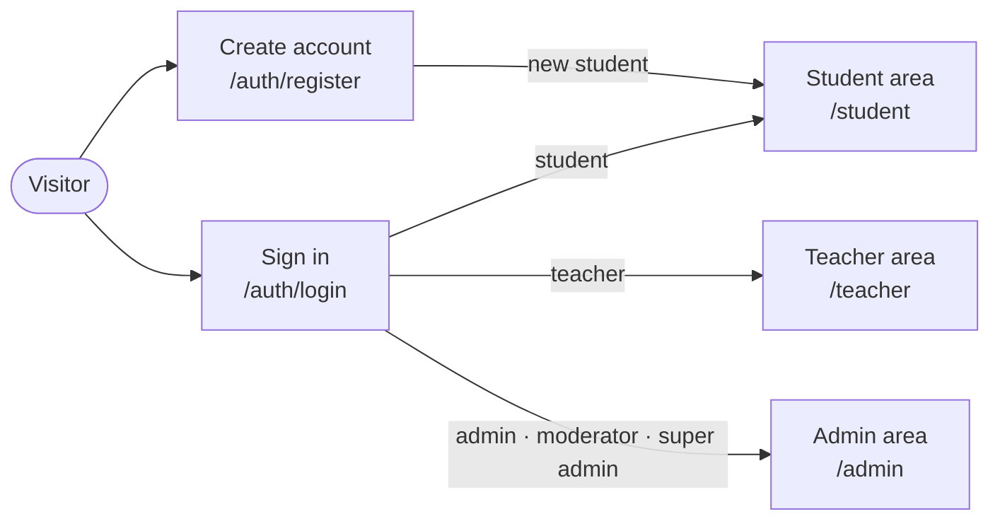

# Frontend features (Next.js)

Plain-language reference for every screen. Endpoints: [backend-features.md](backend-features.md).

## User workflow

## Screens

| Route                                                                      | Screen                                                                                                                                  | Who can use it                                                            |
| -------------------------------------------------------------------------- | --------------------------------------------------------------------------------------------------------------------------------------- | ------------------------------------------------------------------------- |
| `/auth/login`                                                              | Sign in                                                                                                                                 | Visitors who are not signed in                                            |
| `/auth/register`                                                           | Create account                                                                                                                          | Visitors who are not signed in                                            |
| `/admin/*`, `/student/*`, `/teacher/*`                                     | The area's roles                                                                                                                        | Signed-in shell (menu, user, sign out)                                    |
| `/`                                                                        | Home                                                                                                                                    | Everyone                                                                  |
| `/teachers`                                                                | Our Instructors                                                                                                                         | Everyone                                                                  |
| `/pricing`                                                                 | Choose Your Plan (subscription plans)                                                                                                   | Everyone; only Students can subscribe                                     |
| `/courses`                                                                 | Course catalog (search, filters, pages)                                                                                                 | Everyone                                                                  |
| `/free-courses`                                                            | Free courses by course type                                                                                                             | Everyone                                                                  |
| `/courses/[id]`                                                            | Course page (details, previews, enrolment)                                                                                              | Everyone; actions depend on the role                                      |
| `/student/dashboard`                                                       | Student dashboard                                                                                                                       | Students                                                                  |
| `/student/courses`                                                         | My Courses                                                                                                                              | Students                                                                  |
| `/admin/profile`, `/student/profile`, `/teacher/profile`                   | My Profile                                                                                                                              | Everyone signed in (each in their own area)                               |
| `/admin/categories`                                                        | Course setup: categories                                                                                                                | Super Admin, Admin                                                        |
| `/admin/course-types`                                                      | Course setup: course types                                                                                                              | Super Admin, Admin                                                        |
| `/admin/tools`                                                             | Course setup: tools (logo cards)                                                                                                        | Super Admin, Admin                                                        |
| `/admin/homepage-showcase`                                                 | Homepage showcase (logo + slider)                                                                                                       | Super Admin, Admin                                                        |
| `/admin/site-pages`                                                        | Site Pages: show or hide public pages                                                                                                   | Super Admin                                                               |
| `/admin/company-contact`                                                   | Company Contact: phone, WhatsApp, email, address                                                                                        | Super Admin, Admin                                                        |
| `/admin/courses`                                                           | Courses (staff list, filters, bulk edit)                                                                                                | Super Admin, Admin; Moderator (published courses, no manager tools)       |
| `/admin/courses/[id]`                                                      | Course details (staff view of the course page)                                                                                          | Super Admin, Admin, Moderator                                             |
| `/admin/enrollments/[courseId]`                                            | Course enrolments (students, revenue, CSV export)                                                                                       | Super Admin, Admin; Moderator (students + CSV only)                       |
| `/admin/courses/create`                                                    | Create a new course (details, cover, learning content) as a Draft                                                                       | Super Admin, Admin                                                        |
| `/admin/courses/[id]/edit`                                                 | Edit a course: details, cover, learning content, curriculum, live classes, quiz banks; publish                                          | Super Admin, Admin                                                        |
| `/student/courses/[courseId]/learn`                                        | The course player: video lectures, live classes, announcements, study materials, Q&A and quiz practice (full screen, no sidebar)        | Student (enrolled, or with an active plan that covers the course)         |
| `/teacher/courses/[courseId]/learn`                                        | The same player inside the teacher area; the teacher can also post announcements, study materials and live classes and see the students | Teacher of the course                                                     |
| `/admin/courses/[id]/learn`                                                | The same player inside the admin area; staff manage the course content and can download the student list                                | Super Admin, Admin, Moderator                                             |
| `/admin/users`                                                             | Find, create, edit, re-role and (Super Admin) delete user accounts                                                                      | Super Admin, Admin                                                        |
| `/admin/teachers`                                                          | Manage public teacher profiles and link them to Teacher login accounts                                                                  | Super Admin, Admin                                                        |
| `/admin/subscriptions`                                                     | Configure subscription plans; list, assign and cancel member subscriptions                                                              | Super Admin, Admin                                                        |
| `/admin/course-qa`                                                         | See unresolved course questions of every course; open each in the course player to answer and resolve it                                | Super Admin, Admin, Moderator                                             |
| `/teacher/courses`                                                         | The courses the teacher is assigned to, their enrolled students and the way into each course                                            | Teacher                                                                   |
| `/admin/dashboard`                                                         | Snapshot of the whole platform: totals, revenue, charts, top courses, newest enrolments                                                 | Super Admin                                                               |
| `/admin/performance`                                                       | Revenue and enrolment report for all courses or one course over 7 days, 30 days or lifetime                                             | Super Admin                                                               |
| `/student/chat`                                                            | Support Chat: the student's own conversation with the support team (live)                                                               | Students                                                                  |
| `/admin/chat`, `/teacher/chat`                                             | Support Inbox: every student conversation, unread counts, online status, live replies                                                   | Super Admin, Admin, Moderator (`/admin`); Teacher (`/teacher`, no emails) |
| `/admin/notifications`, `/student/notifications`, `/teacher/notifications` | Notifications: my notifications (paged, mark read); Super Admin/Admin also send, edit, delete                                           | Everyone signed in (each in their own area); sending: Super Admin, Admin  |
| `/admin/group-chat`, `/student/group-chat`                                 | Group Chat (channels, messages, files)                                                                                                  | Super Admin, Admin, Moderator (every channel); Students (their channels)  |
| `/community-hub`                                                           | Community Hub (channels, discussions, widgets; Community Settings dialog for admins)                                                    | Everyone (guests see a limited preview); settings: Super Admin, Admin     |
| `/community-hub/[postId]`                                                  | Community discussion (answers, nested replies, reactions)                                                                               | Everyone (taking part needs sign-in)                                      |
| `/community-hub/users/[userId]`                                            | Community profile                                                                                                                       | Everyone (private profiles: owner, Admin, Super Admin only)               |
| `/practice-quiz`                                                           | Practise the free-preview quiz banks of any public course                                                                               | Everyone (guests check answers; signed-in users also save them)           |
| `/admin/schedule`, `/student/schedule`, `/teacher/schedule`                | Study Schedule (timers, reminders, history)                                                                                             | Every signed-in user, in their own area (only their own items)            |
| any unknown address                                                        | Page not found                                                                                                                          | Everyone                                                                  |
| any page that crashes                                                      | Something went wrong                                                                                                                    | Everyone                                                                  |

## Screen details

### Sign in

**Route:** `/auth/login` · **Menu:** none (public)

**Who can use it:** visitors who are not signed in. A signed-in user who opens it is sent to their home page.

**What it is for:** signing in with email and password.

**How to use it:**

1. Enter the email and password and press **Sign in**. Empty fields show "This field is required"; a badly
   formed email shows "Enter a valid email address" (nothing is sent to the server).
2. A wrong email or password shows the server's message ("Invalid credentials") above the form.
3. On success a toast says "Logged in successfully" and the app opens the page that asked for sign-in
   (`?next=`, only same-site pages the role may open) or the role's home page: Super Admin
   `/admin/dashboard`, Admin and Moderator `/admin/courses`, Teacher `/teacher/courses`, Student
   `/student/dashboard`.
4. "Create an account" opens the register page.

**On mobile:** the card fills the screen width; the illustrated left panel and the corner art are hidden.

**API endpoints used:** `GET /api/auth/me`, `POST /api/auth/login`.

**Code:** `frontend/src/app/auth/login/page.tsx`, `frontend/src/components/auth/` (`LoginForm`, `GuestGate`,
`AuthLayout`), `frontend/src/api/auth.api.ts`, `frontend/src/utils/safe-redirect.ts`.

**Tests:** `components/auth/__tests__/LoginForm.test.tsx`, `GuestGate.test.tsx`,
`utils/__tests__/safe-redirect.test.ts`; Playwright `frontend/e2e/auth.spec.ts` (desktop + mobile).

### Create account

**Route:** `/auth/register` · **Menu:** none (public)

**Who can use it:** visitors who are not signed in. The new account is always a Student.

**What it is for:** a student signs up and is signed in at once.

**How to use it:**

1. Enter full name, email and a password of at least 6 characters, then press **Create account**.
2. An email that already has an account shows "Email is already registered".
3. On success a toast says "Account created successfully" and the student dashboard opens.

**On mobile:** same as Sign in.

**API endpoints used:** `GET /api/auth/me`, `POST /api/auth/register`.

**Code:** `frontend/src/app/auth/register/page.tsx`, `frontend/src/components/auth/RegisterForm.tsx`.

**Tests:** `components/auth/__tests__/RegisterForm.test.tsx`; Playwright `frontend/e2e/auth.spec.ts`.

### Signed-in shell (admin, student, teacher)

**Route:** every page under `/admin`, `/student` and `/teacher` · **Menu:** the sidebar itself

**Who can use it:** `/admin`: Super Admin, Admin, Moderator (`/admin/dashboard`: Super Admin only, others
are sent to `/admin/courses`); `/student`: Students; `/teacher`: Teachers. Visitors who are not signed in
are sent to `/auth/login?next=<page>`; other roles are sent to their own home page.

**What it is for:** the frame around every signed-in page: the menu of the area, the signed-in user and the
sign-out button.

**How to use it:**

1. The menu shows only the items the role may open (for example, Moderators do not see Dashboard, Teachers,
   User List, Subscriptions or Performance; Performance appears under "Analytics" for Super Admins).
2. The current page is highlighted. On desktop the arrow button collapses the menu to icons (tooltips show
   the names); course create/edit and course player pages start collapsed.
3. **Logout** signs out and opens `/auth/login`. If the server cannot be reached, the user stays signed in and
   sees "Could not sign out".
4. Support Chat and Notifications carry a red unread count; screen readers hear it in the item's name (e.g.
   "Notifications (3 unread)"), and the collapsed menu's tooltip shows it too.

**On mobile:** a top bar with a menu button replaces the sidebar; the menu slides in as a drawer and closes
after choosing a page.

**API endpoints used:** `GET /api/auth/me`, `POST /api/auth/logout`.

**Code:** `frontend/src/app/{admin,student/(shell),teacher}/layout.tsx`, `frontend/src/components/layout/`
(`AppShell`, `SidebarContent`, `SidebarNavItem`, `nav-items.ts`; `AppShell` also mounts `ShellMessaging`, the
live chat and notification updates), `frontend/src/components/permissions/RequireRole.tsx`,
`frontend/src/proxy.ts`, `frontend/src/context/SocketContext.tsx` (the one Socket.io connection).

**Tests:** `components/layout/__tests__/SidebarContent.test.tsx` (role menus, unread counts in the names),
`context/__tests__/SocketContext.test.tsx` (connect, sign-out, reconnect),
`components/permissions/__tests__/RequireRole.test.tsx`, `src/__tests__/proxy.test.ts`; Playwright
`frontend/e2e/shell.spec.ts` and the access rules in `auth.spec.ts`.

### Public site frame (discount banner, navbar, footer)

**Route:** every page under `frontend/src/app/(public)/` (home, catalog, course page, teachers, pricing, and
later practice quiz and community hub) · **Menu:** the public navbar

**Who can use it:** everyone, signed in or not.

**What it is for:** the common top and bottom of the public site.

**How to use it:**

1. **Discount banner** (red, above the navbar): shown only while a course discount runs. It says "Up to N% off",
   how many courses are in the offer, and counts down to the end ("ENDS IN 1d 4h 3m 2s", every second). It
   hides itself when the time is up. "View discounted courses" opens `/courses`.
2. **Navbar** (sticks to the top): the site logo uploaded by admins on the Homepage Showcase page (or the
   MedhaBee name when there is none) links home. The search box opens the catalog with the text
   (`/courses?search=...`) and shows the catalog's current search when you are on `/courses`. The navbar uses
   the full screen width: the logo sits in the left corner, the links and buttons in the right one, and the
   search box (up to 720 px wide, 48 px high) fills the space between them.
3. Links: All Courses, Free Courses, Pricing, Teachers, Practice Quiz, Community Hub. The current page is
   highlighted. A page a Super Admin switched off on the Site Pages screen has no link (navbar, menu drawer and
   footer), and its address shows "Page not found" (`PageVisibilityGate`; the community hub's discussion and
   profile pages too).
4. Visitors see **Sign In** and **Sign Up**. A signed-in user sees **Dashboard** (their role's home page: Super
   Admin `/admin/dashboard`, Admin and Moderator `/admin/courses`, Teacher `/teacher/courses`, Student
   `/student/dashboard`) and their initial in a round avatar (name on hover).
5. **Language switch** (left of the sign-in buttons, translate icon): shows the other language ("বাংলা" or
   "English") and switches the whole site between English and Bangla at once. The choice is remembered in
   this browser (same key as before, `i18nextLng`) and used again on the next visit.
6. **Footer:** app name, links to Courses, Free Courses, Teachers, Pricing, and the copyright line.

The banner, home page, catalog, pricing, teachers and footer use the same container width (at most 1200 px,
centred); only the navbar is full width.

**On mobile:** below 1200 px the links move into a menu drawer opened with the menu button ("Open site menu")
on the right; the drawer also holds Dashboard or Sign In / Sign Up. On phones narrower than 600 px the navbar
shows only the logo icon, the search box, the language switch (icon only), the avatar (when signed in) and the
menu button. The banner wraps
onto several lines. Every button is at least 44 px high.

**API endpoints used:** `GET /api/auth/me`, `GET /api/home-hero-posts/logo/public`,
`GET /api/courses/discounts/active`.

**Code:** `frontend/src/app/(public)/layout.tsx`, `frontend/src/components/public/PublicLayout.tsx`,
`frontend/src/components/public/layout/` (`PublicNavbar`, `PublicNavLinks`, `NavSearch`, `LanguageSwitcher`,
`NavAuthActions`, `NavDrawer`, `SiteLogo`, `DiscountBanner`, `DiscountCountdown`, `PublicFooter`), `frontend/src/api/public.api.ts`,
`frontend/src/schemas/public.schema.ts`.

**Tests:** `components/public/__tests__/PublicLayout.test.tsx`; Playwright `frontend/e2e/public.spec.ts`
(desktop + mobile).

### Home

**Route:** `/` · **Menu:** the logo in the public navbar

**Who can use it:** everyone.

**What it is for:** the landing page: showcase images, then the live courses and the free ones, each with its
own category cards.

**How to use it:**

1. **Showcase slider** (container width, rounded corners): the public images admins put on the Homepage
   Showcase page, one after another every 5 seconds. Dots switch images by hand; the previous / next arrows
   appear only while the mouse is over the slider (always shown on touch screens, and when a key focuses
   them). The slider holds still while the mouse is over it or a control in it has keyboard focus. There is no
   pause/play button; for people who turn off animations (prefers-reduced-motion) it does not move by itself.
   Without images a blue banner is shown. An image with a title and/or description (set on the Homepage
   Showcase page) shows them at the bottom of the image on a dark gradient.
2. **Live Courses** (one box): the title in the centre, then small category cards (name and number of courses),
   then the course cards. Only courses whose **course type is flagged "Live"** (Course Setup > Course Types)
   are shown here. The first card, **All**, shows every live course; picking a category shows only its live
   courses (the picked card is highlighted). Only categories that have live courses get a card. With no live
   course type, the box says "No live courses yet."
3. **Upcoming Free Live Courses** (a second box, same layout): the same, for **free** courses only.
4. **Course cards** (both boxes): cover, course type, title, start day ("Starts Dec 5, 2026", in the viewer's
   time zone and language, or "Start date to be announced"), price (struck-through list price and "N% off"
   while a discount runs, or "Free") and a **See Details** button. The whole card also opens the course page.
   Teachers and category are not shown on the card. On mouse hover the card lifts, gets a shadow, the cover
   zooms in slightly and the title turns blue. A signed-in Student also sees **Continue Learning** on courses
   they are enrolled in (opens the course player).
5. **Paging:** each box shows up to 30 courses. Page buttons appear under a box only when it has more than 30
   courses. Filters and search are on `/courses`.

**On mobile:** one course card per row (two on tablets, four on desktop); the category cards stay on one row
that scrolls sideways inside the box (the page itself never scrolls sideways); the slider is 220 px high on
phones.

**API endpoints used:** `GET /api/home-hero-posts/public`, `GET /api/categories`,
`GET /api/courses/browse?pricing=Paid|Free&categories&page&limit=30` (one request per box; the category counts
come from `filterCounts.categoriesByPricing`), `GET /api/enrollments` (signed-in Students only).

**Code:** `frontend/src/app/(public)/page.tsx`, `frontend/src/components/public/home/` (`HomePage`,
`HomeHeroSlider`, `HeroSlide`, `HeroSliderControls`, `HomeCourseSection`, `HomeSectionTitle`,
`HomeCategoryFilter`, `CategoryFilterCard`), `frontend/src/components/public/common/` (`CourseGrid`,
`CourseCard`, `CourseStartDay`, helpers), `frontend/src/components/course-card/` (`CourseCover`, `CoursePrice`),
`frontend/src/api/public.api.ts` (`useHomeCourses`), `frontend/src/api/catalog.api.ts` (categories, enrolments).

**Tests:** `components/public/__tests__/HomePage.test.tsx`, `public-utils.test.ts`; Playwright
`frontend/e2e/public.spec.ts` (desktop + mobile: category filter + See Details; language switch).

### Our Instructors

**Route:** `/teachers` · **Menu:** Teachers (public navbar)

**Who can use it:** everyone.

**What it is for:** meet every teacher.

**How to use it:**

1. The page lists every teacher profile: photo (or initial), name, up to four subjects ("+N" for more), a short
   bio and links to Twitter, LinkedIn, website and YouTube when the teacher has them (opened in a new tab; only
   normal web addresses are shown).
2. "No teachers found." when there are none; an error message with **Try again** when the list cannot load.

**On mobile:** one card per row (two on tablets, four on wide screens).

**API endpoints used:** `GET /api/teachers`.

**Code:** `frontend/src/app/(public)/teachers/page.tsx`, `frontend/src/components/public/teachers/`
(`PublicTeachersPage`, `TeacherProfileCard`, `TeacherAvatar`, `ExpertiseChips`, `TeacherSocialLinks`).

**Tests:** `components/public/__tests__/PublicTeachersPage.test.tsx`; Playwright `frontend/e2e/public.spec.ts`.

### Choose Your Plan (pricing)

**Route:** `/pricing` · **Menu:** Pricing (public navbar)

**Who can use it:** everyone can look; only Students can subscribe (same rule as the server).

**What it is for:** compare subscription plans and subscribe. There is no payment gateway yet: subscribing
activates the plan at once and the server takes the price from the plan, never from the browser.

**How to use it:**

1. When plans offer more than one billing period, a switch (Monthly / 3 months / 6 months / Yearly …) chooses
   the period; monthly is chosen first when offered.
2. Each plan card shows its badge, name, the price for that period ("BDT 4,800 for 12 months"), the saving
   against paying monthly ("Save BDT 1,200 (20%)", "BDT 400/mo equivalent"), how many courses are included,
   and its features. A plan without the chosen period says "Not available".
3. **View Included Courses (N)** opens a dialog with the plan's courses, a search box and Category, Course type
   and Pricing filters. "Clear filters" resets them.
4. Visitors see **Get Started** (and "Already have an account?" under the plans): it opens sign-in and comes back
   to `/pricing` afterwards.
5. A Student presses **Subscribe**; a toast says "Subscribed to <plan> plan!". The header then shows "Current
   plan: <plan> - Expires <date>" and that card shows "Current Plan" and a disabled **Active Plan** button.
   With a running plan, the other cards offer **Switch Plan** (or **Switch Billing** for another period of the
   same plan); switching cancels the old subscription on the server.
6. Signed-in staff and teachers see "Only students can subscribe to plans" instead of a button.

**On mobile:** one plan per row (two on tablets); the period switch wraps; the included-courses dialog is full
screen with the filters stacked above the courses.

**API endpoints used:** `GET /api/subscription-plans`, `GET /api/subscriptions/my` (Students),
`POST /api/subscriptions/subscribe` (`{ plan, billingDuration }`), `GET /api/courses/browse?subscriptionPlans=…`
(dialog), `GET /api/categories`, `GET /api/course-types`, `GET /api/enrollments` (Students).

**Code:** `frontend/src/app/(public)/pricing/page.tsx`, `frontend/src/components/public/pricing/`
(`PricingPage`, `PricingHero`, `BillingToggle`, `PlanCard`, `PlanCardContent`, `PlanPrice`, `PlanFeatures`,
`PlanAction`, `PlanCoursesModal`, `PlanCoursesFilters`, `PlanCoursesResults`, `GuestSignInBox`,
`pricing.utils.ts`), `frontend/src/hooks/usePublicSubscribe.ts`, `frontend/src/hooks/useDebouncedValue.ts`,
`frontend/src/components/common/FilterSelect.tsx`.

**Tests:** `components/public/__tests__/PricingPage.test.tsx`, `public-utils.test.ts`; Playwright
`frontend/e2e/public.spec.ts` (guest is sent to sign in, a new Student subscribes).

### Course catalog (`/courses`)

- **Route:** `/courses` (inside the public layout: navbar + footer).
- **Who can use it:** everyone. A signed-in Student also sees "Go to this course" on courses they are enrolled in.
- **What it is for:** finding a course among all Published + Public courses.
- **Step by step:**
  1. The page shows "All Courses" and how many courses match ("12 courses found").
  2. Type in **Search** (the list updates shortly after you stop typing), tick course types, categories,
     Free / Paid, or subscription plans. Each option shows how many public courses it has.
  3. The filters and the page number are kept in the address bar with the backend's own names, so a link can
     be shared or bookmarked: `?search=react&categories=<id>,<id>&courseTypes=<id>&pricing=Free&subscriptionPlans=Premium&page=2`.
     The public navbar search and the home page tiles link here the same way.
  4. "N active" (in the filter panel) or "Clear filters" (when nothing matches) removes every filter.
  5. Click a card to open the course page. On a computer, hovering a card shows a preview (summary, what you
     will learn, plans that include it, "View Details").
  6. 12 courses per page; the page buttons are under the cards.
- **Mobile behaviour:** one card per row on phones, two on tablets, three or four on desktop. The filter
  sidebar becomes a **Filters** button (with the number of active filters) that opens a drawer; "Show courses
  (N)" closes it. No hover preview on touch screens.
- **API endpoints used:** `GET /api/courses/browse` (filters, `page`, `limit=12`, `filterCounts`),
  `GET /api/categories`, `GET /api/course-types`, `GET /api/subscription-plans`, and for Students
  `GET /api/enrollments` (their course ids).
- **Code:** `frontend/src/app/(public)/courses/page.tsx`, `frontend/src/components/browse/catalog/*`,
  `frontend/src/components/browse/card/*`, `frontend/src/hooks/useBrowseParams.ts`,
  `frontend/src/api/browse.api.ts`, `frontend/src/api/catalog.api.ts` (categories, course types, plans,
  enrolments), `frontend/src/schemas/browse.schema.ts`, `frontend/src/schemas/catalog.schema.ts`, the shared
  card parts and search box in `frontend/src/components/course-card/`, prices in `frontend/src/utils/price.ts`.
- **Tests:** `frontend/src/components/browse/__tests__/CourseBrowseView.test.tsx`, `e2e/browse.spec.ts`.

### Free courses (`/free-courses`)

- **Route:** `/free-courses`.
- **Who can use it:** everyone (enrolled Students see "Go to this course" on their courses).
- **What it is for:** a quick list of every free public course.
- **Step by step:**
  1. The page shows how many free courses there are.
  2. Courses are grouped by course type (with the type's description); courses without a type come last under
     "Other Free Courses".
  3. Each group shows up to six cards; "See all <type> courses" opens `/courses?courseTypes=<id>&pricing=Free`.
- **Mobile behaviour:** one card per row on phones, two on tablets, three on desktop.
- **API endpoints used:** `GET /api/courses/browse?pricing=Free`, `GET /api/course-types`,
  `GET /api/enrollments` (Students only).
- **Code:** `frontend/src/app/(public)/free-courses/page.tsx`, `frontend/src/components/browse/free/*`.
- **Tests:** `frontend/src/components/browse/__tests__/FreeCoursesView.test.tsx`, `e2e/browse.spec.ts`.

### Course page (`/courses/[id]`)

- **Route:** `/courses/[id]`.
- **Who can use it:** everyone for Published + Public courses. Drafts and private courses answer "Course not
  found." except for staff and the course's teachers (the backend decides).
- **What it is for:** everything about one course and how to get it.
- **Step by step:**
  1. The dark banner shows the breadcrumb, the course type (gradient badge above the title), title, subtitle,
     price (with discount) and "Subscription". It shows no status and no teacher names.
  2. Below: course type and start / end dates, "What you'll learn", "This course includes", **Tools you will
     use** (logo cards, with the section title and description from the editor), **What you get** (cards with a
     logo, title and description), **Curriculum**, **Projects**, **Who this course is for** (one card per
     item),
     requirements, "About this course" (rich text, sanitised) and "Your Instructors".
  3. **Curriculum** (centred heading) has up to three lists, switched with centred buttons in this order:
     **Live Class** (weekly plan, two week cards per row from tablet width, each class's day and time as the
     teacher wrote them), **Recorded Lectures** (sections with lecture count and length; "Expand all
     sections") and **Quizzes** (free-preview quiz banks, each opening `/practice-quiz?courseId=…&bankId=…`).
     A button is shown only when its list has at least one item; the first one is open at the start.
  4. **Projects:** a card per project (first screenshot, title, short description); **View project** opens a
     panel from the right with the full description, **Live demo** (new tab), the intro video (a YouTube link
     plays in the panel, other links open in a new tab as **Watch intro video**) and every screenshot. After the
     instructors come **Success stories** (photo, title, story, company logo and name) and **Frequently asked
     questions** (click a question to open its answer). Each section is hidden while it is empty.
  5. **Buy bar** (fixed to the bottom of the screen) for visitors and students who have not enrolled: "Call
     Now:" with the phone number from the Company Contact page (a `tel:` link; hidden when no number is set),
     the price, the struck-through list price and "N% discount applied" while a discount runs, and **Enroll
     Now**, which scrolls to the enrolment card. Staff, teachers and enrolled students do not see it.
  6. A lecture marked "Free Preview" with a YouTube video opens the preview player (with the list of every
     other free preview). Locked lectures have no video address for viewers without access.
  7. The card on the right (top on phones) depends on the viewer:
     - **Visitor:** price, "Enroll Free" / "Get Started" (to sign-up) and "Sign In".
     - **Student, not enrolled:** "Enroll Now – Free" / "Buy Now". When the course is part of subscription
       plans there are two choices: **Subscribe and save** (cheapest plan price; "Enroll with Subscription"
       when the student's running plan includes the course, "Upgrade Subscription" when it does not, otherwise
       a link to the plans) or **Buy this course** (always a direct, paid enrolment).
     - **Student, enrolled:** "Go to this course" (`/student/courses/[id]/learn`), the enrolment date and
       "Leave this course" (asks for confirmation).
     - **Super Admin / Admin:** "Edit Course" and "Student View"; **Moderator:** "Student View" only.
     - **Teacher:** the price only.
  8. If the course has a "Course introduction" lecture (or any free preview) on YouTube, the card's picture plays it.
- **Mobile behaviour:** single column; the enrolment card comes right after the banner; the preview player
  opens full screen with the preview list under the video.
- **API endpoints used:** `GET /api/courses/:id` (also the course page sections, tools populated),
  `GET /api/study-curricula/course/:id` (public fields for guests), `GET /api/quiz-bank/public/course/:id`,
  `GET /api/subscription-plans`, `GET /api/site-settings/public` (the "Call Now" number); Students:
  `GET /api/enrollments/:courseId/check`, `GET /api/subscriptions/my`, `POST /api/enrollments/:courseId`
  (body `{ enrollmentType: 'paid' }` when buying a paid course directly), `DELETE /api/enrollments/:courseId`.
- **Security:** YouTube is the only embedded site (CSP `frame-src https://www.youtube.com
https://www.youtube-nocookie.com`, thumbnails `img-src https://i.ytimg.com`); videos are embedded from the
  11-character id only, through the privacy-enhanced domain. Cover and teacher pictures are shown only from
  Cloudinary. Rich text goes through `SafeHtml`.
- **Code:** `frontend/src/app/(public)/courses/[id]/page.tsx`, `frontend/src/components/browse/detail/*`
  (`content/` = curriculum lists, `extras/` = tools, what you get, projects (+ `ProjectDetailsDrawer`),
  audience, success stories, FAQ, `enrollment/` = the enrolment card and `CourseBuyBar`),
  `frontend/src/utils/csp.ts`.
- **Tests:** `frontend/src/components/browse/__tests__/CourseDetailView.test.tsx`,
  `frontend/src/components/browse/__tests__/CourseDetailExtras.test.tsx` (sections, project drawer, buy bar),
  `frontend/src/components/browse/__tests__/course-utils.test.ts`, `frontend/src/utils/__tests__/csp.test.ts`,
  `e2e/browse.spec.ts`, `e2e/site-extras.spec.ts`.

### Student dashboard

**Route:** `/student/dashboard` · **Menu:** Dashboard (student menu)

**Who can use it:** students. It is where a student lands after signing in.

**What it is for:** a quick start: a welcome, how many courses the student is in, the running plan, and the
newest courses to continue.

**How to use it:**

1. The header says "Welcome back, <name>. Continue your courses from the course page."
2. Two cards show the number of **Enrolled courses** and the **Subscription** (plan name and "Expires
   <date>", or "None / No active plan"). A plan whose end date has passed counts as none.
3. Without a running plan a **View Plans** button opens `/pricing`.
4. **Continue learning** lists the four newest enrolments (with "Free course", "Purchased course" or "Enrolled
   with subscription"); a click opens the course player `/student/courses/<id>/learn`. **All my courses**
   opens `/student/courses`. With no enrolments it says "You haven't enrolled in any courses yet." and offers
   **Browse Courses** (`/courses`).
5. Loading shows skeletons; a failed load shows the server message with **Try again**.

**On mobile:** the two cards stack in one column; list rows are at least 56 px high.

**API endpoints used:** `GET /api/auth/me`, `GET /api/enrollments`.

**Code:** `frontend/src/app/student/(shell)/dashboard/page.tsx`, `frontend/src/components/student/`
(`StudentDashboard`, `DashboardStatCard`, `ContinueLearning`), `frontend/src/api/catalog.api.ts`,
`frontend/src/api/profile.api.ts`.

**Tests:** `components/student/__tests__/StudentDashboard.test.tsx`; Playwright `frontend/e2e/student.spec.ts`.

### My Courses

**Route:** `/student/courses` (`?search=` keeps the search box) · **Menu:** My Courses (student menu)

**Who can use it:** students (only their own enrolments).

**What it is for:** every course the student is enrolled in, opening the course player, and leaving a course.

**How to use it:**

1. The courses come in two groups, each with its count: **Free & Paid Courses** and **Enrolled with
   Subscription** (cards with a purple "Subscription" badge). An empty group says "No free or paid courses
   enrolled yet." / "No subscription courses enrolled yet."
2. Each card shows the cover, course type badge, title, teachers, the price ("Free", or the price with the
   struck-through list price and "% off" while a discount runs) and the category. A click opens
   `/student/courses/<id>/learn`.
3. **Search courses...** filters by title as you type; the address (`?search=`) follows once you stop typing; nothing found shows
   `No courses match "<text>".`
4. The bin button on a card ("Remove from my courses") asks "Are you sure you want to remove "<title>" from
   your courses?"; **Remove** deletes the enrolment, shows `Removed from "<title>"` and drops the card.
   An error shows the server message as a toast.
5. No enrolments at all: "You haven't enrolled in any courses yet."

**On mobile:** one card per row (two on tablets, three to four on desktops); the search box is full width; the
remove button is 44 px.

**API endpoints used:** `GET /api/enrollments`, `DELETE /api/enrollments/:courseId`.

**Code:** `frontend/src/app/student/(shell)/courses/page.tsx`, `frontend/src/components/student/`
(`MyCoursesPage`, `EnrolledCourseSection`, `EnrolledCourseCard`, `CourseBadges`, `CourseCardSkeletons`,
`useRemoveEnrollment`, `enrolledCourse.utils.ts`), the shared `CourseCover`, `CourseCardBody`, `CoursePrice`
and `CourseSearchField` in `frontend/src/components/course-card/`, `frontend/src/api/catalog.api.ts`,
`frontend/src/schemas/catalog.schema.ts`, `frontend/src/schemas/student.schema.ts`.

**Tests:** `components/student/__tests__/MyCoursesPage.test.tsx`; Playwright `frontend/e2e/student.spec.ts`.

### My Profile

**Route:** `/admin/profile`, `/student/profile`, `/teacher/profile` · **Menu:** Profile

**Who can use it:** every signed-in user, in their own area (Super Admin, Admin, Moderator under `/admin`).
Only their own account.

**What it is for:** seeing the account, plan and role, and editing name, avatar, community privacy, password
and (students only) email.

**How to use it:**

1. The banner shows the role, avatar (or the first letter in the role's colour), name and what the role is
   for; below are the **Student number** (students only, e.g. `482-917-305`, unique and never changing),
   email, role, joined and last-updated dates.
2. Summary cards: **Enrolled courses** (students) or **Assigned courses** (teachers), **Purchased courses**,
   **Subscription** (plan and expiry) and **Profile status** (Complete with an avatar, otherwise Basic).
3. Students also see the **Subscription** card: the running plan with start/expiry dates, the number of
   courses and features of the plan, **Change Plan** (`/pricing`) and **Cancel Subscription** (asks first,
   then "Subscription cancelled"); without a plan "You do not have an active subscription." and **View
   Plans**. Everyone sees **Role details** (role, kind of access, description).
4. **Edit Profile** opens a dialog:
   - **Upload Avatar** (JPG, PNG, WEBP or GIF up to 5MB, checked before upload) shows a preview;
     **Remove** removes the picture.
   - **Name** is required. **Email** can be changed by students only; for other roles it is read-only.
   - **Private community profile** hides the community stats, discussions and answers from others.
   - **Change password**: current password, new password (6-72 characters) and confirmation. Leave empty to
     keep the password. A student who changes the email must also type the current password.
   - **Save Changes** sends only what changed ("Make at least one change before saving." otherwise). Errors
     from the server (wrong current password, email in use) appear above the fields. On success a toast says
     "Profile updated", the dialog closes and the name/avatar update at once (also in the sidebar).
     Changing the password signs out other devices; this browser gets a fresh session cookie.

**On mobile:** cards stack in one column; the dialog is full screen; the two new-password fields stack.

**API endpoints used:** `GET /api/auth/me`, `PUT /api/auth/me` (multipart), `GET /api/enrollments`
(students), `GET /api/teachers/my-courses` (teachers), `GET /api/subscription-plans` and
`DELETE /api/subscriptions/cancel-my` (students with a plan).

**Code:** `frontend/src/app/{admin,student/(shell),teacher}/profile/page.tsx`,
`frontend/src/components/profile/` (`ProfilePage`, `ProfileHero`, `ProfileFacts`, `ProfileStats`,
`SubscriptionCard`, `ActivePlanDetails`, `RoleDetailsCard`, `EditProfileModal`, `AvatarPicker`,
`AvatarUploadButton`, `CommunityPrivacySwitch`, `ProfilePasswordFields`, `useProfileForm`,
`useAvatarChoice`, `profileFormData.ts`), `frontend/src/api/profile.api.ts`, `frontend/src/api/catalog.api.ts`
(plans, enrolments, cancelling the subscription), `frontend/src/api/teacher.api.ts` (a teacher's course count,
the same request as Assigned courses),
`frontend/src/schemas/profile.schema.ts`.

**Tests:** `components/profile/__tests__/ProfilePage.test.tsx`, `EditProfileModal.test.tsx`; Playwright
`frontend/e2e/profile.spec.ts` (desktop + mobile).

### Course setup (categories, course types and tools)

**Route:** `/admin/categories` (Categories tab), `/admin/course-types` (Course Types tab) and `/admin/tools`
(Tools tab) · **Menu:** "Course Setup" (opens the Categories tab)

**Who can use it:** Super Admin and Admin. A Moderator (or any other role) who opens the address is sent to
their own home page; the backend refuses their requests too (403).

**What it is for:** keeping the two short lists that courses are filed under: categories (subject areas)
and course types (live course, recorded course, seminar, ...). The public catalog filters use them.

**How to use it:**

1. Pick a tab: **Categories** or **Course Types**. Each tab has its own address, so it can be bookmarked.
2. The list shows each item's name, slug (made by the server from the name) and description, plus how many
   items there are.
3. **Add Category** / **Add Course Type** opens a form: name (required, must contain letters or numbers) and
   an optional description. **Save** creates it; a toast confirms it. A name that clashes with an existing
   one shows the server's message in the form.
4. The row menu (⋮) has **Edit** (same form, filled in; **Update** saves) and **Delete** (asks "Delete
   "<name>"? This cannot be undone." first).
5. An item that courses still use cannot be deleted: the server's message is shown as a toast, for example
   "Category is used by 3 course(s)".
6. **Course Types** have a **Live course type** switch in the form; a live type shows a red "Live" chip in the
   list, and its courses fill the home page's Live Courses section.
7. **Tools:** a grid of cards (logo with the tool name under it; 2 per row on phones, 5 on desktops). **Add
   Tool** opens a form with the name (e.g. Node.js, at most 60 characters) and **Choose logo** (PNG, JPEG,
   GIF or WEBP up to 5 MB, previewed at once; required for a new tool). The card menu (⋮) has **Edit**
   (rename, **Change logo**) and **Delete** (asks first; the tool is also removed from every course that
   lists it).

**On mobile:** the tabs fill the width; each item is a card (name, slug, description, ⋮ menu) instead of a
table row; the form opens full screen.

**API endpoints used:** `GET/POST /api/categories`, `PUT/DELETE /api/categories/:id`,
`GET/POST /api/course-types`, `PUT/DELETE /api/course-types/:id`, `GET/POST /api/tools`,
`PUT/DELETE /api/tools/:id`.

**Code:** `frontend/src/app/admin/categories/page.tsx`, `frontend/src/app/admin/course-types/page.tsx`,
`frontend/src/components/setup/` (`CourseSetupPage`, `SetupTabs`, `SetupManager`, `SetupManagerHeader`,
`SetupItemFormModal`, `LiveTypeSwitch`, `SetupRowMenu`, `useSetupColumns`, `tools/` (`ToolsManager`,
`ToolCard`, `ToolLogo`, `ToolFormModal`)), `frontend/src/app/admin/tools/page.tsx`, `frontend/src/api/tools.api.ts`,
`frontend/src/schemas/tools.schema.ts`, `frontend/src/api/setup.api.ts` (the list is the
shared read in `frontend/src/api/catalog.api.ts`, so a save also refreshes the public pages),
`frontend/src/schemas/setup.schema.ts`.

**Tests:** `components/setup/tools/__tests__/ToolsManager.test.tsx`, `components/setup/__tests__/CourseSetupPage.test.tsx` (live switch and chip; list, empty, error, create, validation,
duplicate error, edit, delete, in-use delete refused, course types tab, Moderator sent away); Playwright
`frontend/e2e/setup.spec.ts` (desktop + mobile: add/edit/delete a category, add a course type from the tab,
Moderator blocked).

### Site Pages (Super Admin)

**Route:** `/admin/site-pages` · **Menu:** "Site Pages"

**Who can use it:** Super Admin only (others are sent to their home page; the backend answers 403).

**What it is for:** showing or hiding public pages from time to time without removing them.

**How to use it:**

1. The list has one row per public navbar page (All Courses, Free Courses, Pricing, Teachers, Practice Quiz,
   Community Hub) with its address and state (Active / Hidden).
2. Turn a switch off: the change is saved at once ("<page> is hidden"). The page's link disappears from the
   navbar, the menu drawer and the footer, and its address (for Community Hub also the discussion and profile
   pages) shows "Page not found".
3. Turn it on again to bring the page back ("<page> is visible again"). Nothing is deleted while a page is
   hidden.

**On mobile:** one row per page, the switch on the right (44 px target).

**API endpoints used:** `GET /api/site-settings/public`, `PUT /api/site-settings/pages`.

**Code:** `frontend/src/app/admin/site-pages/page.tsx`, `frontend/src/components/site-settings/`
(`SitePagesPage`, `SitePageRow`), `frontend/src/components/public/common/` (`PageVisibilityGate`,
`useVisibleLinks`, `public-links.ts`), `frontend/src/api/site-settings.api.ts`,
`frontend/src/schemas/site-settings.schema.ts`.

**Tests:** `components/site-settings/__tests__/SitePagesPage.test.tsx`,
`components/site-settings/__tests__/CompanyContactPage.test.tsx`,
`components/public/common/__tests__/PageVisibilityGate.test.tsx`; Playwright `frontend/e2e/site-extras.spec.ts`.

### Company Contact

**Route:** `/admin/company-contact` · **Menu:** "Company Contact"

**Who can use it:** Super Admin and Admin.

**What it is for:** the company's phone, WhatsApp, email and address. The phone number is the "Call Now"
number of the buy bar on course pages.

**How to use it:**

1. Fill in any of **Phone number**, **WhatsApp number** (digits, spaces, dashes, optional + at the start),
   **Email** and **Address** (at most 300 characters). Empty fields clear the saved value.
2. **Save** stores them ("Company contact saved"); a wrong value shows its message under the field.

**On mobile:** one column, full-width fields.

**API endpoints used:** `GET /api/site-settings/public`, `PUT /api/site-settings/contact`.

**Code:** `frontend/src/app/admin/company-contact/page.tsx`, `frontend/src/components/site-settings/`
(`CompanyContactPage`, `CompanyContactForm`), `frontend/src/api/site-settings.api.ts`.

**Tests:** `components/site-settings/__tests__/SitePagesPage.test.tsx`,
`components/site-settings/__tests__/CompanyContactPage.test.tsx`,
`components/public/common/__tests__/PageVisibilityGate.test.tsx`; Playwright `frontend/e2e/site-extras.spec.ts`.

### Homepage showcase

**Route:** `/admin/homepage-showcase` · **Menu:** "Homepage Showcase"

**Who can use it:** Super Admin and Admin (others are sent to their home page; the backend answers 403).

**What it is for:** managing the public site logo and the wide banner images of the homepage slider: upload,
show or hide, schedule, reorder and delete.

**How to use it:**

1. **Site logo:** the current logo is shown (or "No logo uploaded yet."). **Choose logo image** picks a PNG,
   JPEG, GIF or WEBP file up to 5 MB; its name and size appear. **Save Logo** (or **Update Logo** when one
   exists) uploads it and replaces the old one. A wrong file type or a file over 5 MB is refused at once with
   a message, before anything is sent.
2. **Header slider images:** every image is listed in slider order with its position (#1, #2, ...),
   visibility (Public / Private), a "Scheduled to ..." chip when a change is pending, its size in pixels and
   when it publishes ("Publishes immediately when public", "Publishes <date>" or "Changes to Public
   <date>", in your own time zone).
3. **Upload Images** opens a wide panel from the right (full width on phones): choose **one** image
   (PNG/JPEG/GIF/WEBP up to 5 MB; one at a time, so each image gets its own text), its **Title** (at most 120
   characters) and **Description** (at most 300; both optional and shown on the slide), visibility, an
   optional publish date and time (a future date keeps the image as it is until then, then applies the chosen
   visibility), and a position (lower numbers come first; it starts after the last image). **Upload** is
   enabled once a valid image is chosen.
4. Change the order by dragging an image by its handle (⋮⋮), or with **Move Up** / **Move Down** in its menu.
   The new order shows at once and is saved; if saving fails, the old order comes back and an error toast is
   shown. Keyboard: focus the handle, press space, move with the arrow keys, press space again.
5. The image menu (⋮) also has **View Details** (large preview with visibility, size, position and schedule;
   clicking the thumbnail does the same), **Edit** (the same right-side panel: replace the image, change title, description, visibility, date or position;
   clearing the date applies the visibility now), **Make Public** / **Make Private** (applies at once and
   cancels a pending schedule) and **Delete** (asks first).
6. Server errors (for example "Only image files are allowed" for a file whose content is not a real image)
   are shown in the form or as a toast.

**On mobile:** the logo preview sits above the logo controls; each slider image is a card with the full-width
banner on top and the handle, details and menu below; dialogs open full screen.

**API endpoints used:** `GET/PUT /api/home-hero-posts/logo`, `GET/POST /api/home-hero-posts`,
`PUT/DELETE /api/home-hero-posts/:id`, `PATCH /api/home-hero-posts/reorder`.

**Code:** `frontend/src/app/admin/homepage-showcase/page.tsx`, `frontend/src/components/showcase/`
(`HomepageShowcasePage`, `SiteLogoPanel`, `LogoPreview`, `LogoPicker`, `HeroPostsPanel`,
`HeroPostSortableList` (drag and drop, loaded with `next/dynamic`), `HeroPostRow`, `HeroPostThumbnail`,
`HeroPostMenu`, `HeroPostFormDrawer` (uses `components/common/SideDrawer`), `HeroPostFormFields`, `HeroFilePicker`, `HeroPostDetailsModal`,
`useHeroPostActions`, `useHeroText`, `useImageFiles`, `hero-form.ts`, `hero-schedule.ts`, `image-files.ts`,
`common/`), `frontend/src/api/showcase.api.ts`, `frontend/src/schemas/showcase.schema.ts`.

**Tests:** `components/showcase/__tests__/HomepageShowcasePage.test.tsx` (logo + list with details, empty
states, list error, logo upload, wrong logo type refused, multi-image upload body, upload refused by the
server, edit, make public, move down (reorder body), Move Up disabled on the first image, delete, details
dialog, Moderator sent away); Playwright `frontend/e2e/showcase.spec.ts` (desktop + mobile: page sections,
non-image file refused in the upload dialog, Moderator blocked). Real uploads are not run end to end because
the e2e stack has no Cloudinary account.

### Courses (staff list)

**Route:** `/admin/courses` · **Menu:** "Courses" (the landing page of Admin and Moderator)

**Who can use it:** Super Admin, Admin and Moderator. Super Admin and Admin get every course (drafts and
private courses too) with this month's figures and the manager tools. A Moderator sees published courses only
(as in the old client) and no manager tools; the backend refuses status, delete and bulk changes from them (403).

**What it is for:** finding a course and acting on it: open its details, its enrolments, the course player
(student view) or the editor; publish or unpublish it; delete it; change many courses at once.

**How to use it:**

1. The page lists the courses as cards: cover with the course type badge, title (opens the course details),
   subtitle, status ("Published • date" or "Draft"), price, category, visibility, "Subscription" when the
   course is part of the subscription, and its teachers.
2. Super Admin / Admin cards also show **Earned this month** and **Enrollments this month**; both open the
   course's enrolments page.
3. **Filter courses** shows how many courses match. **Show filters** opens: search, course type, category,
   teacher, status (not for Moderators), pricing, visibility, subscription plan, enrolment activity (has / no
   students ever, this month, previous month) and earning activity (same choices). Filters are kept in the
   address (`?search=...&status=...`), so reloading or sharing the link keeps them. **Clear filters** resets all.
4. Card buttons: **Student view** (eye, opens `/admin/courses/[id]/learn`) and **Edit course** (pencil, opens
   `/admin/courses/[id]/edit`) for Super Admin / Admin; a **View** button (student view) for Moderators.
5. The ⋮ menu: **View details**, **Enrollments**, and for Super Admin / Admin **Publish** / **Unpublish**
   (unpublishing asks first) and **Delete** (asks "Delete "<title>"? This cannot be undone."). A course that
   has enrolments cannot be deleted: the server's message ("This course has N enrolment(s); unpublish it
   instead of deleting") is shown as a toast.
6. **Create Course** opens `/admin/courses/create`.
7. **Bulk Edit** (Super Admin / Admin) opens a dialog. Left: search and filters (status, visibility, pricing,
   category, course type), **Select all**, and a checkbox per course of the list. Right, three tabs:
   - **Update Fields**: course type (or "Clear course type"), category, status, visibility, pricing (+ price
     for Paid), subscription (include + allowed plans; sent only when touched), teachers (replace), start and
     end date. Every field starts at "No change"; only filled fields are sent.
   - **Discount Campaign**: a percentage (1 to 99) off each selected course's list price until a future date
     and time (entered in your own time zone).
   - **Post Announcement**: one announcement (title + rich text, the same editor as the course player)
     posted to every selected course.
     **Apply to N courses** sends it; a toast confirms ("Updated N courses", "Discount applied to N courses")
     or shows the reason (missing selection, invalid price or percentage, server message).

**On mobile:** cards stack one per row and hide the cover; the filters are one column; the bulk dialog opens
full screen with the course picker on top of the tabs; every button is at least 44 px high.

**API endpoints used:** `GET /api/courses` (staff view with filters and `enrollmentStats`),
`PATCH /api/courses/:id/status`, `DELETE /api/courses/:id`, `PATCH /api/courses/bulk`,
`PATCH /api/courses/bulk/discount`; dropdowns: `GET /api/categories`, `GET /api/course-types`,
`GET /api/teachers`, `GET /api/subscription-plans`.

**Code:** `frontend/src/app/admin/courses/page.tsx`, `frontend/src/components/admin-courses/list/`
(`AdminCoursesPage` (Suspense), `AdminCoursesView`, `CourseFilterPanel`, `CourseFilterFields`,
`FilterStatusChips`, `course-filters.ts`, `AdminCourseList`, `AdminCourseCard`,
`CourseCardHeading`, `CourseCardChips`, `CourseCardStats`, `CourseStatBox`, `CourseCardFooter`,
`ManagerCourseButtons`, `CourseCardMenu`, `CourseListActions`, `useCourseActions`, `useReferenceOptions`),
`frontend/src/components/admin-courses/bulk/` (`BulkEditModal`, `BulkCourseSelector`, `SelectAllBar`,
`BulkCourseRow`, `BulkEditPanel`, `BulkFieldsForm`, `BulkChoiceFields`, `BulkSubscriptionField`,
`BulkTeachersField`, `BulkDateFields`, `BulkDiscountForm`, `BulkAnnouncementForm`, `bulk-form.ts`,
`useBulkEdit`, `useBulkSelection`), shared `components/common/FilterSelect.tsx`,
`components/common/rich-text/`, `components/course-fields/` (`PlanMultiSelect`, `TeacherMultiSelect`, also
used by the course editor), `frontend/src/api/admin-courses.api.ts` (lists refreshed through
`api/course-cache.ts`), `frontend/src/schemas/admin-courses.schema.ts`.

**Tests:** `components/admin-courses/__tests__/AdminCoursesView.test.tsx` (manager list, URL filters,
Moderator view, empty, error, publish, unpublish with confirm, delete refused with the server message,
delete), `BulkEditModal.test.tsx` (picker filters + select all, field update, validation messages, discount
campaign with server error), `bulk-form.test.ts` (request building rules); Playwright
`frontend/e2e/admin-courses.spec.ts` (desktop + mobile).

### Course details (staff)

**Route:** `/admin/courses/[id]`

**Who can use it:** Super Admin, Admin and Moderator.

**What it is for:** seeing a course exactly as its public page looks, including drafts and private courses
(the backend shows them to staff).

**How to use it:** **Back to Courses** returns to the list. The page is the public course page
(`/courses/[id]`): hero, outline with free previews, live class plan, quizzes, description, teachers. The
side card shows **Edit course** (Super Admin / Admin) and **Student view** (all staff) instead of the
enrolment options. An unknown id shows "Course not found".

**On mobile:** same as the public course page (side card first, sections stacked).

**API endpoints used:** `GET /api/courses/:id`, `GET /api/study-curricula/course/:id`,
`GET /api/quiz-bank/public/course/:id`.

**Code:** `frontend/src/app/admin/courses/[id]/page.tsx`,
`frontend/src/components/admin-courses/detail/AdminCourseDetail.tsx` (reuses
`components/browse/detail/CourseDetailView`).

**Tests:** covered by `components/browse/__tests__/CourseDetailView.test.tsx` (staff actions) and the
Moderator flow in `frontend/e2e/admin-courses.spec.ts`.

### Course enrolments

**Route:** `/admin/enrollments/[courseId]` (from a course card's figures or the ⋮ menu → **Enrollments**)

**Who can use it:** Super Admin and Admin see everything. A Moderator sees the student list and the CSV
export only (the statistics and revenue endpoints are Super Admin / Admin only on the backend).

**What it is for:** seeing who joined a course, how (free, paid, subscription), and what it earned.

**How to use it:**

1. **Back to Courses** returns to the list. The header shows the cover, title, current price (with the
   discount when one runs) and status, plus **Export CSV**, which downloads the names and emails of every
   enrolled student (`course-<id>-students.csv`).
2. Super Admin / Admin: a strip of figures: total students, free, paid, subscription, this month, lifetime
   earned (BDT).
3. **Students** view: "Enrolled Students" with tabs All / Free / Paid / Subscription; each row shows the
   student (avatar + name, or "Deleted account"), email, type, enrolment date and time (your own time zone)
   and the enrolment id.
4. **Revenue** view (Super Admin / Admin): every paid enrolment with list price, discount, amount paid, date
   and id, and the total paid.
5. A wrong or unknown course id shows "Course not found".

**On mobile:** the figures are two per row; each student / payment is a card instead of a table row (the
enrolment id is left out); the tabs scroll sideways if needed.

**API endpoints used:** `GET /api/courses/:id`, `GET /api/enrollments/course/:courseId/students`,
`GET /api/enrollments/course/:courseId/students/export` (plain same-origin download link; the session
cookie goes with it), `GET /api/enrollments/admin/course/:courseId/stats`,
`GET /api/enrollments/admin/course/:courseId?type=paid`.

**Code:** `frontend/src/app/admin/enrollments/[courseId]/page.tsx`,
`frontend/src/components/admin-courses/enrollments/` (`AdminEnrollmentsPage`, `EnrollmentCourseHeader`,
`EnrollmentStatsStrip`, `StatPill`, `EnrollmentViewTabs`, `EnrolledStudentsPanel`, `RevenuePanel`,
`useEnrollmentColumns` (revenue)), `components/admin-courses/BackToCoursesButton.tsx`; the student list is shared
with the course player and the teacher dialog: `components/enrollments/` (`useCourseStudentColumns`,
`StudentCell`, `enrollment-display.ts`), `frontend/src/api/enrollment.api.ts`, `schemas/enrollment.schema.ts`.

**Tests:** `components/admin-courses/__tests__/AdminEnrollmentsPage.test.tsx` (Admin view with stats,
students and export link, type filter, revenue view, Moderator view, error with retry, empty, bad id);
Playwright `frontend/e2e/admin-courses.spec.ts` (a student enrols through the API, the Admin sees them, the
course then cannot be deleted).

### Course editor (create and edit a course)

**Route:** `/admin/courses/create` and `/admin/courses/[id]/edit` · **Menu:** none (opened from the course list)

**Who can use it:** Super Admin and Admin (the backend's course write routes). Moderators and other roles are
sent to their home page (a Moderator lands on `/admin/courses`).

**What it is for:** build a course from start to finish: its details, cover image, description and lists,
the outline (sections and lectures), weekly live classes and the quiz banks, then publish it.

**How to use it:**

1. The page has a menu with twelve tabs: **Basic Info**, **Media**, **Learning Content**, **Tools**, **What You
   Get**, **Projects**, **Who This Course Is For**, **Success Stories**, **FAQ**, **Curriculum**, **Live
   Class**, **Quiz Bank**. The header shows the title, the Draft / Published chip (with "Published on
   ..."), **Preview** (draft) or **View Live** (published; opens `/courses/<id>` in a new tab), **Save Draft**
   and **Publish**.
2. **Basic Info:** title, subtitle, category and course type (a new course starts with the first of each),
   optional start and end date (the end cannot be before the start), teachers (pick from the list, remove a
   chip), visibility (Public / Private), pricing (Free / Paid). Paid shows **List Price** (required) and
   **Discount Price** (the buying price; empty = the list price; it cannot be above the list price) with the
   "% off" chip. **Included in Subscription** shows the plans to tick.
3. **Media:** upload a PNG, JPEG, GIF or WEBP cover up to 5 MB (other files are refused with a message). On a
   new course it is uploaded with the first save; on an existing course it is uploaded at once and replaces
   the old cover.
4. **Learning Content:** the description in the rich text editor (bold, italic, underline, headings, lists,
   alignment) and three lists (what students will learn, what they will get, requirements): type an item and
   press Enter or **+**, edit items in place, remove with **x**.
5. **Creating:** on `/admin/courses/create` press **Save Draft** (or **Publish**). The course is created as a
   Draft (with a title "Untitled Course" if none was typed), gets an "Introduction" section with a free-preview
   "Course Introduction" lecture (as before), and the edit page opens. If the course was created but a later
   step failed (description and lists, the Introduction section, publishing), the edit page still opens with
   a warning to check and save again, so a second try never creates a second course. Curriculum, Live Class
   and Quiz Bank say "Save the course first" until then.
6. **Editing:** every change in the details is saved automatically about a second after the last edit; the
   menu shows "Auto saving..." and "Last saved <time>". **Save Draft** saves and sets the course to Draft;
   **Publish** saves and publishes (both need a category and a course type).
7. **Curriculum:** sections with their lectures. **Add Section**, rename and delete (with confirmation) a
   section; **Add Lecture** (title, YouTube address, Free Preview switch), edit and delete a lecture. Drag a
   section or a lecture by its handle to change the order (keyboard: space, arrows, space); lectures move only
   inside their own section. The new order shows at once; if saving it fails the real order comes back.
8. **Live Class:** weekly plans. **Add Week** opens a form: title, week name, rich text description and one or
   more classes (title, date, time, description; **Add Class** / **Remove Class**). Each week card shows its
   classes with date and time, a "⋮" menu (Edit, Delete with confirmation) and **Add Class** (opens the week
   with an empty class at the end).
9. **Course page sections** (each needs a saved course; each tab has its own **Save section** or saves each
   item at once; "Section saved" confirms it):
   - **Tools:** section title and description, then **Choose tools**: a panel from the right with every tool
     (Course Setup > Tools) as a card; click to select one, several or all, then **Use N tools**. The chosen
     tools are listed as logo cards with a remove (x) button. **Save section** saves.
   - **What You Get:** section title and description, then items: logo (**Choose logo**, uploaded at once),
     title (required) and description; **Add item**, remove with the bin icon. **Save section** saves.
   - **Projects:** the list of projects; **Add project** (or ⋮ > Edit) opens a wide panel from the right:
     title, description, screenshots (**Add screenshots**, several at once, up to 10, remove with x), live
     demo link and intro video link (both optional, `http(s)`). **Save** stores the whole list; ⋮ > Delete
     asks first.
   - **Who This Course Is For:** one input: type an item and press Enter (or +); edit or remove items;
     **Save section**.
   - **Success Stories:** **Add success story** opens a dialog: profile picture, title, description, company
     name and company logo. Edit and Delete in the ⋮ menu.
   - **FAQ:** **Add question** opens a dialog with the question and the answer. Edit and Delete in the ⋮ menu.
10. **Quiz Bank:** quiz sections with their banks on the left. **+** adds a section; each section has a
    **Free** switch (free preview), a "⋮" menu (Rename, Delete: also deletes its banks) and **Add Quiz Bank**
    (title, description). Each bank has its own Free switch and "⋮" menu (Edit, Delete: also deletes student
    attempts). Click a bank to open it on the right: **Edit Bank**, **Add Question** (question, 4 options with
    optional explanations, tick every correct option: at least one) and its questions with the correct answers
    in green; each question can be edited or deleted. Students taking quizzes is a different screen (course
    player).

**On mobile:** the tab menu becomes a scrollable tab bar above the content; forms are one column; dialogs are
full screen; all buttons are at least 44 px. In the Quiz Bank tab the list and the open bank take turns, with
**Back to quiz banks**.

**API endpoints used:** `GET /api/auth/me`, `GET /api/courses/:id`, `POST /api/courses`, `PUT /api/courses/:id`
(multipart), `PATCH /api/courses/:id/status`, `GET /api/categories`, `GET /api/course-types`,
`GET /api/teachers`, `GET /api/subscription-plans`, `POST /api/courses/:courseId/sections`,
`PUT|DELETE /api/courses/:courseId/sections/:sectionId`, `PUT /api/courses/:courseId/sections/reorder`,
`POST /api/courses/:courseId/sections/:sectionId/lectures`,
`PUT|DELETE /api/courses/:courseId/sections/:sectionId/lectures/:lectureId`,
`PUT /api/courses/:courseId/sections/:sectionId/lectures/reorder`, `PATCH /api/courses/:id/extras`,
`POST /api/courses/:id/images`, `GET /api/tools`, `GET|POST /api/study-curricula/course/:courseId`,
`PUT|DELETE /api/study-curricula/:id`, `GET /api/quiz-sections/course/:courseId`, `POST /api/quiz-sections`,
`PUT|DELETE /api/quiz-sections/:id`, `GET /api/quiz-bank/course/:courseId`, `POST /api/quiz-bank`,
`PUT|DELETE /api/quiz-bank/:id`, `POST /api/quiz-bank/:id/questions`, `PUT|DELETE /api/quiz-bank/:id/questions/:qId`.

**Code:** `frontend/src/app/admin/courses/create/page.tsx`, `frontend/src/app/admin/courses/[id]/edit/page.tsx`,
`frontend/src/components/course-editor/` (`CourseEditorPage`, `details/`, `extras/` (the six course page
section tabs, `ToolPickerDrawer`, `ProjectFormDrawer`, `SuccessStoryFormModal`, `FaqFormModal`), `curriculum/`,
`live-class/` (tab and header), `quiz-bank/`), `frontend/src/api/course-extras.api.ts`,
`frontend/src/schemas/course-extras.schema.ts`, shared `components/live-class/` (week cards and form, also in the course player),
`components/common/rich-text/` (the one TipTap editor, loaded by `next/dynamic`), `components/course-fields/`;
data `frontend/src/api/course-editor.api.ts`, the course from `browse.api.ts` (`useCourse`), `quiz.api.ts`,
`live-class.api.ts`; shapes `frontend/src/schemas/course-editor.schema.ts`, `browse.schema.ts`, `quiz.schema.ts`.

**Tests:** `components/course-editor/__tests__/CourseEditorPage.test.tsx` (create, a failed step after creating
opens the edit page with a warning and no second course, price checks, edit and publish, not found, error,
Moderator kept out),
`components/course-editor/__tests__/CourseEditorExtras.test.tsx` (the six course page section tabs),
`components/course-editor/curriculum/__tests__/CurriculumBuilder.test.tsx`,
`components/course-editor/live-class/__tests__/LiveClassTab.test.tsx`,
`components/course-editor/quiz-bank/__tests__/QuizBankTab.test.tsx`; Playwright `frontend/e2e/course-editor.spec.ts`.

### Course player

**Route:** `/student/courses/[courseId]/learn` (no sidebar, as before), `/teacher/courses/[courseId]/learn` and
`/admin/courses/[id]/learn` (inside the area's normal sidebar). The open section is in the address:
`?tab=overview|lectures|live|teacher|announcements|materials|students|qa|quiz`, and `?questionId=<id>` opens one
Q&A question (notification links use this).

**Who can use it:** anyone the server lets read the course content: enrolled students (free or paid
enrolment, or a subscription enrolment while the plan is active and still covers the course), the course's
teachers and Super Admin / Admin / Moderator. Everybody else sees **"Enrol to open this course"** with a
**View course & enrol** link to `/courses/[id]`. An unknown, draft or private course shows **"Course not
found"**.

**What it is for:** learning inside one course, and (for teachers and staff) keeping its content up to date.

**Step-by-step use:**

1. Open a course from **My Courses** (students), **Assigned courses** (teachers) or the admin course list.
2. The page shows a top bar (back arrow to the course list, course title, the lecture that is playing) and the
   section menu.
3. **Video Lectures** (default): the first lecture with a video plays. Pick another lecture in **Course
   Content** (sections open and close like an accordion). Only YouTube videos the server sent are embedded
   (locked lectures have a lock icon and cannot be chosen). The course Q&A is under the video.
4. **Course Overview**: title, subtitle, category, numbers (enrolled students, lectures, total duration,
   sections, announcements, study materials, live classes, Q&A questions, teachers), "What you'll learn",
   requirements and the description.
5. **Live Class**: the weekly plan ("Week 1", "Week 2", ...) with each class's date and time (shown as
   entered) and who posted it. Super Admin, Admin and the course's teachers **Add Week** (title, week name,
   description, one or more classes with title, date and time). The author or a staff admin edits or deletes a
   week from its ⋮ menu or adds one more class with **Add Class** (opens the week with an empty class at the
   end). The same week cards and form as the course editor's Live Class tab.
6. **Teacher**: the course's instructors (photo, name, short bio, expertise).
7. **Announcements**: newest first. Staff admins and the course's teachers **Post Announcement** (title + rich
   text); the author or a staff admin edits or deletes from the ⋮ menu (deleting asks first).
8. **Study Materials**: like announcements, with an optional **Resource Link**. Only `http://` / `https://`
   links are accepted and shown (**Open Resource →** opens a new tab).
9. **Students** (staff and teachers only): enrolled students with enrolment type and date; staff admins also
   see emails and enrolment ids and can **Export CSV**.
10. **Q & A**: filter buttons **Not resolved yet** (default), **All questions**, **Not answered yet** (no
    teacher or staff answer) and **Already resolved**, 8 per page. Everyone **Asks a Question**; open a
    question by its title to read the answers and **Add Answer**. Thumbs-up toggles your upvote. The student
    who asked, teachers and staff admins **Mark solved** / **Mark not solved**. Authors and staff admins edit or
    delete questions and answers.
11. **Quiz Bank**: course progress on top, then the quiz sections with their banks (free-preview ones are
    marked). Each bank has **All**, **Wrong** and **Correct** buttons with progress. Pick one to practise: tick
    one or more options and press **Check Answer**. The server marks the answer; only then the correct options
    turn green, wrong picks red, and the explanations appear. Each question can be answered once; the ↻ button
    resets the bank (asks first) so you can try again. The numbered pager shows answered questions in green
    or red.

**Mobile behaviour:** the section menu becomes a swipeable tab strip under the top bar. The lecture list moves
under the video (side column from 1200 px). Live-class weeks are one column (two from 1200 px). In Quiz Bank
the bank list comes first; after choosing a bank the practice panel replaces it, with **Back to quiz banks**.
Forms open full screen; the student list becomes cards. Buttons are at least 44 px.

**API endpoints used:**

- `GET /api/courses/:id` (outline; video addresses only for viewers with access)
- `GET /api/announcements/course/:courseId` (also the access check: 403 = no access), `POST` same,
  `PUT|DELETE /api/announcements/:id`
- `GET|POST /api/study-materials/course/:courseId`, `PUT|DELETE /api/study-materials/:id`
- `GET|POST /api/study-curricula/course/:courseId`, `PUT|DELETE /api/study-curricula/:id`
- `GET /api/enrollments/course/:courseId/count`, `GET /api/enrollments/course/:courseId/students`,
  `GET /api/enrollments/course/:courseId/students/export` (plain download link, cookie sent by the browser)
- `GET|POST /api/qa/questions/course/:courseId`, `GET|PUT|DELETE /api/qa/questions/:id`,
  `PATCH /api/qa/questions/:id/resolve`, `PATCH /api/qa/questions/:id/upvote`,
  `POST /api/qa/answers/question/:questionId`, `PUT|DELETE /api/qa/answers/:id`, `PATCH /api/qa/answers/:id/upvote`
- `GET /api/quiz-sections/course/:courseId`, `GET /api/quiz-bank/course/:courseId`,
  `GET /api/quiz-bank/course/:courseId/my-attempts`, `POST /api/quiz-bank/:id/attempt/answer`,
  `DELETE /api/quiz-bank/:id/attempt`

**Code location:** routes `frontend/src/app/student/courses/[courseId]/learn/page.tsx`,
`frontend/src/app/teacher/courses/[courseId]/learn/page.tsx`, `frontend/src/app/admin/courses/[id]/learn/page.tsx`;
components `frontend/src/components/learn/` (`LearnPage`, `LearnPlayer`, `LearnNav`, `video/`, `overview/`,
`live/`, `announcements/`, `materials/`, `students/`, `qa/`, `quiz/`, `common/`), shared `components/live-class/`,
`components/enrollments/`, `components/common/rich-text/` (TipTap, loaded by `next/dynamic`),
`components/common/PostedByLine`, `components/common/quiz/` (question option, pager, subsection buttons,
progress bar, reset button, `quiz.utils.ts`; shared with the practice quiz); students' floating support chat
(`components/chat/ShellMessaging`, mounted by `LearnPage` in the student player only); data
`frontend/src/api/learn.api.ts`, `learn-qa.api.ts`, `learn-quiz.api.ts`,
`quiz.api.ts`, `live-class.api.ts`, `enrollment.api.ts`, the course and live classes from `browse.api.ts`;
shapes `frontend/src/schemas/learn.schema.ts`, `quiz.schema.ts`, `enrollment.schema.ts`; texts
`src/i18n/locales/{en,bn}/learn.json`.

**Tests:** `frontend/src/components/learn/__tests__/` (`LearnPlayer.test.tsx`: lecture player, tabs in the URL,
role-based Students tab, 403 / 404 / 500 states; `LearnPage.test.tsx`: support chat button for students,
not for staff; `AnnouncementsTab.test.tsx`: list, sanitising, empty/error,
teacher posts, author deletes, study-material link rules; `QaSection.test.tsx`: filters, resolve rights,
upvote, question detail via URL; `QuizTab.test.tsx`: answers hidden until checked, 409 message, reset, empty;
`PlayerTabs.test.tsx`: Live Class read-only for students and author-only for teachers, add a class, empty and
error; Study Materials add; Students email + export for staff only, empty; Course Overview counts;
`learn-utils.test.ts`). E2E `frontend/e2e/learn.spec.ts` (desktop + Pixel 7): a student is asked to enrol,
then watches, reads an announcement, asks a question and answers a quiz; an admin sees the student list.

### User List

**Route:** `/admin/users` · **Menu:** "User List"

**Who can use it:** Super Admin and Admin. A Moderator (or any other role) who opens the address is sent to
their own home page; the backend refuses their requests too (403).

**What it is for:** finding user accounts and managing them: create, edit, change role and (Super Admin only)
delete. A Super Admin also sees how much each user has enrolled and spent.

**How to use it:**

1. The list shows 10 users per page, newest first: name (students also show "No. 123-456-789", their student
   number, under it), email, role badge and join date. The search also finds a student by student number. The filter box at
   the top says how many users match (for example "3 of 42 users match your filters") and shows the total.
2. **Show filters** opens the filters: search (name or email; the list updates when you stop typing) and
   role. A Super Admin also gets subscription plan, subscription status (active / expired / inactive),
   enrolment activity, spending activity and six min/max spend boxes (they apply when you leave the box or
   press Enter). The filters and the page are kept in the address, so a reload or a shared link keeps them.
   **Clear filters** resets them.
3. **Create User** opens a form: name, email, password (6-72 characters) and role. **Create** saves it.
4. The row menu (⋮):
   - **View Details** (Super Admin): the account with enrolment counts (total, free, paid, subscription),
     spending (total, paid courses, subscriptions, in BDT), subscription plan, status, start and end, and the
     created/updated times.
   - **Edit**: name, email, role and an optional new password (leave it blank to keep the current one).
   - **Change Role**: only the role.
   - **Delete** (Super Admin): after "Delete "<name>"? This cannot be undone.".
5. An Admin can only give the Moderator, Teacher or Student role, and Admin / Super Admin accounts have no
   Edit or Change Role for them (the backend refuses it with 403). The backend also keeps at least one Super
   Admin: trying to demote or delete the last one shows its message ("At least one Super Admin must remain").

**On mobile:** every user is a card (name, email, role, joined, ⋮ menu) instead of a table row; the filters
are one column; the forms open full screen.

**API endpoints used:** `GET /api/users` (with `page`, `limit`, `search`, `role` and the Super Admin
filters), `POST /api/users`, `PUT /api/users/:id`, `PUT /api/users/:id/role`, `DELETE /api/users/:id`,
`GET /api/subscription-plans` (plan filter).

**Code:** `frontend/src/app/admin/users/page.tsx`, `frontend/src/components/people/users/` (`UsersPage`,
`UsersManager`, `UsersFilterPanel`, `UsersBasicFilters`, `UsersAdvancedFilters`, `UsersList`, `useUserColumns`,
`UserRowMenu`, `UserFormModal`, `UserFormFields`, `UserRoleModal`, `RoleSelect`, `RoleChip`, `UserDetailsModal`, `UserDetailsGrid`,
`user-utils`), shared filter pieces in
`frontend/src/components/people/common/`, `frontend/src/hooks/usePeopleUserParams.ts`,
`frontend/src/api/people.api.ts`, `frontend/src/schemas/people.schema.ts`.

**Tests:** `components/people/__tests__/UsersPage.test.tsx` (list and counts, Admin cannot manage
Admin/Super Admin accounts, empty, error, URL filters sent (Super Admin filters not sent for an Admin),
Super Admin filters and details, create with password check and Admin role choices, edit without empty
password, change role with the backend refusal shown, delete, Moderator sent away); Playwright
`frontend/e2e/people.spec.ts` (desktop + mobile: a Super Admin creates, edits and deletes a user).

### Teachers

**Route:** `/admin/teachers` · **Menu:** "Teachers"

**Who can use it:** Super Admin and Admin (others are sent to their home page).

**What it is for:** the public teacher profiles shown on the site and on courses: name, bio, photo,
expertise, social links, and the Teacher login account the profile belongs to.

**How to use it:**

1. Each teacher is a card: photo, name, short bio, up to three expertise tags (+N for more), how many courses
   they teach, and the linked account (name, email, role) or "Not linked".
2. **Add Teacher** opens the form: name and bio (required), expertise (comma separated), social links as a
   JSON object (for example `{"linkedin": "https://..."}`; anything else is refused before sending), a
   Teacher account to link (only accounts not linked to another profile are offered; picking one fills in an
   empty name) and a profile photo (JPG, PNG, WebP or GIF up to 5 MB, previewed before saving).
3. The card menu (⋮) has **View details** (bio, joined date, number of courses, all expertise, social links
   (only real http(s) links), and the assigned courses with type, category, status, visibility, students and a
   **View Course** button), **Edit** (same form, filled in; choosing "None" unlinks the account) and
   **Delete** (after confirmation; the teacher is also removed from their courses).

**On mobile:** one card per row; the form and the details open full screen; the course rows stack.

**API endpoints used:** `GET /api/teachers`, `POST /api/teachers`, `PUT /api/teachers/:id` (multipart),
`DELETE /api/teachers/:id`, `GET /api/courses` (staff view, to count and list each teacher's courses),
`GET /api/users?role=Teacher&limit=100` (accounts to link).

**Code:** `frontend/src/app/admin/teachers/page.tsx`, `frontend/src/components/people/teachers/`
(`TeachersPage`, `TeachersManager`, `useTeachersData`, `TeacherCard`, `TeacherCardFooter`, `TeacherCardMenu`,
`TeacherFormModal`, `TeacherTextFields`, `TeacherAccountSelect`, `TeacherImagePicker`, `useTeacherImageChoice`,
`TeacherDetailsModal`, `TeacherProfileSummary`, `TeacherSocialLinks`, `TeacherCourseRow`, `TeacherCourseThumb`, `teacher-utils`),
`frontend/src/api/people.api.ts` (save, delete); the profiles are read with `public.api.ts` `useTeachers` and
the courses with `admin-courses.api.ts` `useAdminCourses` (the same requests as the course pages and the staff
course list).

**Tests:** `components/people/__tests__/TeachersPage.test.tsx` (cards with course count and linked account,
empty, error, details with courses and only safe links, add as multipart with only free accounts offered,
invalid social links JSON refused, delete, Moderator sent away); Playwright `frontend/e2e/people.spec.ts`
(an Admin sees a teacher, opens the details and deletes it).

### Subscriptions

**Route:** `/admin/subscriptions` (Plans tab), `/admin/subscriptions?tab=members` (Subscription Members) ·
**Menu:** "Subscriptions"

**Who can use it:** Super Admin and Admin (others are sent to their home page).

**What it is for:** setting up the subscription plans students can buy, and looking after members'
subscriptions (assign a plan to someone, cancel one).

**How to use it:**

1. **Plans** tab: one card per active plan with its badge, every billing option (label, months, price in BDT
   and the price per month) and its features. **Add Plan** opens the form: plan name, billing options (label,
   months (whole number, 1 or more), price (0 or more); add or remove rows, at least one), badge, card colour
   (hex) and feature lines (empty lines are left out). **Edit** opens the same form (the name cannot be
   changed: it identifies the plan). The red bin deletes the plan after confirmation.
2. **Subscription Members** tab: status tabs **Active Members**, **Cancelled**, **Expired**, **All Records**,
   each with its count. **Show filters** adds search (member name, email or plan), plan, status and billing
   duration. The list shows user, plan, billing, amount paid, status, start and end dates and who assigned it
   ("Self" when the student subscribed). Tab, filters and page are kept in the address.
3. **Assign Subscription** (needs at least one plan): find the user by typing their name or email, pick the
   plan and one of its billing options, and an end date (today or later; the plan runs until the end of that
   day). The user's other active subscriptions are cancelled by the server.
4. The red cancel button on an active record cancels it after confirmation.

**On mobile:** the tabs scroll sideways; plan cards are one per row; each member is a card (start date and
"assigned by" are left out); forms open full screen.

**API endpoints used:** `GET /api/subscription-plans` (shared catalog read), `POST /api/subscription-plans`,
`DELETE /api/subscription-plans/:id`, `GET /api/subscriptions` (page, limit, status, search, plan,
billingDuration), `POST /api/subscriptions/assign`, `PATCH /api/subscriptions/:id/cancel`,
`GET /api/users?search=` (user picker).

**Code:** `frontend/src/app/admin/subscriptions/page.tsx`, `frontend/src/components/people/subscriptions/`
(`SubscriptionsPage`, `SubscriptionsView`, `PlansPanel`, `PlanCard`, `PlanBillingTable`, `PlanFeatureList`,
`PlanCardActions`, `PlanFormModal`, `PlanBillingFields`, `BillingOptionRow`, `PlanFeatureFields`, `MembersPanel`,
`MemberStatusTabs`, `MembersFilterPanel`, `useMemberFilterSelects`, `MembersList`, `useMemberColumns`, `MemberUserCell`,
`MemberStatusChip`, `CancelSubscriptionButton`, `AssignSubscriptionModal`, `AssignPlanFields`, `AssignEndDateField`,
`UserPicker`, `plan-utils`), `frontend/src/hooks/usePeopleSubscriptionParams.ts`,
`frontend/src/api/people.api.ts` (plans are read with `catalog.api`'s `useSubscriptionPlans`, so a saved
plan also refreshes the pricing page).

**Tests:** `components/people/__tests__/SubscriptionsPage.test.tsx` (plan cards, plan error, add plan with
validation and number conversion, delete plan, members with status counts and cancel, empty member view,
assign with user search and future end date, Moderator sent away); Playwright `frontend/e2e/people.spec.ts`
(an Admin adds a plan, assigns it to a new student, cancels it and deletes the plan).

### All Course Q & A

**Route:** `/admin/course-qa` · **Menu:** "Course Q&A"

**Who can use it:** Super Admin, Admin and Moderator.

**What it is for:** one place for staff to see the questions students have not had resolved yet, in every
course, and jump straight to each one to answer or resolve it (as in the old client).

**How to use it:**

1. The page lists one box per course (sorted by title) with its unresolved questions, and shows how many
   courses and questions there are.
2. Each box has filter buttons with counts: **Not resolved yet**, **All questions**, **Not answered yet**
   (no answer from staff) and **Already resolved**. Questions without a staff answer are highlighted and
   marked "Needs staff answer".
3. Each question shows its title, Open/Solved, a two-line preview, who asked and when, and the number of
   answers. Clicking it opens the question's thread in the course player
   (`/admin/courses/<id>/learn?tab=qa&questionId=<id>`), where staff read every answer, write one and mark
   the question resolved. Coming back, the list is up to date (a resolved question leaves it).

**On mobile:** the boxes fill the width, the filter buttons wrap.

**API endpoints used:** `GET /api/qa/admin/course-questions` (answering and resolving: see Course player).

**Code:** `frontend/src/app/admin/course-qa/page.tsx`, `frontend/src/components/people/course-qa/`
(`CourseQaPage`, `CourseQuestionCard`, `QuestionFilterButtons`, `QuestionRow`, `QuestionStatusChips`,
`qa-utils`); the author line is `components/common/PostedByLine`. The preview is the question's rich text as
plain text (`utils/html-text.ts`), never HTML.

**Tests:** `components/people/__tests__/CourseQaPage.test.tsx` (groups and filters, empty, error, each
question links to its thread in the player); Playwright `frontend/e2e/people.spec.ts` (a Moderator opens the
page and is kept out of the user list).

### Assigned courses (teacher)

**Route:** `/teacher/courses` · **Menu:** Assigned Courses (teacher area; the teacher's landing page after sign-in)

**Who can use it:** Teachers. Other roles never reach the teacher area.

**What it is for:** a teacher sees every course they teach, who is enrolled, and opens a course.

**How to use it:**

1. The page lists one card per course (newest first): cover, title, subtitle, status (Published / Draft),
   course type, category, visibility, a short plain-text preview of the description and the assigned teachers.
2. **Students** opens a dialog with the enrolled students: name, picture, how they enrolled (Free, Paid or
   Subscription) and the date. Teachers never see student emails (the server leaves them out).
3. **View** opens the course at `/teacher/courses/<courseId>/learn` (the course player).
4. No courses: a message explains that no course is assigned yet and that an admin may need to link the
   teacher profile to the account.

**On mobile:** one card per row (two side by side from 1200 px); the cover is hidden on phones; the
buttons wrap and are 44 px high; the students dialog is full screen and shows students as cards.

**API endpoints used:** `GET /api/teachers/my-courses`, `GET /api/enrollments/course/:courseId/students`
(only for the teacher's own courses; checked on the server).

**Code:** `frontend/src/app/teacher/courses/page.tsx`, `frontend/src/components/teacher/` (TeacherCoursesPage,
TeacherCourseCard, TeacherCourseSummary, TeacherCourseFooter, CourseStudentsModal, teacherCourse.utils.ts),
`frontend/src/api/teacher.api.ts` (students via `useCourseStudents` in `enrollment.api.ts`, columns from
`components/enrollments/useCourseStudentColumns`),
`frontend/src/schemas/teacher.schema.ts`.

**Tests:** `components/teacher/__tests__/TeacherCoursesPage.test.tsx`; Playwright `frontend/e2e/teacher.spec.ts`.

### Dashboard (Super Admin)

**Route:** `/admin/dashboard` · **Menu:** Dashboard (admin area; the Super Admin's landing page)

**Who can use it:** Super Admin only. Admins and Moderators who open it are sent to `/admin/courses`.

**What it is for:** one look at the state of the platform.

**How to use it:**

1. Eight number cards: total revenue (and this month), students (and this month's enrolments), courses
   (published / draft), active subscriptions (and subscription revenue), teachers, categories, open questions,
   course revenue (and total enrolments). Money is shown in Taka (৳).
2. Charts: revenue over the last 30 days, paid enrolments over the last 30 days (two separate charts, one
   scale each), users by role (pie), course status and course pricing (bars). Hover a chart for exact values.
3. **Top Courses**: the five courses with the most enrolments ("Deleted course" when a course is gone).
4. **Recent Enrollments**: the six newest enrolments with student, course, type and date/time (your time zone).

**On mobile:** cards in one column (two on tablets, four on desktop); charts stack in one column; recent
enrolments are cards instead of a table. The charts load after the numbers (separate download).

**API endpoints used:** `GET /api/dashboard/summary`.

**Code:** `frontend/src/app/admin/dashboard/page.tsx`, `frontend/src/components/insights/dashboard/`
(SuperAdminDashboard, DashboardStatGrid, DashboardCharts, TimelineChart, CountBarChart, TopCoursesCard,
TopCourseRow, RecentEnrollmentsCard), shared `components/insights/` (InsightStatCard, ChartCard,
BreakdownPieChart, insights.utils.ts), `frontend/src/api/insights.api.ts`, `frontend/src/schemas/insights.schema.ts`.

**Tests:** `components/insights/__tests__/SuperAdminDashboard.test.tsx`, `DashboardCharts.test.tsx`;
Playwright `frontend/e2e/insights.spec.ts`.

### Performance reports (Super Admin)

**Route:** `/admin/performance` · **Menu:** Performance

**Who can use it:** Super Admin only. Admins and Moderators who open it are sent to `/admin/courses`.

**What it is for:** how much revenue and how many enrolments all courses, or one course, brought in.

**How to use it:**

1. The heading reads "Overview" followed by the selected course ("All courses" at first). Press the course
   name to open the course picker: search by title, choose "All courses" or one course (draft courses carry an
   "Unpublished" tag).
2. The numbers: this month's revenue (with the all-time total), this month's enrolments (with the all-time
   total) and total students split into paid / free / subscription.
3. Pick the metric (Revenue or Enrollments) and the date range (Last 7 days, Last 30 days, Lifetime). Lifetime
   shows one point per month, the others one per day.
4. Switch between line, bar and pie chart. The pie always shows the all-time free / paid / subscription split.
5. Every choice (course, range, metric, chart) is kept in the address, so a reload or a shared link shows the
   same report. Unknown values in the address fall back to the defaults and are never sent to the server.

**On mobile:** the numbers stack in one column; the metric and range pickers share one row; the chart switch
buttons are 44 px; the course picker opens full screen.

**API endpoints used:** `GET /api/performance/overview?courseId=<id|all>&dateRange=<7d|30d|lifetime>`,
`GET /api/performance/courses`.

**Code:** `frontend/src/app/admin/performance/page.tsx`, `frontend/src/components/insights/performance/`
(PerformancePage, PerformanceHeader, PerformanceStats, PerformanceStatBlock, PerformanceControls,
ChartTypeToggle, PerformanceChartPanel, PerformanceChart, MetricTimeChart, CourseSelectDrawer,
CourseSelectHeader, CourseSelectOption, usePerformanceParams.ts), `frontend/src/api/insights.api.ts`.

**Tests:** `components/insights/__tests__/PerformancePage.test.tsx`; Playwright `frontend/e2e/insights.spec.ts`.

### Support Chat (student)

**Route:** `/student/chat` · **Menu:** Support Chat

**Who can use it:** students. Each student has exactly one support conversation (the server creates it on first use).

**What it is for:** a student asks the support team (admins, moderators, teachers) for help and gets answers in real time.

**How to use it:**

1. Open **Support Chat** from the menu. The header says "Support Chat — Our team is here to help you".
2. With no messages yet, "Welcome to Support Chat! 👋" is shown.
3. Type in **Type your message...** and press **Enter** (or the send button). **Shift+Enter** starts a new line. A message can have up to 2000 characters.
4. While you type, staff see "<your name> is typing". When a staff member types, "<name> is typing" appears under the messages.
5. Staff replies appear at once; opening the page (and every reply read on it) marks the conversation read, so the unread badge goes back to zero.
6. **Search messages...** filters the messages by text, sender name or role ("No messages match your search." when nothing fits).
7. If the server refuses a message, a toast says "Message is too long" or "Failed to send message".

**On mobile:** the chat fills the screen under the top bar; only the message area scrolls; the send button is 44 px.

**API endpoints used:** `GET /api/chat/conversations` (the student's conversation), `GET /api/chat/conversations/:id/messages`; Socket.io `chat:send`, `chat:typing`, `chat:markRead` (sent) and `chat:message`, `chat:typing`, `chat:error` (received).

**Code:** `frontend/src/app/student/(shell)/chat/page.tsx`, `frontend/src/components/chat/StudentChatPage.tsx`, `StudentChatPanel.tsx`, `MessageList.tsx`, `ChatComposer.tsx`, `useConversationLive.ts`, `useChatComposer.ts`; data `frontend/src/api/chat.api.ts`, `frontend/src/schemas/chat.schema.ts`.

**Tests:** `components/chat/__tests__/StudentChatPage.test.tsx`; Playwright `frontend/e2e/chat.spec.ts`.

### Floating support chat (student)

**Route:** every page of the student area except `/student/chat` and `/student/group-chat` (where it would cover the message box), and the student course player · **Menu:** none (round chat button in the bottom right corner)

**Who can use it:** students.

**What it is for:** reach support from any student page without leaving it.

**How to use it:**

1. The round chat button shows a red badge with the number of unread staff replies.
2. Press it: the chat window opens (the same conversation, search and message box as the Support Chat page), the keyboard focus moves into it and the replies are marked read.
3. Press the close (X) button or **Escape** to go back to the round button (the focus returns to it).
4. In the course player the page keeps free space at the bottom, so its last buttons can always be scrolled clear of the round button. Staff never see the button there.

**On mobile:** the chat window covers the whole screen; the close button is in its header.

**API endpoints used:** as Support Chat (student).

**Code:** `frontend/src/components/chat/ChatWidget.tsx`, `useWidgetFocus.ts` (focus and Escape) (shown by `ShellMessaging.tsx`, mounted once per area by `components/layout/AppShell.tsx` and by `components/learn/LearnPage.tsx` in the student course player).

**Tests:** `components/chat/__tests__/ChatWidget.test.tsx` (unread count, open/close, focus and Escape, hidden on the chat pages and for staff), `components/learn/__tests__/LearnPage.test.tsx`; Playwright `frontend/e2e/chat.spec.ts`.

### Support Inbox (staff)

**Route:** `/admin/chat` (Super Admin, Admin, Moderator) and `/teacher/chat` (Teacher) · **Menu:** Support Chat

**Who can use it:** all staff. Teachers answer like the others but never see student email addresses.

**What it is for:** staff read and answer every student's support conversation.

**How to use it:**

1. The left list ("Support Inbox") shows every conversation, most recent first: the student's name and picture, a green (online) or grey (offline) dot, "Active now" / "Offline", the unread count, the time (today) or date of the last message, and the last message.
2. **Search students...** filters by name, email or last message.
3. Choose a conversation: the right side shows the student (name, online status and, not for teachers, email), the messages and the reply box ("Reply to <name>..."). Opening it marks it read for all staff.
4. Type and press **Enter** to reply; the student sees it at once. "<name> is typing" shows while the student types.
5. New student messages move their conversation to the top of the list with a new unread count, live. (Live updates carry no email, because teachers receive them too; the email already loaded stays, so admins can still search by it.)
6. If the connection drops (also when the server closes it after a password change), the app reconnects by itself and reloads the conversations, messages and counts.

**On mobile:** one pane at a time: the list first; choosing a conversation opens it full width with a back arrow ("Back to conversations").

**API endpoints used:** `GET /api/chat/conversations` (all conversations), `GET /api/chat/conversations/:id/messages`; Socket.io `chat:send` (with `conversationId`), `chat:typing`, `chat:markRead` (sent) and `chat:message`, `chat:conversationUpdated`, `chat:typing`, `chat:presence`, `chat:presenceSnapshot`, `chat:error` (received).

**Code:** `frontend/src/app/admin/chat/page.tsx`, `frontend/src/app/teacher/chat/page.tsx`, `frontend/src/components/chat/StaffChatPage.tsx`, `ConversationList.tsx`, `ConversationListItem.tsx`, `StaffConversationPanel.tsx`, `StaffChatHeader.tsx`, `useChatLiveSync.ts`.

**Tests:** `components/chat/__tests__/StaffChatPage.test.tsx`; Playwright `frontend/e2e/chat.spec.ts`.

### Notifications

**Route:** `/admin/notifications`, `/student/notifications`, `/teacher/notifications` (`?tab=send|all|sent&page=N`) · **Menu:** Notifications

**Who can use it:** everyone signed in reads their own notifications. Super Admin and Admin also send, edit and delete them (Moderators only read).

**What it is for:** the admin team sends announcements to whole roles; everyone reads them here.

**How to use it:**

1. **All Notifications** lists your notifications, newest first, 10 per page. Each shows its title, priority (Low, Normal, High, Urgent, with a coloured left border), "Unread" when you have not opened it, and the date.
2. Press a notification to open it: the message (rich text) and "Sent by <name>". Opening an unread one marks it read.
3. **Mark all read** marks everything read (it is off when nothing is unread).
4. Super Admin / Admin see three tabs. **Send Notification**: enter a title (max 140 characters), the message (rich text), the priority and the roles to send to (Student is ticked at first), then press **Send Notification**; a toast says how many users received it.
5. **Sent Notifications** lists every notification the admin team sent with its roles. The "⋮" menu has **Edit** (title, message, priority, roles; recipients follow the new roles) and **Delete** (after a confirmation; recipients no longer see it).
6. New, edited and deleted notifications reach the inbox and the unread badge live.

**On mobile:** one column; the tabs scroll sideways; dialogs are full screen; buttons are 44 px.

**API endpoints used:** `GET /api/notifications?page&limit`, `GET /api/notifications/unread-count`, `PATCH /api/notifications/:id/read`, `PATCH /api/notifications/read-all`; Super Admin/Admin: `POST /api/notifications`, `GET /api/notifications/sent/all?page&limit`, `PUT /api/notifications/:id`, `DELETE /api/notifications/:id`; Socket.io `notification:new`, `notification:updated`, `notification:deleted` (received).

**Code:** `frontend/src/app/{admin,teacher}/notifications/page.tsx`, `frontend/src/app/student/(shell)/notifications/page.tsx`, `frontend/src/components/notifications/` (`NotificationsScreen.tsx`, `InboxPanel.tsx`, `SentPanel.tsx`, `SendNotificationPanel.tsx`, `EditNotificationModal.tsx`, `NotificationCard.tsx`, `useNotificationLiveSync.ts`); data `frontend/src/api/notifications.api.ts`, `frontend/src/schemas/notifications.schema.ts`.

**Tests:** `components/notifications/__tests__/NotificationsInbox.test.tsx`, `NotificationsAdmin.test.tsx`; Playwright `frontend/e2e/notifications.spec.ts`.

### Unread badges (top bar)

**Route:** the top bar of every signed-in area (phones and tablets) · **Menu:** the chat and bell buttons at the right of the top bar

**Who can use it:** everyone signed in.

**What it is for:** see at a glance how many support chat messages and notifications are unread.

**How to use it:** the chat button opens the area's Support Chat page, the bell opens Notifications; each shows a red count while something is unread (read as e.g. "Notifications (3 unread)" by screen readers). Counts update live over the socket.

**On mobile:** this is where the badges are; on desktop (no top bar) the sidebar items Support Chat and Notifications show the same counts (and say them in their accessible names).

**API endpoints used:** `GET /api/notifications/unread-count`, `GET /api/chat/conversations`.

**Code:** `frontend/src/components/notifications/TopBarAlerts.tsx`, `NavUnreadBadge.tsx`, `useNavUnreadCount.ts`, `frontend/src/components/chat/useChatUnreadCount.ts`, `frontend/src/components/layout/TopBar.tsx`, `SidebarNavItem.tsx`, `nav-items.ts` (`badge`).

**Tests:** `components/notifications/__tests__/TopBarAlerts.test.tsx`, `components/layout/__tests__/SidebarContent.test.tsx`.

### Group Chat

**Route:** `/admin/group-chat`, `/student/group-chat` · **Menu:** Create Channel (the old menu name). The
old admin sidebar had no link to the page; the admin menu now has the item so staff can reach it.

**Who can use it:** Super Admin, Admin and Moderator (under `/admin`) see and manage **every** channel, also
blocked and archived ones. Students (under `/student`) see the channels they belong to, plus open channels
to discover. Teachers are ordinary members on the server side, but the teacher area has no group-chat page
(the old client had none either).

**What it is for:** group conversations in channels: public channels anyone can join, private channels
that need the channel admin's approval, with text messages and file attachments, live.

**How to use it:**

1. The left column has a search box (name or description), **Create Channel**, **My Channels** (type icon,
   name, member count and a red badge with my unread messages) and **Discover Channels** (open channels I
   am not in yet). On a computer the first of my channels opens by default.
2. **Create Channel** opens a dialog: **Channel name** (required), **Description**, **Channel type**
   (Public / Private). **Create** shows "Channel created" and opens the new channel; I am its admin.
3. Picking a Discover channel shows its public card only (name, description, type, member count): **Join
   this channel** (public: "Joined channel", the messages open), or **Request to join** (private: the button
   becomes "Join request sent" with **Cancel request**). Members and other people's requests are never shown
   to non-members.
4. In a channel: the header shows the name and member count (tap it for the details dialog), the type and
   **Blocked** when blocked. Channel admins and staff see **Add Members** and, when there are pending
   requests, **Requests (n)**.
5. **Details** dialog: tabs **Description**, **Members (n)** (name, platform role, channel role; managers
   can remove ordinary members after a confirmation, "Member removed") and, for managers, **Requests (n)**
   with **Accept** ("Join request approved").
6. **Add Members**: type at least 2 letters of a name; tap people to select them (members are greyed
   "Already a member"); **Add Selected (n)**. Emails are shown only to staff (the backend sends them only
   to staff).
7. The ⋮ menu: **Edit** and **Delete** (archives the channel, after a confirmation) for the channel's
   creator and staff; **Leave** for other members (after a confirmation); **Block channel / Unblock
   channel** for Super Admin, Admin and Moderator.
8. Messages: a search box filters the loaded messages (text, sender, role). Each message shows the sender's
   avatar, name and role badge (or "You"), the time in my time zone, the text and the attachments (images
   inline, other files as buttons that open in a new tab). New messages and "<name> is typing" arrive live;
   opening a channel marks it read (the unread badge goes away).
9. Writing: type in **Message** (Enter sends, Shift+Enter adds a line). **+** opens Upload image / Upload
   PDF / Upload files/documents. Up to 10 files of up to 10 MB each (checked before sending); each picked
   file shows a preview with a remove button. Allowed: images, PDF, Office/ZIP, audio/video and plain
   text; the server checks the real file content and its message ("This file type is not allowed") is
   shown as a toast, the text and files stay so nothing is lost.

**On mobile:** one side at a time: the channel list first; picking a channel shows it full width with a
back arrow (**Back to channels**). The header buttons wrap to a second line; dialogs are full screen;
touch targets are 44 px.

**API endpoints used:** `GET /api/group-chat/channels`, `GET /api/group-chat/channels/discover`,
`POST /api/group-chat/channels`, `PATCH /api/group-chat/channels/:channelId`,
`POST|DELETE /api/group-chat/channels/:channelId/join`,
`POST /api/group-chat/channels/:channelId/approve/:userId`,
`POST /api/group-chat/channels/:channelId/members`,
`DELETE /api/group-chat/channels/:channelId/members/:userId`,
`POST /api/group-chat/channels/:channelId/leave`, `PATCH /api/group-chat/channels/:channelId/archive`,
`PATCH /api/group-chat/channels/:channelId/block`, `GET|POST /api/group-chat/channels/:channelId/messages`
(POST is multipart: `content`, `files`), `PATCH /api/group-chat/channels/:channelId/read`,
`GET /api/group-chat/users/search`. Socket.io (the app's one shared connection): emits
`groupChat:joinRoom` (when a channel opens, so channels joined after connecting are live too) and
`groupChat:typing`; listens to `groupChat:message`, `groupChat:channelUpdated` and `groupChat:typing`
(every payload is checked with a Zod schema).

**Code:** `frontend/src/app/admin/group-chat/page.tsx`, `frontend/src/app/student/(shell)/group-chat/page.tsx`,
`frontend/src/components/group-chat/` (`GroupChatPage`, `useGroupChatSelection`, `ChannelSidebar`,
`ChannelSidebarHeader`, `ChannelSection`, `ChannelListItem`, `ChannelPanel`, `ChannelHeader`,
`ChannelTitleButton`, `ChannelJoinPreview`, `JoinButtons`, `ChannelConversation`, `MessageList`,
`MessageBubble`, `MessageMeta`, `MessageAttachment`, `GroupTypingIndicator`, `MessageComposer`,
`useMessageComposer`, `AttachMenu`, `SelectedFilePreview`, `ChannelDialogs`, `ChannelFormModal`,
`useChannelForm`, `AddMembersModal` (with the shared `components/common/SearchField`), `UserSearchList`, `ChannelDetailsModal`,
`ChannelMembersTab`, `ChannelRequestsTab`, `useChannelMenu`, `useChannelCommands`, `useChannelMembership`,
`group-chat-utils.ts`), `frontend/src/hooks/useGroupChatSocket.ts`, `frontend/src/hooks/useGroupChatFiles.ts`,
`frontend/src/hooks/useTypingEmitter.ts` ("is typing", also stopped when the box closes; shared with support chat),
`components/common/UserAvatar.tsx` and `utils/user-display.ts` (avatars, role colours),
`frontend/src/api/group-chat.api.ts` (requests, hooks and the cache updates for live events),
`frontend/src/schemas/group-chat.schema.ts`.

**Tests:** `components/group-chat/__tests__/GroupChatPage.test.tsx` (15 tests: list + unread, empty, error,
mark read + room join, join public, request/cancel private, multipart send, backend file-type error, 10 MB
check, live message + typing, leave, staff block/edit/delete, approve request, create channel, add members);
Playwright `frontend/e2e/group-chat.spec.ts` (desktop + mobile: a student creates a channel and sends a
message; an Admin finds a private channel and blocks it).

### Community Hub

**Route:** `/community-hub` · **Menu:** public navbar "Community Hub"

**Who can use it:** everyone. Visitors who are not signed in see a limited preview (the first 10 discussions,
no paging) and cannot post or react. Signed-in users post, react and open their profile. Super Admin and Admin
also get **Community Settings** and the archive filter. Super Admin, Admin and Moderator can pin and edit or
delete any discussion; the author can edit or delete their own.

**What it is for:** the public discussion area: questions and answers grouped in channels, with reactions,
points and badges.

**How to use it:**

1. The header shows the title, description and background picture chosen by admins. Type in the search box and
   press **Search**; the count "Search results (n)" appears. Clearing the box (or **✕**) shows everything again.
2. The bar under the header shows the total members, discussion questions and answers.
3. Pick a channel in the **Channels** list (or **All Channels**). The heading shows the channel and its number
   of discussions.
4. **Show filters** opens the filter panel: channel, From/To dates and (Super Admin, Admin) **Archive on/off**
   for archived discussions. **Clear filters** or **Hide filters** removes them. Channel, dates, search and
   archive are kept in the address bar, so reloads and shared links keep them.
5. **New Discussion** opens "Start a discussion": choose a channel, enter a title, write the description in the
   rich text editor and optionally add up to 8 pictures (PNG, JPEG, GIF, WEBP, at most 5 MB each; other files
   are refused with a message). **Publish Discussion** saves it.
6. Each card shows the author (click the name for a profile preview with counts, badges and **View Profile**),
   role, points, earned badges, date and channel, the title, the start of the text, picture thumbnails, the
   reaction button (Like, or remove your reaction), **Choose a reaction** (Like, Love, Wow, Sad, Angry,
   Helpful), the answer count and the most used reactions (opens the list of who reacted). Pinned discussions
   come first with a "Pinned discussion" strip. Clicking the card or its title opens the discussion.
7. The "⋮" menu of a card: **Edit** (dialog with channel, title, description and new pictures, which replace the
   old ones), **Pin/Unpin** (staff) and **Delete** (after a confirmation; the discussion is archived).
8. Scrolling to the end loads more discussions (or press **Load more discussions**).
9. The right column shows Most Answered Questions, Top Contributors, Badges and Online Members.
10. **Community Settings** (Super Admin, Admin) opens a dialog with four sections: **Header** (title,
    description, background picture), **Channels** (create, edit, archive; name, rich text description,
    picture), **Badges** (create, edit, archive; name, picture, required points as a whole number of 0 or more)
    and **Points Settings** (points for an accepted answer, a new post, a reply and a received reaction).
    Archiving asks for confirmation; archived channels and badges are shown faded.

**On mobile:** the three columns stack (channels, discussions, widgets); the search box and buttons stack in one
column; dialogs open full screen; all buttons are at least 44 px.

**API endpoints used:** `GET /api/community` (with channel, dateFrom, dateTo, search, archived, limit, skip),
`POST /api/community/posts`, `PUT /api/community/posts/:postId`, `PATCH /api/community/posts/:postId/reactions`,
`PATCH /api/community/posts/:postId/pin`, `PATCH /api/community/posts/:postId/archive`,
`GET /api/community/users/:userId` (profile preview); settings: `GET/PUT /api/community/settings`,
`GET /api/community/admin/channels`, `POST /api/community/channels`, `PUT /api/community/channels/:id`,
`PATCH /api/community/channels/:id/archive`, `GET/POST /api/community/badges`, `PUT /api/community/badges/:id`,
`PATCH /api/community/badges/:id/archive`, `GET/PUT /api/community/point-rules`.

**Code:** `frontend/src/app/(public)/community-hub/page.tsx`, `frontend/src/components/community/hub/`
(CommunityHubPage), `post/`, `sidebar/`, `admin/` (CommunityAdminModal), `common/`;
`frontend/src/api/community.api.ts`, `frontend/src/schemas/community.schema.ts`.

**Tests:** `components/community/__tests__/CommunityHubPage.test.tsx`, `CommunityAdminModal.test.tsx`;
Playwright `frontend/e2e/community.spec.ts`.

### Community discussion

**Route:** `/community-hub/[postId]` · **Menu:** none (opened from the hub)

**Who can use it:** everyone can read. Signed-in users answer, reply to answers and react. Only the person who
started the discussion can accept answers. The author or staff (Super Admin, Admin, Moderator) can delete an
answer or reply.

**What it is for:** reading one discussion with all its answers and taking part.

**How to use it:**

1. **Back to Community Hub** returns to the list.
2. The discussion shows its author line, date and channel, the title, the full text (sanitised before it is
   shown), a picture gallery (previous/next, "2 / 5") and the reaction bar. Its "⋮" menu has Edit, Pin/Unpin and
   Delete as on the hub; after Delete the hub opens.
3. **Reply** opens the answer form (rich text and up to 8 pictures); **Publish Reply** adds it. Visitors see
   **Sign in to reply**, which returns here after signing in.
4. Answers are listed with the accepted ones first. The discussion's creator sees **Accept / Accepted** on each
   answer; an accepted answer has a green "Accepted answer" label.
5. Each answer has reactions, **Replies (n)** (shows or hides its nested replies) and **Reply** (a short rich
   text reply to that answer). The "⋮" menu of an answer or nested reply offers **Delete** (with confirmation).
6. **Load more answers** loads the next 10.
7. The side column lists the latest and the most answered discussions of the same channel.
8. A discussion that does not exist (or was archived) shows "Discussion not found".

**On mobile:** the side column moves below the answers; nested replies are indented less; forms are one column.

**API endpoints used:** `GET /api/community/posts/:postId`, `GET /api/community/posts/:postId/replies`,
`POST /api/community/posts/:postId/replies`, `PATCH /api/community/replies/:replyId/reactions`,
`PATCH /api/community/replies/:replyId/accepted`, `PATCH /api/community/replies/:replyId/archive`,
`POST /api/community/replies/:replyId/replies`, `PATCH /api/community/answer-replies/:childReplyId/archive`,
`GET /api/community?channel=` (side column), plus the post endpoints of the hub (react, pin, edit, delete).

**Code:** `frontend/src/app/(public)/community-hub/[postId]/page.tsx`,
`frontend/src/components/community/detail/` (DiscussionDetailPage).

**Tests:** `components/community/__tests__/DiscussionDetailPage.test.tsx`; Playwright `frontend/e2e/community.spec.ts`.

### Community profile

**Route:** `/community-hub/users/[userId]` · **Menu:** "My Profile" on the hub, "View Profile" in the profile
preview

**Who can use it:** everyone. A private profile shows only the avatar, name and "This profile is private." to
others; the owner, Admin and Super Admin still see everything.

**What it is for:** a member's community activity.

**How to use it:**

1. The banner shows the avatar, name, role, points and "Member since".
2. Four counters: discussions asked, answers/replies, reactions received and given.
3. **Discussions** and **Answers and Replies** link to the discussions; **Badges** lists the earned badges.
4. On your own profile, the **Private profile** switch hides your details from other members (saved on your
   account; also available in the profile editor).

**On mobile:** counters in one column, lists above the badges.

**API endpoints used:** `GET /api/community/users/:userId`, `PUT /api/auth/me` (`isCommunityProfilePrivate`).

**Code:** `frontend/src/app/(public)/community-hub/users/[userId]/page.tsx`,
`frontend/src/components/community/profile/` (CommunityProfilePage).

**Tests:** `components/community/__tests__/CommunityProfilePage.test.tsx`; Playwright `frontend/e2e/community.spec.ts`.

### Practice quiz (`/practice-quiz`)

**Route:** `/practice-quiz` (optional `?courseId=<id>&bankId=<id>`) · **Menu:** public navbar "Practice Quiz"; the quiz
bank rows of a course page link here with both parameters.

**Who can use it:** everyone. Guests get every answer checked but nothing is saved. Signed-in users (any role)
save their answers in their attempt for that bank, see them again after a reload and can reset them.

**What it is for:** trying the free-preview quiz banks of published public courses before (or after) enrolling.

**How to use it:**

1. The left list ("Browse Free Quizzes") shows every course that has a free-preview quiz section or bank, with
   cover, title, subtitle, price and "Sub" when a subscription includes it. **Filter** opens search, category,
   pricing (Free Only / Paid Only) and course type; **Clear All** removes every filter.
2. The first course opens by itself (or the course of the link). The bar above the quiz shows the course,
   "Total Quiz" (free + locked banks, with "n locked"), the price and **Unlock Course** (locked banks exist) or
   **View Course**; both open the course page.
3. The right list shows the course's free sections and banks. Each bank has **All**, **Wrong** and **Correct**
   with counts and progress; a folded bank shows a small green/red progress line. The first bank (or the bank of
   the link) is selected. A link to a bank that is not free preview shows a note and opens the first free bank.
4. The middle shows the course and bank progress (total, answered, correct, incorrect, not answered yet,
   accuracy), the bank title and one question at a time. Tick one or more options and press **Check Answer**
   (or **Skip**). The result shows: correct options green, a wrong pick red, explanations under the options,
   "✓ Correct!" or "✗ Incorrect". **Next** goes on; the numbered pager jumps to any question (answered ones are
   green or red).
5. Guests see "Sign in to save your progress..." with a **Sign in** button (returns here after sign-in).
6. Signed-in users: each question can be answered once per attempt. To retry, press the reset button (bank header
   or bank in the right list) and confirm; "Practice reset" confirms it. Guests can reset too (clears the page's
   memory only).

**On mobile:** below 1200 px wide the two lists are not shown beside the quiz: two buttons, **Courses** and
**Quiz banks**, open them as side drawers that close after a choice. The course bar wraps, the progress blocks
stack, buttons and options are at least 44 px high. On wide screens both lists are sidebars that stay in view
while scrolling and fold to a thin strip with their round arrow button.

**API endpoints used:** `GET /api/quiz-bank/public/courses` (filters `search`, `categories`, `courseTypes`,
`pricing`), `GET /api/quiz-bank/public/course/:courseId`, `GET /api/categories`, `GET /api/course-types`,
`GET /api/auth/me`; guests: `POST /api/quiz-bank/public/:id/questions/:qId/check`; signed in:
`GET /api/quiz-bank/course/:courseId` (reveals correct options and explanations of answered questions),
`GET /api/quiz-bank/course/:courseId/my-attempts`, `POST /api/quiz-bank/:id/attempt/answer` (409 when already
answered: the message is shown), `DELETE /api/quiz-bank/:id/attempt`.

**Code:** `frontend/src/app/(public)/practice-quiz/page.tsx`, `frontend/src/components/practice-quiz/`
(PracticeQuizView, usePracticePage / usePracticeSelection / usePracticeAnswers / usePracticeActions, courses/,
tree/, panel/, layout/), `frontend/src/api/practice-quiz.api.ts`, `frontend/src/schemas/practice-quiz.schema.ts`.
The question option, pager, subsection buttons, progress bar and reset button are shared with the course player
(`components/common/quiz/`, texts `quiz.common.*`); attempts, banks, answering and resetting reuse the player's
`useMyQuizAttempts` / `useQuizBanks` (`api/learn-quiz.api.ts`, `api/quiz.api.ts`). The public tree is ONE request
and key (`getPublicQuizTree`, `queryKeys.quiz.publicTree`) shared with the course page, which only reads its sections.

**Tests:** `components/practice-quiz/__tests__/PracticeQuizView.test.tsx` (12: guest check right/wrong, Wrong
list, deep link, missing bank fallback, course choice in URL, pricing filter, empty, error, signed-in save +
revealed explanation, saved answer + reset, 409, failed bank list for a signed-in user); Playwright `frontend/e2e/practice-quiz.spec.ts` (guest deep link
and check; student save, reload, reset).

### Study Schedule

**Route:** `/admin/schedule`, `/student/schedule`, `/teacher/schedule` · **Menu:** Schedule

**Who can use it:** every signed-in user, in their own area (Super Admin, Admin and Moderator under
`/admin`). Everyone sees and changes only their own timers and reminders (the server checks the owner).

**What it is for:** timing study sessions, setting reminders that ring when a session should start, and
looking back at completed sessions.

**How to use it:** the page has three tabs: **Study Timer**, **Reminders** and **History**.

1. **Study Timer**
   - **New Study Timer**: type a **Title** (required) and an optional description, then set the length on
     the clock dial: tap **HH**, **MM** or **SS** above the dial and then tap the dial (hours use two rings:
     1–12 outside, 0 and 13–23 inside; after a tap the dial moves on to the next unit). With the keyboard,
     focus the dial and use the arrow keys. The default is 25 minutes. **Start Timer** creates the timer and
     it starts counting at once ("Timer started"). A length of 0 shows "Duration must be greater than 0.".
   - **Active Timers** lists running and paused timers ("2 timers · 50m 0s total"). Each card shows the
     status (RUNNING / PAUSED), a large digital clock with the time left, and a progress bar.
   - **Pause** saves how long the timer has run; **Resume** (or **Start** when it never ran) carries on;
     **Reset** goes back to the full time and waits for **Start**; **Stop** cancels the timer ("Timer
     stopped") and it leaves the list (cancelled timers are not in the history).
   - When the time reaches 0 the timer is saved as completed, an alarm sound plays, a toast says "Timer
     completed: <title>" and (if allowed) a system notification appears. It then moves to the history. A
     timer that ran out while the page was closed is completed quietly the next time the page opens.
   - The time left is always worked out from saved timestamps (the time it last started plus the seconds it
     had before), never by counting ticks, so it stays right after a reload, in a background tab or on
     another device.
2. **Reminders**
   - **New Reminder**: **Title** (required), optional description, **Start Date & Time** (required, must be in
     the future) and optional **End Date & Time** (must be after the start). Dates are typed and shown in the
     viewer's own time zone and sent to the server in UTC. **Set Reminder** saves it ("Reminder set"); the
     first time the browser may ask whether the site can show notifications.
   - **Your Reminders** lists upcoming and active reminders. An upcoming one shows **UPCOMING** and a
     "Starts in 00:12:30" countdown; start and end are shown under the title.
   - When a reminder's start time arrives while the schedule page is open (any tab), it becomes **ACTIVE**:
     an alarm sound plays, an alert at the top says "Study session started: <title>" (it stays until it is
     closed) and, if allowed, a system notification appears. The card then shows a **Study time** stopwatch
     counting from that moment, and the header shows how many are active and the total studied.
   - **Complete Session** ends it ("Session completed") and moves it to the history.
   - The **⋮** menu: **Edit reminder** opens a dialog with the same fields (clearing the end removes it;
     moving the start into the future makes it upcoming again so it rings at the new time); **Delete** asks
     first, then "Reminder deleted".
3. **History**
   - Two tabs filter by type: **Timers (n)** and **Reminders (n)**. A badge shows the total (time of the
     completed timers, or time studied in reminders from the alarm to completion).
   - Each row shows the title, the time as `HH:MM:SS`, the description and the dates (timers: completed on;
     reminders: started / ended). **⋮ → Delete from history** asks first, then "Removed from history".
   - With nothing completed yet: "No completed sessions yet. Your history will appear here."

Alarms and notifications only work while the page is open in the browser (there is no push service); the
sound is made with the browser's Web Audio and the notification with the browser's Notification API.

**On mobile:** the form card comes first and the list under it (one column); the tabs scroll sideways if
needed; the clock dial shrinks to the screen width; buttons are at least 44 px high; the edit dialog is full
screen.

**API endpoints used:** `GET /api/study-schedules` (with `type` and `status` filters),
`POST /api/study-schedules/timer`, `POST /api/study-schedules/reminder`, `PUT /api/study-schedules/:id`
(pause/resume/reset/stop/complete a timer with `status` and `elapsedSeconds`; fire a reminder with
`status: active` + `firedAt`; complete with `completedAt`; edit title, description and dates),
`DELETE /api/study-schedules/:id`.

**Code:** `frontend/src/app/{admin,student/(shell),teacher}/schedule/page.tsx`,
`frontend/src/components/schedule/` (`SchedulePage`, timers: `TimerSection`, `TimerForm`,
`TimerDurationField`, `DurationClockPicker`, `DurationUnitButtons`, `DurationDialFace`, `DialNumbers`,
`duration-dial.ts`, `TimerCard`, `TimerActions`, `useTimerCard`; reminders: `ReminderSection`, `ReminderForm`,
`ReminderFields`, `ReminderEditModal`, `ReminderCard`, `ReminderCountdown`, `ReminderDates`,
`ReminderStudyPanel`, `useReminderActions`, `useReminderAlarms`, `ReminderAlarmAlert`; history:
`HistorySection`, `HistoryTypeTabs`, `HistoryList`, `HistoryItem`, `HistoryItemDates`, `TotalBadge`; shared:
`DigitalClock`, `ClockUnitLabels`, `ScheduleCardHeading`, `FormCardTitle`, `FormSubmitButton`, `useNow`,
`useDurationText`, `schedule.utils.ts`, `schedule.theme.ts`, `alarm.ts`), `frontend/src/api/schedule.api.ts`,
`frontend/src/schemas/schedule.schema.ts`.

**Tests:** `components/schedule/__tests__/schedule.utils.test.ts` (clock maths and form rules),
`TimerSection.test.tsx`, `ReminderSection.test.tsx`, `HistorySection.test.tsx`; Playwright
`frontend/e2e/schedule.spec.ts` (desktop + mobile).

### Something went wrong

**Route:** any page that crashes · **Menu:** none

**Who can use it:** everyone.

**What it is for:** instead of a blank page, a crash shows "Something went wrong", a **Try again** button and a
link to the start page (plus a reference code for server errors). The same screen appears inside a signed-in
area when checking the signed-in user fails for a reason other than "not signed in" (server or network
error); **Try again** repeats the check.

**On mobile:** the buttons stack full width.

**API endpoints used:** none.

**Code:** `frontend/src/app/error.tsx`, `frontend/src/app/global-error.tsx`,
`frontend/src/components/errors/ErrorView.tsx`.

**Tests:** `components/permissions/__tests__/RequireRole.test.tsx` (a failed check shows the screen; Try
again retries).

### Page not found

**Route:** any unknown address · **Menu:** none

**Who can use it:** everyone.

**What it is for:** a friendly 404 page with a button back to the start page.

**On mobile:** the same, centred.

**API endpoints used:** none.

**Code:** `frontend/src/app/not-found.tsx`, `frontend/src/components/errors/NotFoundView.tsx`.

**Tests:** Playwright `frontend/e2e/shell.spec.ts`.

<!--
TEMPLATE: one section per screen, in the order they were built or migrated.

### <Screen name>

**Route:** `/path` · **Menu:** where it is in the sidebar

**Who can use it:** roles.

**What it is for:** one or two plain sentences.

**How to use it:**
1. Step by step: what the user does and sees, including confirmations and error messages.

**On mobile:** what changes (cards instead of a table, filter drawer, full-screen dialogs).

**API endpoints used:** links to backend-features.md.

**Code:** route file and feature folder.

**Tests:** component tests and the Playwright flow (desktop + mobile).
-->
